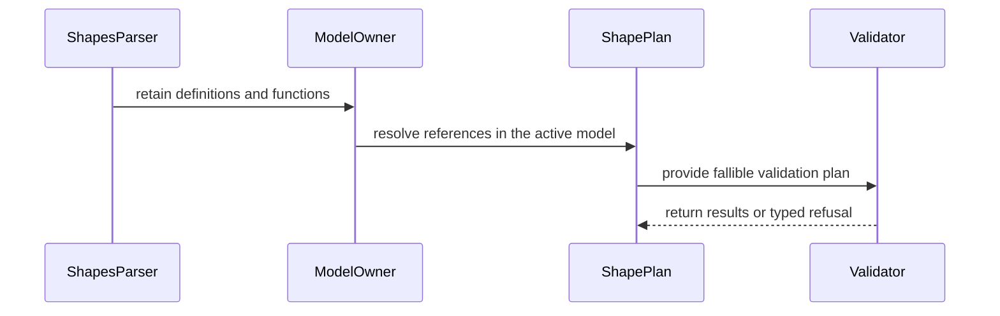

<!-- This is an auto-generated comment: summarize by coderabbit.ai -->
<!-- review_stack_entry_start -->

<a href="https://app.coderabbit.ai/change-stack/Blackcat-Informatics/purrdf/pull/691?cs_source=review_comment"><picture><source media="(prefers-color-scheme: dark)" srcset="https://storage.googleapis.com/coderabbit_public_assets/review-stack-in-coderabbit-ui-dark.svg?v=3"><source media="(prefers-color-scheme: light)" srcset="https://storage.googleapis.com/coderabbit_public_assets/review-stack-in-coderabbit-ui.svg?v=3"></picture></a>

<!-- review_stack_entry_end -->
<!-- This is an auto-generated comment: review paused by coderabbit.ai -->

> [!NOTE]
> ## Reviews paused
> 
> It looks like this branch is under active development. To avoid overwhelming you with review comments due to an influx of new commits, CodeRabbit has automatically paused this review. You can configure this behavior by changing the `reviews.auto_review.auto_pause_after_reviewed_commits` setting.
> 
> - Last reviewed commit: ea133b28828cbae033249eeae0c40dfe4d1c7c84
> 
> Use the following commands to manage reviews:
> - `@coderabbitai resume` to resume automatic reviews.
> - `@coderabbitai review` to trigger a single review.
> 
> Use the checkboxes below for quick actions:
> - [ ] <!-- {"checkboxId":"7f6cc2e2-2e4e-497a-8c31-c9e4573e93d1"} --> ▶️ Resume reviews
> - [ ] <!-- {"checkboxId":"e9bb8d72-00e8-4f67-9cb2-caf3b22574fe"} --> 🔍 Trigger review

<!-- end of auto-generated comment: review paused by coderabbit.ai -->
<!-- recent_review_start -->

No actionable comments were generated in the recent review. 🎉

<strong>ℹ️ Recent review info</strong>

<dl>
<dd>

<strong>⚙️ Run configuration</strong>

<dl>
<dd>

- **Source mode**: Auto
- **Repository**: Unavailable
- **Branch**: Unavailable
- **File**: No configuration file from this repository applied
- **Commit**: Unavailable
- **Layers**: Organization UI
- **Review profile**: CHILL
- **Plan**: Advanced
- **Run ID**: `76a50f44-e8ad-4cd6-833f-7ced3ddd3488`

</dd>
</dl>

<strong>📥 Commits</strong>

<dl>
<dd>

Reviewing files that changed from the base of the PR and between 2443eec1beb8b0424fd65e2581c95812fa74d220 and ea133b28828cbae033249eeae0c40dfe4d1c7c84.

</dd>
</dl>

<strong>📒 Files selected for processing: 3</strong>

<dl>
<dd>

* `crates/shapes/src/linkml/projection.rs`
* `crates/shapes/tests/emitter_projections.rs`
* `docs/design/purrdf-simd.md`

</dd>
</dl>

<strong>🚧 Files skipped from review as they are similar to previous changes: 1</strong>

<dl>
<dd>

* docs/design/purrdf-simd.md

</dd>
</dl>

**Included review availability:** This review used your included allowance. 9 included reviews remain after this review. Your included PR review attempts over the past 7 days set your current allowance at 10 reviews per hour.

</dd>
</dl>

<!-- recent_review_end -->
<!-- walkthrough_start -->

<strong>📝 Summary</strong>

<dl>
<dd>

<!-- This is an auto-generated comment: release notes by coderabbit.ai -->

## Summary by CodeRabbit

* **New Features**
  * Added support for shared shape and property references, including edge-specific validation settings.
  * Prepared shape products preserve referenced definitions and function behavior after the original model is unavailable.
  * JSON Schema projections support referenced shape and property definitions.
  * Product identity now reflects changes to the retained model.
* **Bug Fixes**
  * Recursive shape references are rejected during loading, while shared acyclic references remain supported.
  * Stack, preparation, and unresolved-reference failures return errors instead of partial results or conformance verdicts.
  * Improved error reporting across Python, command-line, C, and WebAssembly interfaces.
* **Documentation**
  * Added guidance on recursion and resource-limit failures, with expanded Simplified Chinese translations.

<!-- end of auto-generated comment: release notes by coderabbit.ai -->
The PR adds model-owned shape and function catalogs, typed recursion and preparation refusals, reference-aware planning and evaluation, and model-aware product serialization. It also updates host error adapters, projections, tests, and documentation.

**Changes: SHACL model ownership and refusal handling**

|Layer / File(s)|Summary|
|:---|:---|
|**Typed refusals and recursion detection**   `crates/shapes/src/error.rs`, `crates/shapes/src/shapes/parser/recursion.rs`, `crates/shapes/tests/never_panic.rs`|Adds structured recursion and preparation refusals, stack-margin processor errors, and dependency polarity. Recursive shape references are detected during parsing.|
|**Model-owned definitions and references**   `crates/shapes/src/shapes.rs`, `crates/shapes/src/shapes/link.rs`, `crates/shapes/src/expression.rs`, `crates/shapes/src/shapes/parser/*`, `crates/shapes/src/schema_import.rs`|Shapes and expressions retain their model owner. Shape and property references resolve through the owner rather than copying referenced bodies into each root.|
|**Fallible planning, validation, and analysis**   `crates/shapes/src/plan.rs`, `crates/shapes/src/constraints.rs`, `crates/shapes/src/path.rs`, `crates/shapes/src/engine.rs`, `crates/shapes/src/rules.rs`, `crates/shapes/src/footprint/*`, `crates/shapes/src/target_eval.rs`, `crates/shapes/src/extension_usage.rs`, `crates/shapes/src/function_resolution.rs`|Lowering, validation, path evaluation, target resolution, rules, footprints, and reachable-usage analysis propagate preparation and reference errors.|
|**Projection and product persistence**   `crates/shapes/src/json_schema.rs`, `crates/shapes/src/schema_surface.rs`, `crates/shapes/src/product/*`, `crates/shapes/tests/catalog_*`, `crates/shapes/tests/property_references.rs`|Schema projection handles catalog references. Product encoding retains model domains and indexes, checks ownership, and includes an encoded-model digest in product identity.|
|**Host adapters and supporting changes**   `bindings/python/src/shacl.rs`, `crates/cli/src/shapes_source.rs`, `crates/rdf-capi/src/error.rs`, `crates/rdf-wasm/src/shacl.rs`, `crates/rdf-core/src/artifact/identity.rs`, `crates/rdf-core/src/ir/pack/bits.rs`, `docs/book/src/validation/shacl.md`|Host APIs render the new refusals. Identity encoding, varint output, fixtures, allocation checks, translations, and documentation are updated.|

<!-- change_assessment_start -->
**Priority:** ➖ Normal

**Estimated code review effort:** 5 (Critical) | ~90 minutes

<!-- change_assessment_commit:"ea133b28828cbae033249eeae0c40dfe4d1c7c84" -->

<!-- change_assessment_end -->

### Sequence Diagram(s)

**Possibly related issues**

- [Blackcat-Informatics/purrdf#558](https://github.com/Blackcat-Informatics/purrdf/issues/558) — Adds typed recursion refusals and host propagation, but does not implement the complete visitor contract requested by the issue.
- [Blackcat-Informatics/purrdf#690](https://github.com/Blackcat-Informatics/purrdf/issues/690) — Covers regressions from the model-catalog integration, including schema import and recursive-schema behavior.
- [Blackcat-Informatics/purrdf#489](https://github.com/Blackcat-Informatics/purrdf/issues/489) — Addresses SHACL recursion checks and stack-margin refusals, but not the RDFC and SPARQL UDF requirements.

**Possibly related PRs**

- [Blackcat-Informatics/purrdf#687](https://github.com/Blackcat-Informatics/purrdf/pull/687) — Both PRs update the SHACL admission allocation baseline.

</dd>
</dl>

<!-- walkthrough_end -->

<strong>Merge Risk:</strong> <strong>🟡 Moderate</strong> · up to <code>ea133</code>

<dl>
<dd>

<!-- final_review_risk_start -->
<!-- final_review_risk_label
**Merge Risk:** **🟡 Moderate** · up to `ea133`
-->
<!-- final_review_risk_coverage:{"sourceCommitId":"ea133b28828cbae033249eeae0c40dfe4d1c7c84","coveredCommitId":"ea133b28828cbae033249eeae0c40dfe4d1c7c84","kind":"reviewed"} -->

Property cardinality checks and emitted OpenAPI references may still be affected. Resolve or explicitly accept those open concerns before merging.
<!-- final_review_risk_end -->

</dd>
</dl>

<strong>Security architecture risk:</strong> <strong>🟡 Moderate</strong> · up to <code>2443e</code>

<dl>
<dd>

<!-- architecture_review_start -->
<!-- architecture_review_label
### Security Architecture Review

**Security architecture risk:** **🟡 Moderate** · up to `2443e`
-->

Shared validation definitions and saved-validator compatibility change across several APIs. Inspected failure paths preserve errors rather than returning successful validation, but restored definitions receive some checks only on first use, and current-head qualification remains incomplete.

**Retained concerns**
No architecture-level concerns identified.

<strong>Security review details</strong>

<dl>
<dd>

**Security Blast Radius**
- _inferred_ — The relevant exposure is the embedding process accepting externally supplied shapes or prepared-product bytes, with effects on validation policy and reports across supported APIs. The evidence does not identify a deployed remote endpoint, tenant boundary or infrastructure privilege expansion.

**Trust Boundaries and Controls**
- _observed_ — AST decoding accepts reference terms without resolving their targets. Lowering explicitly refuses unknown targets and property-reference type mismatches, and binding propagates that refusal. Successful restoration therefore does not establish full semantic reference closure, but the inspected binding path does not turn a missing target into a successful validation.
- _observed_ — Common admission deliberately avoids recomputing the dataset's canonical identity. This producer-certification and consumer-digest-chain design predates the PR; it is not established here as a newly introduced weakening.

**Resilience and Maintainability Implications**
- _observed_ — Direct and restored-product validation paths propagate preparation, binding and validation failures before report serialization. This preserves failure containment at the inspected report-producing boundaries.

**Hardening Proposals**
- _proposed_ — Make the distinction between restored identity checks and deferred semantic reference validation explicit in the admission contract. Qualify it with a structurally valid product containing an unknown target, covering restoration, re-serialization and binding, without implying that the current behavior permits successful validation.

</dd>
</dl>

<!-- architecture_review_end -->

</dd>
</dl>

<!-- pre_merge_checks_walkthrough_start -->

<strong>Pre-merge checks: <picture></picture> 4 · <picture></picture> 1</strong>

<dl>
<dd>

<strong><picture></picture> Failed checks: 1 warning</strong>

|     Check name     |                                              Status                                              | Explanation                                                                                                                                                                                               | Resolution                                                                         |
| :---------------- | :----------------------------------------------------------------------------------------------: | :-------------------------------------------------------------------------------------------------------------------------------------------------------------------------------------------------------- | :--------------------------------------------------------------------------------- |
| Docstring Coverage |  | Docstring coverage is 74.92% which is insufficient. The required threshold is 80.00%. Docstring coverage is scoped to functions touched by this diff. Analyzed 622 functions across 72 files. (1 skipped… | Write docstrings for the functions missing them to satisfy the coverage threshold. |

<strong><picture></picture> Passed checks: 4 passed</strong>

<dl>
<dd>

|         Check name         |                                             Status                                             | Explanation                                                                                                                                                                                           |
| :------------------------ | :--------------------------------------------------------------------------------------------: | :---------------------------------------------------------------------------------------------------------------------------------------------------------------------------------------------------- |
|         Title check        |  | The title clearly summarizes the primary changes: bounded SHACL recursion and retention of shared definition catalogs.                                                                                |
|     Linked Issues check    |  | Check skipped because no linked issues were found for this pull request.                                                                                                                              |
| Out of Scope Changes check |  | Check skipped because no linked issues were found for this pull request.                                                                                                                              |
|      Description check     |  | The pull request description directly explains the shared-definition retention, stack-exhaustion refusals, streaming identity hashing, validation scope, and testing status covered by the changeset. |

</dd>
</dl>

<strong>Full details: Docstring Coverage</strong>

<dl>
<dd>

**Explanation**

Docstring coverage is 74.92% which is insufficient. The required threshold is 80.00%. Docstring coverage is scoped to functions touched by this diff. Analyzed 622 functions across 72 files. (1 skipped: 1 unsupported.)

**Resolution**

Write docstrings for the functions missing them to satisfy the coverage threshold.

</dd>
</dl>

</dd>
</dl>

<!-- pre_merge_checks_walkthrough_end -->
<!-- finishing_touch_checkbox_start -->

<strong>✨ Finishing Touches: 💡 1</strong>

<dl>
<dd>

<!-- finishing_touch_suggestion:docstrings -->

<strong>📝 Generate docstrings: 💡</strong>

<dl>
<dd>

- [ ] <!-- {"checkboxId":"3e1879ae-f29b-4d0d-8e06-d12b7ba33d98"} --> Commit to this branch
- [ ] <!-- {"checkboxId":"7962f53c-55bc-4827-bfbf-6a18da830691"} --> Create a new PR

</dd>
</dl>

<strong>🧪 Generate unit tests (beta)</strong>

<dl>
<dd>

- [ ] <!-- {"checkboxId": "6ba7b810-9dad-11d1-80b4-00c04fd430c8", "radioGroupId": "utg-output-choice-group-6376948056"} --> Commit to this branch
- [ ] <!-- {"checkboxId": "f47ac10b-58cc-4372-a567-0e02b2c3d479", "radioGroupId": "utg-output-choice-group-6376948056"} --> Create a new PR

</dd>
</dl>

</dd>
</dl>

<!-- finishing_touch_checkbox_end -->

<!-- autopilot:start -->
- [ ] <!-- {"checkboxId":"2708ad07-9f24-4260-9c11-7dc76a49f2e3"} --> <strong title="Keep fixing CodeRabbit findings and required CI, and resolving merge conflicts">Autofix</strong> · Keep fixing CodeRabbit findings and required CI, and resolving merge conflicts
<!-- autopilot:end -->
<!-- tips_start -->

Comment `@coderabbitai help` to get the list of available commands.

<!-- tips_end -->
