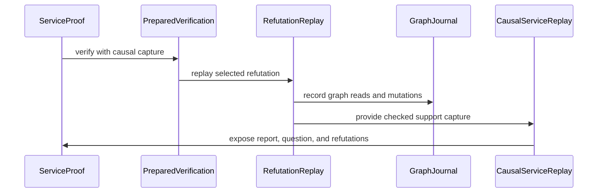

# PR #602 — comments and review threads

8 comment(s). **Every one needs a disposition** in
`review-debt.md`: addressed (with the commit hash) or declined (with the
reason posted in reply). Bot comments count.

## 1. coderabbitai — 

<!-- This is an auto-generated comment: summarize by coderabbit.ai -->
<!-- review_stack_entry_start -->

<a href="https://app.coderabbit.ai/change-stack/Blackcat-Informatics/purrdf/pull/602?scope=ghh_OusAJGA4HG8ljoOV0wJvVx8NmnZIjc2DdjmxOu0xZWA&amp;cs_source=review_comment"><picture><source media="(prefers-color-scheme: dark)" srcset="https://storage.googleapis.com/coderabbit_public_assets/review-stack-in-coderabbit-ui-dark.svg?v=3"><source media="(prefers-color-scheme: light)" srcset="https://storage.googleapis.com/coderabbit_public_assets/review-stack-in-coderabbit-ui.svg?v=3"></picture></a>

<!-- review_stack_entry_end -->
<!-- recent_review_start -->

No actionable comments were generated in the recent review. 🎉

<strong>ℹ️ Recent review info</strong>

<dl>
<dd>

<strong>⚙️ Run configuration</strong>

<dl>
<dd>

- **Configuration used**: defaults
- **Review profile**: CHILL
- **Plan**: Team
- **Run ID**: `6dc46866-0b25-4997-9585-32d946e0bc3b`

</dd>
</dl>

<strong>📥 Commits</strong>

<dl>
<dd>

Reviewing files that changed from the base of the PR and between 86d651aceb8d75147fb13b3cae62ef88f7cef8ff and 638f02216d5c238e1bfa34140108dfce4598d187.

</dd>
</dl>

<strong>📒 Files selected for processing: 8</strong>

<dl>
<dd>

* `crates/entail/src/owl_dl/graph.rs`
* `crates/entail/src/owl_dl/graph/changes.rs`
* `crates/entail/src/owl_dl/graph/changes/slice.rs`
* `crates/entail/src/owl_dl/hyper.rs`
* `crates/entail/src/owl_dl/proof.rs`
* `crates/entail/src/owl_dl/proof/schema_tests.rs`
* `crates/entail/src/owl_dl/proof/source/causal.rs`
* `crates/entail/tests/current_clash_support.rs`

</dd>
</dl>

**Included review availability:** This review used your included allowance. 0 included reviews remain after this review. Your included PR review attempts over the past 7 days set your current allowance at 1 review per hour.

</dd>
</dl>

<!-- recent_review_end -->
<!-- walkthrough_start -->

<strong>📝 Walkthrough</strong>

<dl>
<dd>

The change adds source-aware causal evidence to OWL-DL proof preparation and replay. It records graph changes and selected dependencies, validates clash and merge support, and exposes borrowed causal views through service verification. It also adds nominal-introduction proof encoding and validation, tests, and a proof vector.

**Changes: OWL-DL causal proof support**

|Layer / File(s)|Summary|
|:---|:---|
|**Record source and syntax provenance**   `crates/entail/src/owl_dl/{absorb.rs,axiom_source.rs,bounds.rs,clause.rs,concept.rs,data.rs,input_source.rs,key_proofs.rs,key_values.rs,mod.rs,parser.rs,query.rs,roles.rs,roles/*,syntax.rs,syntax/tests.rs,axiom_source/tests.rs,input_source/tests.rs,key_proofs/tests.rs,key_values/tests.rs}`|Parsing, key preparation, role compilation, and TBox absorption retain source anchors, syntax captures, and input provenance for native facts and generated clauses.|
|**Journal graph changes and select support**   `crates/entail/src/owl_dl/graph.rs`, `crates/entail/src/owl_dl/graph/changes*`|Graph operations record attributed mutations, selected reads, and role-path witnesses. Journal slicing selects dependencies backward from a clash or merge, including relevant key, schema, and role evidence.|
|**Replay clashes, merges, and NI branches**   `crates/entail/src/owl_dl/{hyper.rs,proof.rs,tableau.rs}`, `crates/entail/src/owl_dl/proof/capture.rs`, `crates/entail/src/owl_dl/concept.rs`, `crates/hash/README.md`, `crates/entail/README.md`|Replay captures current support for clashes and merges. Proof validation checks reserved-root introduction branches and nominal saturation. Proof encodings add v6 merge support and v7 introduction-branch metadata while retaining legacy decoding.|
|**Expose checked causal evidence**   `crates/entail/src/lib.rs`, `crates/entail/src/owl_dl/proof/source*`, `crates/entail/src/reasoner/proof*`, `crates/entail/src/reasoner/mod.rs`|Borrowed public views expose resolved causal inputs, steps, mutations, branches, syntax, role sources, and schema evidence. Service verification can return captures for closed refutation runs.|
|**Validate public causal proofs and vectors**   `crates/entail/tests/current_clash_support.rs`, `crates/validate/...`, `crates/rdf-capi/src/entail.rs`, `bindings/python/tests/test_entail_reasoning.py`, `Makefile`, `docs/WASM_TESTING.md`|Tests cover source and question binding, selected dependencies, nominal merges, reserved-node origins, key literal metadata, and inverse/transitive licenses. The proof-vector count increases to 17, including a recursive nominal-introduction case.|

<!-- change_assessment_start -->
**Priority:** ➖ Normal

**Estimated code review effort:** 5 (Critical) | ~120 minutes

<!-- change_assessment_commit:"638f02216d5c238e1bfa34140108dfce4598d187" -->

<!-- change_assessment_end -->

### Sequence Diagram(s)

### Changes
**SIMD inventory measurement**

|Layer / File(s)|Summary|
|:---|:---|
|**Update SIMD operation counts**   `docs/design/purrdf-simd.md`|The `eval.bgp-join-probe` inventory updates the `x86_64-v3` count from 14 to 18 and the `x86_64-v4` count from 21 to 18.|

</dd>
</dl>

<!-- walkthrough_end -->

<strong>Merge Risk:</strong> <strong>⚪ Minimal</strong> · up to <code>638f0</code>

<dl>
<dd>

<!-- final_review_risk_start -->
<!-- final_review_risk_label
**Merge Risk:** **⚪ Minimal** · up to `638f0`
-->
<!-- final_review_risk_coverage:{"sourceCommitId":"638f02216d5c238e1bfa34140108dfce4598d187","coveredCommitId":"638f02216d5c238e1bfa34140108dfce4598d187","kind":"reviewed"} -->

No actionable merge-blocking risk remains in the reviewed paths after normal checks.
<!-- final_review_risk_end -->

</dd>
</dl>

<!-- pre_merge_checks_walkthrough_start -->

<strong>Pre-merge checks: <picture></picture> 4 · <picture></picture> 1</strong>

<dl>
<dd>

<strong><picture></picture> Failed checks: 1 warning</strong>

|     Check name     |                                              Status                                              | Explanation                                                                                                                                                                                   | Resolution                                                                         |
| :---------------- | :----------------------------------------------------------------------------------------------: | :-------------------------------------------------------------------------------------------------------------------------------------------------------------------------------------------- | :--------------------------------------------------------------------------------- |
| Docstring Coverage |  | Docstring coverage is 61.28% which is insufficient. The required threshold is 80.00%. Docstring coverage is scoped to functions touched by this diff. Analyzed 576 functions across 52 files. | Write docstrings for the functions missing them to satisfy the coverage threshold. |

<strong><picture></picture> Passed checks: 4 passed</strong>

<dl>
<dd>

|         Check name         |                                             Status                                             | Explanation                                                                                                                                                                                               |
| :------------------------ | :--------------------------------------------------------------------------------------------: | :-------------------------------------------------------------------------------------------------------------------------------------------------------------------------------------------------------- |
|      Description Check     |  | Check skipped - CodeRabbit’s high-level summary is enabled.                                                                                                                                               |
|         Title check        |  | The title clearly and concisely describes the main change: exposing checked, source-bound OWL DL causal dependencies.                                                                                     |
|     Linked Issues check    |  | Issue `#596` is directly linked and remains open. The current code exposes borrowed source-aware causal views and verifies them through `ServiceProof::verify_prepared_causal` in the existing independent… |
| Out of Scope Changes check |  | The changes remain connected to issue `#596`. Native journal capture, backward slicing, syntax and axiom provenance, schema and role licences, equality membership support, nominal replay validation, pub… |

<strong>Full details: Linked Issues check</strong>

<dl>
<dd>

**Explanation**

Issue `#596` is directly linked and remains open. The current code exposes borrowed source-aware causal views and verifies them through `ServiceProof::verify_prepared_causal` in the existing independent replay. The public tests cover source scope, scoped blanks, literals, question assumptions, equality and key memberships, role paths, generated witnesses, branching, reserved nominal identities, invalid bindings, missing or unclosed support, stopping, and storage refusal. `graph::changes::slice` rejects incomplete evidence instead of returning an empty graph. `graph::changes::slice::key` now retains both checked membership supports for selected equalities. The reported native, packaged WASM, Python, and C ABI validation covers the required acceptance paths. The recursive nominal correction supports valid current replay and generated-identity coverage. Downstream GMEOW integration remains separate as required.

</dd>
</dl>

<strong>Full details: Out of Scope Changes check</strong>

<dl>
<dd>

**Explanation**

The changes remain connected to issue `#596`. Native journal capture, backward slicing, syntax and axiom provenance, schema and role licences, equality membership support, nominal replay validation, public consumer views, and refusal errors implement the checked causal dependency contract. The recursive nominal changes support generated witness and reserved-identity evidence required by the issue. Tests, proof-vector updates, documentation, WASM selection, and C ABI inventory updates support the implementation and its acceptance coverage. No unrelated semantic feature, shipping dependency, consumer namespace, compiler-profile change, host workaround, or downstream GMEOW integration is introduced.

</dd>
</dl>

</dd>
</dl>

</dd>
</dl>

<!-- pre_merge_checks_walkthrough_end -->

- [ ] <!-- {"checkboxId":"585bb3f6-faf5-4dbf-96d2-74e382adf19a"} --> Fix all pre-merge checks with AI
<!-- finishing_touch_checkbox_start -->

<strong>✨ Finishing Touches: 💡 1</strong>

<dl>
<dd>

<!-- finishing_touch_suggestion:docstrings -->

<strong>📝 Generate docstrings: 💡</strong>

<dl>
<dd>

- [ ] <!-- {"checkboxId":"3e1879ae-f29b-4d0d-8e06-d12b7ba33d98"} --> Commit to this branch
- [ ] <!-- {"checkboxId":"7962f53c-55bc-4827-bfbf-6a18da830691"} --> Create a new PR

</dd>
</dl>

<strong>🧪 Generate unit tests (beta)</strong>

<dl>
<dd>

- [ ] <!-- {"checkboxId": "6ba7b810-9dad-11d1-80b4-00c04fd430c8", "radioGroupId": "utg-output-choice-group-unknown_comment_id"} --> Commit to this branch
- [ ] <!-- {"checkboxId": "f47ac10b-58cc-4372-a567-0e02b2c3d479", "radioGroupId": "utg-output-choice-group-unknown_comment_id"} --> Create a new PR

</dd>
</dl>

</dd>
</dl>

<!-- finishing_touch_checkbox_end -->

<!-- autopilot:start -->
- [ ] <!-- {"checkboxId":"2708ad07-9f24-4260-9c11-7dc76a49f2e3"} --> <strong title="Keep fixing CodeRabbit findings and required CI, and resolving merge conflicts">Autofix</strong> · Keep fixing CodeRabbit findings and required CI, and resolving merge conflicts
<!-- autopilot:end -->
<!-- tips_start -->

Comment `@coderabbitai help` to get the list of available commands.

<!-- tips_end -->

## 2. paudley — 

# Checked native causal support

The complete acceptance contract is native issue 596. This work is a prerequisite of GMEOW 1803 Task 2, not completion of shared world updates or all-local class delegation. Principles 4, 7, 17 and 18 govern the downstream boundary. Preserve one native calculus, original source ownership, stopping/admission and normal hooks. No local GMEOW corpus production, host probing/caps, hook bypass or alternative merge path is authorized. Preserve unrelated root REWORK_LIST.md and sibling worktrees.

## Task 1: Resolve checked evidence against its consumer source

Typed borrowed views must preserve every native concept constructor, roles, source/query terms, named and scoped anonymous terms, literal datatype/language/direction, reserved/generated nodes and actual replayed witnesses. Resolve only through the sealed independently prepared consumer context after successful current-support replay. Preserve authored RDF expression syntax separately from normalization, using the existing XSD range owner. Shared owned/borrowed context storage is delivered; no duplicate knowledge-base copy or invented vocabulary is allowed.

## Task 2: Record and slice the actual checked causal derivation

Build dependencies through existing native graph/replay operations and select backward from the terminal clash. Include asserted premises, normalized TBox and internalized source licenses, actual query/branch assumptions, equality causes/aliases, accepted role paths and generated witness/distinctness effects. Exclude unrelated earlier applications. This is causal support, not a globally minimal justification. Missing current support or unsupported families must refuse explicitly, never return an empty successful graph.

Implemented: ordered native write/read capture; immutable selected fact versions; source-owned ABox/rule anchors; original source/query expression, range, facet, inverse and list capture; compiler-owned TBox/internalization and universal-state licenses; independently checked selected schema bound derivations; original sparse role-closure/component and compiled-transition licenses; asymmetric/disjoint-role constraints; native asserted key-value indexing and atomic value/equality evidence publication; original key-membership decision recording with all-branch native replay in the pre-key world.

Current integration: requested membership journals are now selected while their original phase and checked schema capability remain active. Owned support retains original selected sources, syntax, role licenses, causes/paths and schema-read ordinals; raw journals are discarded. Selected key equality links its key and actual value assertion rows to both original membership proofs and every checked branch. Missing recording, missing/tampered rows and incomplete/unclosed membership support refuse explicitly. No extra solver search, second semantic checker or late replay against derived equalities is permitted. Original phase/meta ownership remains attached across later query encoding. Final qualification and self-review are in validation.md.

Selected effects now retain their actual original journal ordinals and mutations. The separate cause vectors are removed; source and key selection read the retained effects. Generated existential successors retain their original parent and checked creating application, including inverse restrictions; unsupported reserved nominal identities and generated distinctness remain explicit. Current qualification is in validation.md.

The original selected dependency edges and read checkpoints now survive in owned support, with per-vertex spans into source/schema/path licenses and a fail-closed terminal root. Universal-role reads retain the actual fixed-top, hierarchy or native compiled-component decision, with object-domain endpoint dependencies and original accepted automaton/order sources. Unrelated earlier vertices and source chains are excluded; missing compiler metadata refuses. Qualification is in validation.md.

Next implement remaining counting/nominal effects and expose the actual public causal graph with sealed source/question/calculus/branch ownership and native stopping/admission. Preserve generated identities in their original proof/branch scope. The service entry point must bind every requested run's assumptions to the consumer question and collect through the existing native verification loop rather than verify and replay again. Unsupported membership effect families remain explicit until their native support is implemented. The internal selector is not the public result and does not finish Task 2.

### Public service integration delivered

The public verify_prepared_causal entry and borrowed graph views now implement the service-entry requirement above. They share the original verification loop, bind every selected run to the consumer question and capture each refutation once. Original stopping/admission errors, phase ownership, branches, paired key assertions, syntax, role licenses and selected schema steps survive. Valid unused schema implications and unvisited legacy entries are excluded. Remaining counting/nominal effects and complete native/packaged WASM qualification are next; the full issue remains incomplete. See tasks/T2-public-causal-review.md and validation.md.

## Task 3: Qualify complete source support

Current required repair: reserved birth/generative licensing is implemented but uncommitted. A new recursive-origin source is inconsistent by its minimum, singleton nominal and inverse maxima; the native producer instead returns consistency True and its verifier accepts the completion. Parsed axioms are correct. Keep the clean failing public_causal_reserved_nested_origin_retains_original_parent_descriptor regression and repair native NI/blocking/unravelling correctness before full qualification, commit or PR readiness. Evidence, exact source and primary calculus reference are in tasks/T2-reserved-current.md and reserved-nested-diagnostic.log. This requirement remains inside the active issue; it is not a waived test or accepted limitation. Earlier direct controls do not establish recursive-origin acceptance.

Merge-closure progress supersedes the unchecked-merge gap below: the producer retains its original final-application cursor and shared arena, v6 encoding preserves it, and the existing replay loop proves the actual native inequality closure and exact final identification. Clause and merge leaves share checked causal selection; legacy merges remain explicitly unclosed. Public singleton and exhaustive nominal-branch cases, wrong-prefix controls and native/WASM wire roundtrips are implemented. See tasks/T2-merge-closure-review.md and validation.md. Next implement the still-guarded reserved nominal-root birth identity, finish the original full acceptance matrix and optimized packaged WASM, then independent/CodeRabbit review and full-issue PR/ghprsq integration. The original contract and wider logic queue remain unchanged.

Counting progress: original traversals and the native clique now retain selected reused role/filler facts and existing inequalities before witness creation. A counting head checkpoint binds fresh births and new inequalities to the original checked body/application/head atom. Missing checkpoints still refuse. Public forward/inverse counted witnesses and a native reused-clique/generated-pair control are implemented. Self-review and the exact remaining merge-closure gap are in tasks/T2-counting-review.md. Next retain the original current-support cursor for merge closures, preserve its arena and wire representation, and independently replay the pre-merge inequality/final head through existing native graph operations. A merge license alone is not a checked closure; the actual public nominal-singleton control still refuses Unclosed. Reserved nominal identities and complete WASM acceptance remain required. This does not narrow the original contract.

Exercise disconnected input, derived membership, normalized min/max bounds, inverse/transitive paths, equality/aliases, existential witnesses and inequalities, branches, scoped blanks and literal metadata, wrong source/question/proof, missing/tampered/legacy support, stopping and original admission refusals. Test the actual public causal checker, not only conversion helpers or private selectors. Run affected native/scalar WASM tests, strict affected Clippy, normal hooks and actual packaged WASM. Retain failures and distinguish local evidence from hosted acceptance. No speedup claim without measurement. No repository corpus production from tests.

## Task 4: Review and merge

No component PR before the full issue contract is implemented and qualified. Inspect the complete review surface, incorporate actionable CodeRabbit feedback where available, and merge only with /home/paudley/stage/root/bin/ghprsq and selected Stage evidence. No independent local dispatcher is available: local assessments are explicitly self-review, never independent approval. GMEOW dependency integration, shared/delta execution, deletion of the old class engine and the rest of the logic issue/PR queue remain required by the wider goal after this prerequisite.

## Current execution state: 2026-10-18

The earlier intermediate next-step paragraphs remain history. Counting effects, checked merge closures, the public question-bound causal graph and reserved nominal birth support are now implemented. The additional recursive reserved-origin case exposed a real NI saturation defect and an unsound accepted completion. Both paths are repaired: explicit exhaustive NI-only branches use the v7 layout; native current replay checks their generative trigger, and completion replay refuses the unsaturated blocked graph. The native identifying branch of a selected predecessor runs before allocating a reserved set it would absorb, retaining the original source/binding and recovering the unchanged oracle work ceiling. No temporary probe remains.

Current local results: 810 library cases passed with one existing report-only fixture ignored; all 11 public cases passed on native and actual scalar WASM; strict affected all-target Clippy passed; the explicit proof-vector producer refreshed 17 bodies while preserving expected answers; both native vector-consumer cases passed; full helper hygiene passed. The shared-vector scalar-WASM check and normal signed commit hook are running. Current details and limitations are in tasks/T2-ni-repair-current.md, tasks/T2-ni-repair-self-review.md and validation.md.

Next: complete those live checks, push the coherent native repair, dispatch the existing branch CI for actual optimized packaged-WASM acceptance, and audit the original complete acceptance matrix before a full-issue PR. Obtain independent/CodeRabbit review and integrate only through ghprsq. Then resume the downstream GMEOW 1803 integration and remaining logic queue. A live refresh captured 78 open GMEOW issues and no open PRs; raw bodies are retained under raw/gmeow-open-issues.json and raw/gmeow-open-prs.json. No full-issue completion is claimed.
## Full-issue PR readiness update

The original public behavior contract is implemented and demonstrated on native, scalar WASM, optimized packaged WASM, the actual Python host and C ABI. The focused Python case passed; all 109 C ABI library tests and strict affected C ABI Clippy passed. The two CI assembly failures are stale generated cells, regenerated through the original writer from matching source/compiler/manifest evidence and complete 112-site measurement shards. Original failed reports remain unchanged.

Proceed with the full-issue PR and independent/CodeRabbit review after the normal correction commit/push. Fresh PR CI remains an explicit merge gate for the generated projection and test-inventory delta. This advances the original complete implementation into review and preserves the no-component-PR boundary; no behavior or acceptance criterion is removed or moved to follow-up. Final full CI, review dispositions and ghprsq integration still determine completion. This is self-review, not independent approval.

## 3. paudley — 

@coderabbitai full review

Please review the complete original issue 596 contract, especially source/schema licenses retained across key-membership phases, backward selection of actual dependencies, equality/role paths, exhaustive nominal-introduction choices and the original generative predecessor check. Trace the production verification loop and borrowed source ownership as well as the tests.

The highest remaining review uncertainty is interaction coverage across those phases and recursive nominal introductions. This change also repairs a concrete false-consistency verdict and makes independent completion verification reject the unsaturated blocked graph.

Actual validation passed on native, scalar WASM, optimized packaged WASM, Python and C ABI. The final C ABI inventory and generated SIMD documentation corrections passed their focused checks; PR CI remains pending. Local assessments are self-review and do not claim independent approval.

## 4. coderabbitai — 

<!-- This is an auto-generated reply by CodeRabbit -->
<!-- CodeRabbit review command invocation: v2:bd98af91e03e152e6a61877922b8018cf52b89198a4e144dd4416123e6ed0a61 -->

⚠️ Action not completed

Review rate limited.

---

Your included review limit is currently reached under our [Fair Usage Limits Policy](https://docs.coderabbit.ai/management/rate-limits#fair-usage-limits-policy). Your current included review allowance is based on your included PR review attempts over the past 7 days. This review may still proceed through usage-based billing if eligible. Your next included review will be available in 41 minutes.

## 5. paudley — 

The docstring coverage result is inconclusive and reports skipped files. The actual public Rust contract passes `cargo rustdoc --locked -p purrdf-entail --lib -- -D warnings -D missing-docs` for the entire entailment crate, including the new causal and source views. Public contracts describe source identity, borrowed ownership, checked support, branch scope, refusal and trust boundaries. Blanket expansion of comments over private/test functions solely to satisfy the bot percentage is declined. This does not waive a documentation warning or a missing public API contract.

The full CodeRabbit review is retained and both actionable threads have explicit dispositions: existing cache invalidation verified, decoder layout admission fixed and regression-tested. The automatic follow-up review of the two-file repair is currently limited by the organization review allowance; it has not reviewed that repair. Fresh hosted CI remains pending and no merge is claimed.

## 6. paudley — 

Downstream local-scope qualification found an additional causal-support defect on a tiny singleton nominal. With two unequal individuals both asserted in the same singleton class, native proof verification closes correctly, but the selected source graph omitted the first membership that had already identified the nominal target. It retained only the second membership and inequality. That is incomplete equality support, so the current pushed head must not merge even if its existing CI finishes green.

The new public regression failed on that exact missing membership. The native repair records original-to-representative lookups and attaches identification-head reads to the original checked application before its effects. Both named and reserved-root lookups use the same native identity primitive. Backward slicing follows the existing immutable merge parents rather than running another equality procedure. The same public test now covers both a failed identifying merge and a successful identifying merge followed by a class clash; both require complete membership support and exclude disconnected input.

The first focused repaired regression passed. Full affected native qualification is running; strict Clippy, scalar WASM, normal commit hooks, push and fresh hosted qualification remain pending. This is part of the original source-bound dependency requirement, not a downstream workaround or a follow-up descope. The earlier temporary inspection example has been moved into the selected Stage evidence and is absent from shipping source.

## 7. paudley — 

The nominal target identity-path correction is now signed, committed through normal hooks, and pushed. The source tree is clean. Both the failed-merge and successful-merge variants retain the required original memberships, expose the actual forwarding path, and exclude the disconnected input. No-op lookups add no extra journal dependency; the original mutation-only work-accounting assertion remains unchanged.

Current local qualification passes 811 library cases with one existing report-only case ignored, all 13 public native cases, all 13 actual scalar WASM cases, both shared-vector consumers across 17 vectors on native and WASM, strict all-target entailment Clippy, and the complete helper hygiene target. There is no change to proof encoding, expected answers, dependencies, features or compiler profiles.

The preceding full CI succeeded before this correction. Fresh [current-source CI](https://github.com/Blackcat-Informatics/purrdf/actions/runs/39127797390) is running and still required. CodeRabbit is actively reviewing all eight files changed since its full original review, including the decoder and identity-path fixes. It has independently withdrawn the cache false positive and confirmed the decoder guards in the original threads. No final merge or completed current-source hosted qualification is claimed.

## 8. paudley — 

The latest eight-file review is complete with no actionable comments. Its documentation percentage warning measures all touched functions, including private/test helpers. The current source again passes the actual public Rust contract: cargo rustdoc --locked -p purrdf-entail --lib -- -D warnings -D missing-docs. New Alias and Identification views are documented. The prior evidence-based decision against blanket private/test comment expansion still applies; no documentation gate or configuration was weakened. Current hosted CI remains required before merge.

