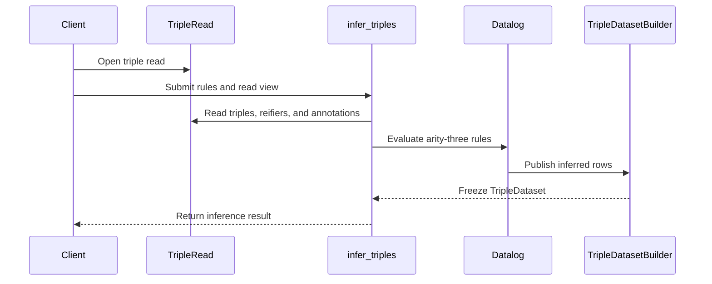

# PR #549 — comments and review threads

17 comment(s). **Every one needs a disposition** in
`review-debt.md`: addressed (with the commit hash) or declined (with the
reason posted in reply). Bot comments count.

## 1. coderabbitai — 

<!-- This is an auto-generated comment: summarize by coderabbit.ai -->
<!-- review_stack_entry_start -->

<a href="https://app.coderabbit.ai/change-stack/Blackcat-Informatics/purrdf/pull/549?scope=REDACTED&amp;cs_source=review_comment"><picture><source media="(prefers-color-scheme: dark)" srcset="https://storage.googleapis.com/coderabbit_public_assets/review-stack-in-coderabbit-ui-dark.svg?v=3"><source media="(prefers-color-scheme: light)" srcset="https://storage.googleapis.com/coderabbit_public_assets/review-stack-in-coderabbit-ui.svg?v=3"></picture></a>

<!-- review_stack_entry_end -->
<!-- This is an auto-generated comment: review paused by coderabbit.ai -->

> [!NOTE]
> ## Reviews paused
> 
> It looks like this branch is under active development. To avoid overwhelming you with review comments due to an influx of new commits, CodeRabbit has automatically paused this review. You can configure this behavior by changing the `reviews.auto_review.auto_pause_after_reviewed_commits` setting.
> 
> - Last reviewed commit: 025daaed59c822d82107bb4ec6945b21134fced2
> - Latest commit, not reviewed: a5224d2621b823bf2ebb0137e43c8bc6500f98d3
> 
> Use the following commands to manage reviews:
> - `@coderabbitai resume` to resume automatic reviews.
> - `@coderabbitai review` to trigger a single review.
> 
> Use the checkboxes below for quick actions:
> - [ ] <!-- {"checkboxId":"7f6cc2e2-2e4e-497a-8c31-c9e4573e93d1"} --> ▶️ Resume reviews
> - [ ] <!-- {"checkboxId":"e9bb8d72-00e8-4f67-9cb2-caf3b22574fe"} --> 🔍 Trigger review

<!-- end of auto-generated comment: review paused by coderabbit.ai -->
<!-- recent_review_start -->

No actionable comments were generated in the recent review. 🎉

<strong>ℹ️ Recent review info</strong>

<dl>
<dd>

<strong>⚙️ Run configuration</strong>

<dl>
<dd>

- **Configuration used**: defaults
- **Review profile**: CHILL
- **Plan**: Team
- **Run ID**: `5f267a44-a8f5-4982-aa8c-1bf30982bb7f`

</dd>
</dl>

<strong>📥 Commits</strong>

<dl>
<dd>

Reviewing files that changed from the base of the PR and between 49295bd27815443536d33376bd15ee877d29b6ef and 025daaed59c822d82107bb4ec6945b21134fced2.

</dd>
</dl>

<strong>📒 Files selected for processing: 1</strong>

<dl>
<dd>

* `crates/rdf-wasm/js/tests/async-concurrency.test.mjs`

</dd>
</dl>

**Included review availability:** This review used your included allowance. 3 included reviews remain after this review. Your included PR review attempts over the past 7 days set your current allowance at 5 reviews per hour.

</dd>
</dl>

<!-- recent_review_end -->
<!-- walkthrough_start -->

<strong>📝 Walkthrough</strong>

<dl>
<dd>

This pull request adds a graph-free `TripleDataset` carrier and extends Datalog, SRL inference, SPARQL evaluation, and text indexing to support triple-shaped data. It also updates named-graph checks, tests, benchmarks, documentation, WASM selections, and SIMD assembly tooling.

**Changes: Graph-free triple carrier**

|Layer / File(s)|Summary|
|:---|:---|
|**Triple storage, builder, and conversion**   `crates/rdf-core/src/ir/builder/triple.rs`, `crates/rdf-core/src/ir/triple.rs`, `crates/rdf-core/src/ir/dataset.rs`, `crates/rdf-core/src/ir/frozen_terms.rs`, `crates/rdf-core/src/ir/builder.rs`, `crates/rdf-core/src/ir/validate.rs`, `crates/lex/src/allocation.rs`, `crates/rdf-core/benches/ir_layout.rs`|Adds compact triple, reifier, and annotation storage with lazy ordinal permutations. Moves frozen term data into `FrozenTerms` and adds conversion from `RdfDataset` when named graphs are absent.|
|**Read sessions and public API**   `crates/rdf-core/src/ir/triple/read.rs`, `crates/rdf-core/src/dataset_view.rs`, `crates/rdf-core/src/ir/mod.rs`, `crates/rdf-core/src/lib.rs`, `crates/rdf/src/lib.rs`|Adds fallible triple read sessions, graphless view operations, typed named-graph refusals, and public carrier exports.|

**Arity-aware Datalog execution**

|Layer / File(s)|Summary|
|:---|:---|
|**Clause and store shapes**   `crates/datalog/src/clause.rs`, `crates/datalog/src/store.rs`, `crates/datalog/src/dictionary.rs`, `crates/datalog/src/guard.rs`, `crates/datalog/src/admission.rs`|Generalizes clauses, stores, guards, and admission APIs over arity. Triple stores use three positions and predicate-only partition keys.|
|**Planning, cache, and proofs**   `crates/datalog/src/plan.rs`, `crates/datalog/src/cache.rs`, `crates/datalog/src/proof.rs`|Carries arity through plans, cache entries, and proof APIs. Triple clause hashes and proof encodings use separate domains.|
|**Evaluation and scheduling**   `crates/datalog/src/seminaive.rs`, `crates/datalog/src/seminaive/evidence.rs`, `crates/datalog/src/seminaive/factors.rs`, `crates/datalog/src/chase.rs`, `crates/datalog/src/schedule.rs`|Generalizes joins, derivations, chase, evidence, and schedules to shaped facts. Base reads require scheduled evaluation, which can retain a base snapshot.|
|**Runtime tests and identities**   `crates/datalog/tests/rules_runtime.rs`, `crates/datalog/README.md`, `crates/hash/README.md`|Adds runtime coverage for triple evaluation, snapshots, no-output rules, and store behavior. Documents triple and quad shapes and lists triple-specific hash domains.|

**SRL triple inference**

|Layer / File(s)|Summary|
|:---|:---|
|**Carrier-specific rule lowering and evaluation**   `crates/shapes/src/srl/lower.rs`, `crates/shapes/src/srl/document.rs`, `crates/shapes/src/srl/eval.rs`, `crates/shapes/src/rules.rs`, `crates/shapes/src/term.rs`, `crates/shapes/src/srl/mod.rs`|Adds `infer_triples` and evaluates triple reads through the arity-three engine. Inferred rows are published to the matching carrier.|
|**Inference tests and facade coverage**   `crates/shapes/tests/*`, `crates/purrdf/tests/base_surface.rs`, `crates/shapes/Cargo.toml`, `crates/shapes/README.md`|Tests compare triple and quad inference and cover empty rule heads, statement roles, and scoped blank-node identity.|

**SPARQL triple-carrier support**

|Layer / File(s)|Summary|
|:---|:---|
|**Named-graph checks and query behavior**   `crates/sparql-eval/src/dataset_spec.rs`, `crates/sparql-eval/src/eval.rs`, `crates/sparql-eval/tests/host_identity.rs`|Checks named-graph support before graph-dependent query evaluation. Tests cover graph-request refusals and compare default-graph results across carriers.|
|**Retained-result conformance**   `crates/sparql-conformance/src/compare.rs`, `crates/sparql-conformance/src/lib.rs`, `crates/sparql-conformance/src/run.rs`, `crates/sparql-conformance/tests/triple_carrier.rs`|Adds retained evaluation outcomes and shared verdict accounting. The triple-carrier test runs supported cases from the SPARQL 1.0, 1.1, and 1.2 corpora and records named-graph refusals.|

**Graph-free text profiles**

|Layer / File(s)|Summary|
|:---|:---|
|**Corpus profiles and index shapes**   `crates/text/src/corpus.rs`, `crates/text/src/index.rs`, `crates/text/src/lib.rs`|Adds `GraphFree` alongside the default `GraphLanguage` profile. Graph-free indexes use language-only partitions and separate identity domains.|
|**Profile-aware retrieval and tests**   `crates/text/src/dictionary.rs`, `crates/text/src/dictionary_relation.rs`, `crates/text/src/occurrence_dictionary.rs`, `crates/text/src/relation.rs`, `crates/text/src/score.rs`, `crates/text/tests/*`|Propagates corpus profiles through matching, relations, and scoring. Tests cover graph-free indexing, retrieval, RDF 1.2 partitions, and named-graph refusals.|

**Shared validation and tooling**

|Layer / File(s)|Summary|
|:---|:---|
|**Auditing, macros, and SIMD assembly tooling**   `crates/helper-census/src/*`, `crates/lex/src/constructors.rs`, `helpers-ledger.toml`, `scripts/*`, `scripts/simd-asm-manifest.toml`, `docs/design/purrdf-simd.md`, `.github/workflows/ci.yaml`|Extends helper-census authority checks to frozen term ownership. Extends `variant_from!` for const-generic targets. SIMD assembly tooling adds consumer-bench support and local runtime contexts. The workflow timeout and artifact-upload condition also change.|
|**Test selection and design documentation**   `Makefile`, `docs/WASM_TESTING.md`, `docs/book/*`, `docs/design/purrdf-backend-contract.md`, `crates/*/README.md`, `crates/rdf-core/Cargo.toml`|Adds WASM test selections and documents triple storage, reads, inference, and graph-free text indexing.|

<!-- change_assessment_start -->
**Priority:** ⬇️ Low

**Estimated code review effort:** 5 (Critical) | ~120 minutes

<!-- change_assessment_commit:"025daaed59c822d82107bb4ec6945b21134fced2" -->

<!-- change_assessment_end -->

### Sequence Diagram(s)

</dd>
</dl>

<!-- walkthrough_end -->

<strong>Merge Risk:</strong> <strong>⚪ Minimal</strong> · up to <code>025da</code>

<dl>
<dd>

<!-- final_review_risk_start -->
<!-- final_review_risk_label
**Merge Risk:** **⚪ Minimal** · up to `025da`
-->
<!-- final_review_risk_coverage:{"sourceCommitId":"025daaed59c822d82107bb4ec6945b21134fced2","coveredCommitId":"025daaed59c822d82107bb4ec6945b21134fced2","kind":"reviewed"} -->

The test now checks that synchronous and asynchronous execution agree on the stack-refusal boundary. No actionable merge-blocking risk is established by this test-only change.
<!-- final_review_risk_end -->

</dd>
</dl>

<!-- pre_merge_checks_walkthrough_start -->

<strong>Pre-merge checks: <picture></picture> 3 · <picture></picture> 2</strong>

<dl>
<dd>

<strong><picture></picture> Failed checks: 2 warnings</strong>

|         Check name         |                                              Status                                              | Explanation                                                                                                                                                                                               | Resolution                                                                                                                                                                                                                          |
| :------------------------ | :----------------------------------------------------------------------------------------------: | :-------------------------------------------------------------------------------------------------------------------------------------------------------------------------------------------------------- | :---------------------------------------------------------------------------------------------------------------------------------------------------------------------------------------------------------------------------------- |
| Out of Scope Changes check |  | The PR still changes unrelated SIMD infrastructure in `scripts/simd_asm_runtime.py`, `scripts/test_simd_asm_runtime.py`, `scripts/check-simd-asm.py`, `scripts/simd-asm-manifest.toml`, and `.github/wor… | Remove the unrelated SIMD runner, test, manifest, assembly-tooling, and workflow changes from this pull request, or move them to a separate pull request. Retain infrastructure changes only when they directly support issue `#492`. |
|     Docstring Coverage     |  | Docstring coverage is 73.64% which is insufficient. The required threshold is 80.00%. Docstring coverage is scoped to functions touched by this diff. Analyzed 679 functions across 55 files.             | Write docstrings for the functions missing them to satisfy the coverage threshold.                                                                                                                                                  |

<strong><picture></picture> Passed checks: 3 passed</strong>

<dl>
<dd>

|      Check name     |                                             Status                                             | Explanation                                                                                                                                                                                               |
| :----------------- | :--------------------------------------------------------------------------------------------: | :-------------------------------------------------------------------------------------------------------------------------------------------------------------------------------------------------------- |
|  Description Check  |  | Check skipped - CodeRabbit’s high-level summary is enabled.                                                                                                                                               |
|     Title check     |  | The title clearly and concisely describes the main changes: adding a graph-free RDF carrier and triple rule execution.                                                                                    |
| Linked Issues check |  | Issue `#492` is open and directly linked. The PR adds `TripleDataset` storage with 12-byte triple rows, 8-byte reifier rows, and SPO/POS/OSP access. It adds typed named-graph refusal paths, including em… |

</dd>
</dl>

<strong>Full details: Out of Scope Changes check</strong>

<dl>
<dd>

**Explanation**

The PR still changes unrelated SIMD infrastructure in `scripts/simd_asm_runtime.py`, `scripts/test_simd_asm_runtime.py`, `scripts/check-simd-asm.py`, `scripts/simd-asm-manifest.toml`, and `.github/workflows/ci.yaml`. These changes alter runner context handling, benchmark discovery, assembly measurements, workflow timeout and artifact behavior, and checksum inputs. They do not implement or test the graph-free carrier required by issue `#492`.

</dd>
</dl>

</dd>
</dl>

<!-- pre_merge_checks_walkthrough_end -->
<!-- finishing_touch_checkbox_start -->

<strong>✨ Finishing Touches: 💡 1</strong>

<dl>
<dd>

<!-- finishing_touch_suggestion:docstrings -->

<strong>📝 Generate docstrings: 💡</strong>

<dl>
<dd>

- [ ] <!-- {"checkboxId":"3e1879ae-f29b-4d0d-8e06-d12b7ba33d98"} --> Commit to this branch
- [ ] <!-- {"checkboxId":"7962f53c-55bc-4827-bfbf-6a18da830691"} --> Create a new PR

</dd>
</dl>

<strong>🧪 Generate unit tests (beta)</strong>

<dl>
<dd>

- [ ] <!-- {"checkboxId": "6ba7b810-9dad-11d1-80b4-00c04fd430c8", "radioGroupId": "utg-output-choice-group-6185664552"} --> Commit to this branch
- [ ] <!-- {"checkboxId": "f47ac10b-58cc-4372-a567-0e02b2c3d479", "radioGroupId": "utg-output-choice-group-6185664552"} --> Create a new PR

</dd>
</dl>

</dd>
</dl>

<!-- finishing_touch_checkbox_end -->

<!-- autopilot:start -->
- [ ] <!-- {"checkboxId":"2708ad07-9f24-4260-9c11-7dc76a49f2e3"} --> <strong title="Keep fixing CodeRabbit findings and required CI, and resolving merge conflicts">Autofix</strong> · Keep fixing CodeRabbit findings and required CI, and resolving merge conflicts
<!-- autopilot:end -->
<!-- tips_start -->

Comment `@coderabbitai help` to get the list of available commands.

<!-- tips_end -->

## 2. paudley — 

# Complete graph-free RDF 1.2 carrier

Issue #492 remains OPEN. This is the approved implementation plan; current source
and scoped qualification are recorded in validation.md. Whole delivery is not claimed.
The isolated branch paudley/492-triple-only-carrier-for-rdf-1-2 was opened by
stagectl at origin/main `5144f5c1a`, then explicitly fast-forwarded to published
S1 10316f2c1. The original open.json setup base remains unchanged. PR #544 is an
unmerged source dependency: its dictionary-parametric Datalog and operational
DatasetView interfaces are reused, not reimplemented. Its checks qualify only
its original behavior. Source and review work on #492 cannot mutate PR #544.
No foundation PR or hidden followup is authorized.

## Governing decisions and prior art

Root AGENTS, .baseline, .goals, one-home ledger, layers, portability, determinism
and normal hooks apply. Current Stage intake captures the complete issue and its one approved design
comment. The discarded ADR 0032 remark supplies no approval or requirement. Its unresolved consumer ADR is available at
/home/paudley/Active/katamari/docs/adr/0038-rdf-1-2-claims-one-graph-derived-views-and-refinements.md;
38.1 requires one graph with no graph name or dataset-kind in authority,
projection, index, export or wire format. This is a consumer constraint; the
existing quad carrier remains fully supported and semantically unchanged.

Reuse the original term interner/frozen lexical and reverse lookup machinery,
DatasetView checked-read law, permutation/query kernels, RDFC graph-view path,
and Datalog semi-naive/planning/arrangement homes. There will be no second term
decoder, rule evaluator, hash implementation or analyzer. Existing issue #292
canonical graph-view and #383 default projection are precedent, not a substitute
for graph-free physical storage. Current ClauseAtom/compiled arrays always have
four positions and RelationStore keys are (predicate, graph); wrapping that store
with a constant graph does not satisfy this contract. Forge recurrence coverage
is exactly prior-art.md's bounded 200-commit tally, not a complete failure count.

## Design

### Physical graph and shared term ownership

Publish TripleDataset and its explicit builder, with base rows three native
TermIds (12 bytes), reifier rows (reifier, triple) (8 bytes) and annotation rows
(reifier,predicate,object) (12 bytes). No graph slot/table is stored in these
carrier tables. SPO is physical freeze order, with only POS and OSP lazy ordinal
indexes, plus the actual side-table indexes. Share/refactor the existing frozen
term-table home so both carriers use the same arena, resolution, store-once
reverse lookup, RDF 1.2 triple terms, blank scopes, direction, content recognition
and caller configurations. Do not retain an empty RdfDataset as a disguised
graph-free dictionary. Fallible capacity/admission follows the original homes.

Public triple ingestion exposes no graph parameter. An explicit conversion
from a quad dataset validates all base/side rows and declared graphs before
publication; named content, including remembered empty named graphs, is a typed
refusal rather than discarded information. Move the original term owner instead
of cloning strings. Immutable graph-free publication retains no quad-row copy.

### Views and typed named-graph refusal

The frozen TripleDataset owns graph-free immutable payload only. Its explicit
fallible read door constructs a fresh operation-local TripleRead session, which
implements the existing DatasetView and FallibleDatasetView protocol, retaining
the frozen owner and one shared sticky typed error owner for its iterator,
term-guard and parallel/correlated children. This follows the existing segmented
snapshot/session split rather than embedding read failure in frozen data.
Reader control allocation is admitted/fallible before construction. A new read
session over the SAME frozen data is a healthy request, not a global reset.
The compatibility view projects ephemeral default QuadIds only at its existing
protocol boundary; physical rows and identities stay graph-free. Core public
query/canonical/text/rule callers obtain this read session explicitly; no
infallible DatasetView impl on the frozen payload silently bypasses the door.
Add an explicit named-graph support contract consumed by the actual engine
before GRAPH enumeration/term lookup, including GRAPH variable, constant,
FROM NAMED, prepared/correlated/nested forms and an empty graph. Thus absence of
a graph term cannot turn an unsupported request into an empty successful answer.
Use a typed refusal, retaining its original code/cause at public native boundaries.
Direct quads_for_pattern/statement graph requests on TripleRead with Named
latch NamedGraphsUnsupported in that operation-local shared error owner before
any iterator output. Its read_error and every typed term-read/reservation door
retain that first cause; checked_read therefore refuses the entire drain,
including an empty input/empty iterator. There is no empty successful fallback.
Explicit require_named_graphs preflight is implemented by that same session and
used by actual engine graph/dataset-spec entry paths, before missing-term or
empty-row shortcuts. Once an operational read fails, its children are invalid;
the source TripleDataset stays unchanged. Healthy default SPARQL retry uses a
fresh public read session over the same frozen data. Existing quad readers use
their unchanged support/status law. This is the concrete request/session API
selected for independent review, not a source edit or executed demonstration.
Default/Any internal scans enumerate precisely the original triple and virtual
statement graph. Real default SPARQL callers use those original indexes.

### Compile-time Datalog graph-free shape

Generalize the original clause/compiled-position/planning/store waist by a
closed compile-time triple versus quad shape. Triple atoms have exactly three
stored/visited positions and predicate-only partition keys; no default graph
constant participates in SIPS priority, binding arrays, relation keys, row logs,
proof/model identity or emission. Quad shape retains four positions and its
original partition semantics. Reuse one semi-naive join, negation, arrangement,
factor, chase/proof and rule execution implementation with shape-parametric
parts, rather than a triple evaluator or post-hoc projection of arity 4 output.
Use the dictionary-parametric D::Id waist being implemented by #490 when the
changes integrate; native/host IDs must not be remapped at integer joins.
SPARQL 1.2 RL translation/materialization chooses triple shape from the actual
input carrier and returns graph-free RDF 1.2 data through the actual public SPARQL RL home, Shapes srl::infer_triples. Existing srl::infer retains its quad result; no reverse Entail-to-Shapes dependency is introduced.
Standard default-graph rule model equality is established against the existing
quad all-default carrier; variable predicates and recursive/cyclic rules remain.

### Canonical and text identities

Use the original fault-aware flat-presentation RDFC view canonicalizer
(`try_canonicalize_flat_view`), with exact equality of canonical bytes against
the all-default quad form under that same presentation (including RDF 1.2 statement data and
blank scopes). Document this byte identity explicitly. Dataset digest may retain
that identity only if its actual preimage is demonstrated identical; otherwise
register an explicit distinct graph-free hash domain and tested versioned law.
No independent canonicalization algorithm or stringified graph sentinel.

Text uses a distinct explicit graph-free corpus profile: documents (subject,
language), partitions (language), with original direction merging, exclusions,
field/token/analyzer and zero-token laws. Share the original corpus/ranking
construction using a compile-time key shape whose graph component is absent,
not serialized as None/default. Corpus fingerprint/profile identity, actual
scoring, retrieval source binding and deterministic egress use that profile.
Existing graph-language profile stays unchanged. The pack partition precedent
does not authorize claiming a graph-partitioned pack is graph-free.

## Completeness contract

| Requirement | Actual demonstration | Task |
| --- | --- | --- |
| 12N row storage, compact statement rows, three orders | Actual public builder publishes nontrivial RDF 1.2 N-row data; frozen row-byte counter=12N,8R,12A; compile-time layout assertions; real POS/OSP and all side probes compare expected original IDs without graph tables; scaling bench retains actual memory/index counters | 1,2 |
| Named graphs typed refusal, additive quad behavior | Real engine SELECT/ASK/CONSTRUCT/prepared/nested GRAPH and FROM NAMED over fresh empty/populated TripleRead sessions refuse with exact typed diagnostic; same frozen TripleDataset healthy default retry on a fresh session succeeds; direct checked_read over named base/statement pattern refuses before output, including empty input and worker/correlated children; quad controls retain original behavior | 1,2 |
| Default SPARQL conformance | Existing official corpus runner executes its unchanged default-graph tests on TripleDataset, with an explicit manifest-derived inclusion inventory/count, original solution/report comparison and XPASS discipline; no arbitrary exclusions or self-oracle | 1,2 |
| Arity 3 RL, predicate-only keys, same model | Public SPARQL RL materialization on triple input uses compiled three-position atoms/keys; original standard RL/recursive/variable-predicate fixtures compare exact model against original all-default quad form and independent expected answers; no arity 4 surrogate | 1,2 |
| RDFC/dataset digest law | Actual canonical graph-view output and identity preimage are compared for RDF 1.2 reifiers, annotations, nested triples, blank relabelings and directional strings; distinct domain only if explicit and documented/tested | 1,2 |
| Graph-free text corpus/profile/identity | Real Index construction and query/retrieval exercise subject-language keys, language partitions, original rank/token/exclusion laws and profile binding; frozen identity vectors show absent graph component and preserve existing quad profile | 1,2 |
| Native/portable/hygiene/docs/landing | Complete affected native and actual WASM executions, original controls/scale bench, strict workspace consumers, generated docs/book, one complete final gate after corrections settle; independent full-contract audit, normal hooks, required hosted checks, ghprsq and owned cleanup | 2,3 |

## Task 1: Complete original-home implementation and consumer wiring

Implement the whole graph-free term/table/view, Datalog/entail and text/canonical
production contract as one coherent source batch. Coordinate dictionary changes
through the published `10316f2c1` dependency without adopting its prior checks as #492 qualification. Review
actual ingress/egress and typed boundaries independently; no partial foundation
publication. Focused compiler/runtime checks start after coherent source/caller
migration, with unchanged controls and resource assertions retained.

## Task 2: Qualify the complete public contract and fix concrete findings

Run the completeness table's actual native/portable/corpus/scale controls and
independent source/consumer review. Batch real related corrections; reuse unaffected
evidence and repeat only invalidated coverage. Reserve one full make check or
required equivalent for settled source. No baseline whole-workspace discovery.
Record truthful executions in validation.md; an aborted or failed gate is not
qualification. Commit/push the complete issue normally after required review/gates.

## Task 3: Publish, finalize, merge and clean the complete issue

Open the complete PR, publish authoritative plan/acceptance/uncertainty through
Stagectl, resolve actual feedback and current-head hosted prerequisites, assess
the actual integration candidate and finalize using ghprsq only. Verify issue
closure, archive and cleanup before recording completion. No unrelated donor,
active source, audit evidence or benchmark baseline is disposable.

## Declined additions and boundaries

No semantic feature, implicit vocabulary, alternate engine, fixed graph sentinel,
graph-discarding conversion or arity 4 wrapper is accepted. Standalone new host
product APIs and graph-free pack/wire redesign are not requested by this issue;
existing published crates/hosts must still build and preserve original behavior,
and actual portable execution of the new core/rule/text contract is required.
No requested triple-only storage, rule, canonical, identity or query capability
is deferred to another issue. Planning recheck must adjudicate the concrete
operation-local TripleRead request/status interface above before source edits.

## Implementation order inside Task 1

Coherent compiler slices are internal checkpoints of the complete issue, never
independently delivered foundation PRs:

1. Extract the original frozen term owner and lookup/resolve bodies into one
   graph-independent native home. Both resident carriers own that same concrete
   dictionary. Build the explicit graph-free row/side-table carrier and its
   builder with original validation and admission. Keep all frozen quad callers
   working and preserve term/configuration/blank identity in ownership transfer.
2. Publish the operation-local TripleRead and original-session first-cause
   transport; wire a named-graph preflight through the actual engine and wrapper
   views before all missing-term/enumeration shortcuts. Exercise fresh-session
   retry and RDF 1.2 statement-layer reads before broader query qualification.
3. Generalize the original Datalog atoms, compiled slots and predicate partition
   key by a closed static shape, preserving the S1 D::Id dictionary waist. Wire
   actual public SPARQL RL materialization to the triple shape. No arity-four staging
   relation, default graph constant or duplicate rule interpreter is allowed.
4. Route original RDFC and text/retrieval homes through graph-free physical keys
   and explicit identity laws. Refactor shared computation instead of copying
   canonicalization, analyzer, ranking, hashing or serialization bodies.
5. Complete the matrix above, including manifest-derived unchanged default-graph
   SPARQL corpus, arity-three RL and actual native/WASM execution. Only then
   publish the complete contract and assess integration.

The first focused checks target the actual changed packages/interfaces, using
standard directories and installed tools. No baseline full suite is scheduled.
N owns the current heavy Rust lane; implementation/read work proceeds without a
competing Cargo invocation until explicit handoff and resource admission.

## Current unresolved implementation questions

These are design work within scope, not permission requests or deferrals:
- Choose the smallest frozen dictionary extraction that retains all old public
  methods and exact source-backed mint invariants without duplicate lookup bodies.
- Keep triple-only ingestion graph-free during accumulation as well as frozen
  publication; any shared builder control must not retain quad rows or expose a
  graph parameter on the triple public API.
- Preserve the existing typed operational error at all actual engine boundaries;
  an unsupported named graph must not become a successful empty result through
  DatasetView wrappers or an unbound GRAPH variable.
- Keep compile-time shape identity explicit across rule proofs/cache/model keys
  and graph-free text corpus/source binding, not merely change row widths.

Independent planning recheck must accept the concrete TripleRead and closed
static shape design before production edits. Open implementation questions are
resolved in that design/source review; none authorizes omitting a requirement.

## Concrete native ownership and identity decisions

The frozen dictionary extraction moves original resolve/reverse-lookup bodies,
not a second parser. RdfDataset's existing public methods continue to delegate
to that one concrete owner. TripleDataset holds the same owner by value plus
only compact triple/statement tables; no empty RdfDataset is retained. Its
builder stores compact rows while the original mutable term home provides
interning, scope/CDT binding and term validation. Factor freeze's term ownership
transfer so this path does not create a temporary frozen quad dataset.

The existing flat canonical presentation already emits actual RDF 1.2 assertion
triples for reifier/annotation rows. Use it explicitly for graph-free canonical
bytes/digest and compare the same presentation on the all-default quad oracle.
Do not describe the overlay presentation's annotation graph sentinel as a
graph-free identity. `try_flat_digest_view` hashes precisely the canonical
document via original ContentDigest; equality of preimages is testable without
a new hash implementation or domain.

TripleRead may borrow the immutable payload for its lifetime; its child readers
and term guards retain the same fallibly allocated Shared status control. Fresh
read() constructs a new control over the same frozen owner. Control birth and
lazy permutation buffers use the original Memory/Resident or caller admission
home; no external grant may be refunded while a returned owner still uses it.
Resident reserve_workspace still checks first-cause status on acquisition and
resize, rather than returning an unconditional no-op after a named-graph fault.
The named-graph capability is distinct from observed named_graphs content:
empty quad datasets remain capable; triple sessions refuse even empty graph
patterns. Actual engine preflight covers authored dataset specs and all nested
algebra paths before data-dependent shortcuts.

## 3. paudley — 

The complete graph-free carrier is published as PR #549. Its final local
`make check`, fifteen current portable controls, metadata, both books and six
translated-rendering gates pass. The three original failed targets were repaired
and rechecked. Hosted documentation then found four private-item links; the
comment-only correction points to public argument constants and passes strict
public rustdoc. Current hosted checks are running on that correction.

The broadest review risk is the shared arity-generic compilation and frozen
lexical-owner boundary. Existing independent seam reviews, unchanged quad
assertions, the full native gate and real compact-carrier/query/rule/portable
executions cover those paths. Pending multi-architecture and hosted checks remain
distinct acceptance; there is no fresh independent approval in this update.

Callers choose the triple carrier explicitly. Named-graph operations receive a
typed refusal. Flat canonical output matches the all-default quad model;
graph-free text generations use a distinct physical profile and identity.
Measurements here count storage bytes and allocations, not elapsed performance.

## 4. paudley — 

Commit `da57b2500` fixes the cross-link failure in the existing assembly
consumer command. Standard `cargo check` emits the original benchmark consumer
without linking or running it. The actual AArch64 lookup probe and all 112
registered sites pass their original criteria on that configuration. Existing
command/refusal checks and normal commit/push hooks pass. No vector floor,
arithmetic restriction, compiler or host tool was changed.

The complete seven-configuration producer is running as CI `38614052111`.
Single-configuration evidence does not establish that full acceptance; generated
parity and final hosted checks/review remain required.

## 5. paudley — 

The frozen IRI lookup measurement is corrected in published `463d0bf16`.

Current emitted code shows the public dataset method is a one-instruction tail
jump to the shared `FrozenTerms::term_id_by_iri` implementation. That actual
owner contains the hashing and table probe: 204 instructions and seven vector
operations on baseline x86 in both captured library graphs. The manifest now
names this existing owner for both native carrier forms.

The earlier metadata-artifact explanation was wrong. Its reader filter is
removed, restoring the original graph membership. All configuration coverage,
vector floors, AES mnemonic requirements, FMA ceilings and relaxed-instruction
prohibitions remain unchanged. Existing reader self-tests and normal commit/push
hooks pass. No runtime lookup or hashing implementation was duplicated or changed.

The optional diagnostic was stopped after establishing this cause in both library
graphs; its incomplete consumer graph earns no acceptance credit. The required
complete projection is now dispatched on the corrected source:
https://github.com/Blackcat-Informatics/purrdf/actions/runs/38647095855

The seven-configuration result, generated document parity and current hosted
review/checks remain pending. No merge or issue closure is claimed.

## 6. paudley — 

# Remaining carrier delivery

The complete implementation remains in the existing PR #549 checkout. No
subagents or additional implementation branches are used.

1. Integrate landed #551 before final assembly generation. Production merges
   automatically; resolve only proof identity conflicts using the combined native
   source index. Preserve the carrier's frozen lexical authority, all original
   authority paths, sinks, classes, reasons and capacity invariants. Run affected
   allocation/carrier/query controls and strict affected compilation.
2. The terminal seven-shard run has stale documentation cells only; all actual
   SIMD requirements remain enforced. The separate full producer reached its
   hosted 120-minute job limit and has no complete result. Use the existing
   standard local reader to generate all seven configurations and requalify the
   generated document. Keep every site, vector floor, AES requirement, FMA
   ceiling and relaxed-instruction prohibition unchanged. Do not manually edit
   numeric cells or restart the terminal producer without addressing its cause.
3. Publish the integrated source and generated table normally. Refresh complete
   material review and hosted checks. Reuse the earlier successful full local
   carrier gate for unchanged behavior, with affected #551 integration controls
   and the actual candidate assessment; do not repeat unrelated testing.
4. Once the full issue contract is qualified, merge with ghprsq, verify issue
   closure, actual integration, archived evidence and mirror, then remove the
   delivery branch/worktree and update REWORK_LIST.md.

This is the owner's bounded delivery plan, not an independent approval.

## 7. paudley — 

@coderabbitai full review

Please review the complete issue #492 implementation at `364fc3090`, including
real callers and the issue's full acceptance contract: compact RDF 1.2 carrier,
typed named-graph refusal, default SPARQL corpus, static arity-three rules and
public SRL model parity, canonical identity and the graph-free text profile.

Landed #551 is integrated. Production merged automatically; the ledger retains
the carrier's lexical authority and all original sinks/classes/reasons. Native
combined-source identities refresh 40 constructor records and 37 allocation
authority records. Actual helper hygiene passes all 82 enforced jobs and 118
distinct rows. Warning-denied all-target compilation passes nine affected
packages. Fresh runtime checks pass 25 allocation, five carrier, five host-ID,
23 segmented-query (including the full 200000-claim file-backed input), four
arity-three rule, four public SRL and two graph-free text controls.

The earlier full local carrier gate and portable demonstrations remain recorded
with their source scope. Complete current hosted acceptance is still pending.
The terminal assembly failures are stale table cells; actual vector/AES/FMA/
relaxed-instruction requirements passed. The full projection job hit its
120-minute limit. Its bounded workflow correction removes two obsolete probes,
allows complete generation/replay and retains diagnostics on interruption. No
compiler selection, source algorithm, configuration or acceptance floor changes.

The provided local compiler differs from the hosted compiler. The complete
table will therefore be generated by the existing hosted reader after this
material source recheck. No merge qualification or issue closure is claimed.

## 8. coderabbitai — 

<!-- This is an auto-generated reply by CodeRabbit -->
<!-- CodeRabbit review command invocation: v2:6909ccf9ea6f556dbbf034d44ca2b6af6558bda77f380be511b8c2332943ed78 -->

✅ Action performed

Full review finished.

## 9. paudley — 

The optional dictionary-sharing proposal in review
https://github.com/Blackcat-Informatics/purrdf/pull/549#pullrequestreview-5527789356
is declined for this PR.

The captured Base owns an independent, ID-preserving dictionary.
`RelationStore::term_bytes` charges both physical arenas; the existing native
and portable base/retraction control explicitly checks their combined footprint,
original IDs and refusal before sink interning. No single-copy or constant-cost
Base snapshot claim is made.

Issue #492 requires compact 12/8/12-byte RDF carrier rows, graph-free rule
positions and partition keys, default-query conformance and equal rule models.
It does not promise identical term-arena allocation or admission cost between
the representations. Replacing this explicit reasoning-store ownership is an
optional representation change. The implemented ownership and actual accounting
remain part of the tested contract; the separate recursive negative-Base delta
regression is being corrected and is not discharged by this disposition.

## 10. paudley — 

The carrier review findings are corrected in the production paths:

- Local graph admission stops at SERVICE. Its resolver admits the remote body;
  neighboring local GRAPH and FROM NAMED still refuse. The actual pre-fix runtime
  failure and subsequent native/WASM raw/prepared controls are retained.
- Recursive rules whose Base reads are only negative keep their semi-naive
  model delta. Negative atoms and negative conjunctions both produce the same
  66 path facts as the quad reference within its exact 691-step budget, on native
  and WASM. The old code exceeds that limit.
- Healthy TripleRead checks use the shared acquire flag; the original first
  cause is published under the mutex before the release store. Native
  sibling-thread and WASM first-fault/fresh-session controls pass.
- The assembly reader holds one shared artifact lease through both Cargo builds,
  artifact reads and the verdict. The actual regression fails before the repair;
  all seventeen reader controls pass afterward. Cargo uses the standard dirs.
- The backend contract names both carriers' frozen term owner and the actual
  Inference<TripleDataset> return type.

Affected warning-denied all-target Clippy and the actual helper gate pass.
The complete compact-carrier default-query corpus replay also passes with its
original grading and inventory (590 default cases and 45 typed named refusals).
The optional Base dictionary proposal is separately disposed in comment
6184209352; both independent arenas remain charged. It is not used to excuse
the negative-Base algorithm defect.

@coderabbitai Please review the published delta against the previous complete
review, including the SERVICE, shared-failure publication, recursive negative
Base and shared artifact-lease corrections. Recheck the two corrected contract
descriptions and report any remaining material findings. The complete hosted
assembly projection follows on the stable source; it is not yet claimed passed.

## 11. coderabbitai — 

<!-- This is an auto-generated reply by CodeRabbit -->
<!-- CodeRabbit review command invocation: v2:7270e859c83d89a7d2960f9c302b7fc829b22e5400469f9019d30ad4990742bf -->
`@paudley` I’ll review the published delta against the previous complete review, with this scope:

- SERVICE admission boundaries and local named-graph refusal.
- `TripleRead` shared-failure publication and first-cause preservation.
- Semi-naive delta handling for recursive rules with negative Base reads.
- The shared artifact lease across builds, reads, and verdict generation.
- Both carriers’ frozen term ownership and the documented `Inference<TripleDataset>` return type.

The optional Base dictionary-sharing change remains outside this review’s requested changes. Complete hosted assembly acceptance remains pending.

✅ Action performed

Review finished.

> Note: CodeRabbit is an incremental review system and does not re-review already reviewed commits. This command is applicable only when automatic reviews are paused.

## 12. paudley — 

The external delta review completed on `4e75877ec` with no actionable comments
(run c2699d34-93d9-4624-8277-c85540d52092; summary comment 6170725331).
It processed the eleven changed files; helpers-ledger.toml was skipped as
similar to prior changes. The native index and actual helper gate separately
qualify that mechanical identity refresh; no independent ledger approval is
claimed. This is a completed delta review, not a formal GitHub approval.

The automatic summary retains two warnings, both disposed here explicitly:

- The infrastructure scope warning is declined. The generic carrier refactor
  moved frozen lookup to FrozenTerms and chase execution to chase_with; the
  manifest follows those actual bodies with unchanged vector/AES/FMA/relaxed
  requirements. Generic text holdings need emission from the actual
  multimodal_on_demand_read consumer; the reader compiles that existing target
  without running its benchmark. Standard Cargo artifact handling removes
  private Stage context protocols and target/build-dir overrides. The shared
  lease and regression are required for correct source attribution under those
  standard directories. The workflow budget addresses the demonstrated terminal
  120-minute failure; diagnostics are retained and obsolete probes removed.
  These are qualification changes for the production homes affected by #492,
  not an unrelated infrastructure migration. Across the five files the net
  change is 50 additions and 70 deletions; no runtime dependency is introduced.
- The bot's default 80-percent docstring warning is declined as a blanket
  coverage target. It counts private helpers, tests and tooling alongside public
  APIs. Required public documentation is checked by the repository's strict
  rustdoc and warning-denied checks, which pass in the affected evidence. The
  actual return-type and frozen-owner contract findings are corrected. No
  concrete missing API contract remains identified by this percentage warning.

The optional Base dictionary proposal was already disposed with ownership and
physical accounting evidence in comment 6184209352. No required issue behavior is
replaced by a follow-up issue or accepted debt.

The complete hosted projection remains live in run 38682735961, job
116250688459. Its result, final hosted checks and integration assessment still
gate merge. No pending result is called a pass.

## 13. paudley — 

The current CI failures are repaired in `49295bd27`:

- Flat OPTIONAL parents suspend in the existing admitted OrdinaryRunner. Resume
  calls the original finish_left_join; no completion algorithm is duplicated.
  All eleven stack controls, including the unchanged forty-stack sweep and a
  new 2 MiB admitted-plan control, pass. Fifteen focused OPTIONAL controls,
  three ownership controls, all fifteen active frozen-governor controls, six
  host-ID/carrier cases, the complete default-query corpus and the actual WASM
  bag/OPTIONAL case pass. Fuel traces and expected certificates are unchanged.
- The XML assembly measurement follows the existing out-of-line write_term
  owner on native targets as it already did on wasm. The current CI compiler
  no longer emits the thin xml_escape_text helper separately. The site, seven
  configurations, scanner/escape-driver checks, floors, FMA ceilings and relaxed
  prohibitions remain; no production inlining attribute was changed.

Affected strict all-target Clippy and the actual helper gate pass. The constructor
identity and constructor source set are unchanged; no ledger refresh is needed.
The first extra 256 KiB expectation was invalid under the separate 512-byte-per-
algebra-level admission law, and remains a failed diagnostic. The original
6368 KiB sweep and its acceptance are unchanged.

The invalidated producer 38682735961 is terminal cancelled and its partial
diagnostics are retained. Complete current projection and hosted acceptance
remain pending; no result is inferred from the cancelled run.

@coderabbitai review

Please review this source delta, particularly OPTIONAL node-boundary restoration,
first-error/certificate/ownership behavior and the XML emission home. Reuse the
previous complete review for unchanged code. Report remaining material findings.

## 14. coderabbitai — 

<!-- This is an auto-generated reply by CodeRabbit -->
<!-- CodeRabbit review command invocation: v2:b3d1beef5bd8d20175f3105fa601c1968644e69ba5ad9f9b8cfbdb29a5cf8487 -->

✅ Action performed

Review finished.

> Note: CodeRabbit is an incremental review system and does not re-review already reviewed commits. This command is applicable only when automatic reviews are paused.

## 15. paudley — 

The optimized-package stack-boundary correction is pushed in `025daaed5`.

The previous hosted package run passed 457 of 458 tests. Its sole failure
expected host algebra-height admission specifically, although the same test's
bisection already permits the evaluator's typed stack refusal. The corrected
test captures the synchronous refusal and requires the asynchronous lane to
return the identical message. The deepest accepted answer, repeated jobs,
healthy neighbor, stack restoration, high-water limits and no-poll expression
frames remain checked. No production limit or error mapping changed.

Standard `make wasm-pkg` passed, including the optimized artifact's post-link
region/poison and SIMD checks. The focused named test passed on that artifact,
including 673128 polls and 457 yields. This is a focused pass, not a claim that
all 458 package cases were rerun locally. New hosted checks remain separate.

The source review through `49295bd27` reports no actionable comments, and all
seven review threads are resolved. That review does not yet cover this latest
test-only correction. The complete projection producer in run `38687235725`
continues on unchanged Rust and manifest source. Its current ARM, v3 and
Neoverse shard failures are stale documentation cells; the actual instruction
requirements pass. No pending full projection or hosted check is called passed.

@coderabbitai review

## 16. coderabbitai — 

<!-- This is an auto-generated reply by CodeRabbit -->
<!-- CodeRabbit review command invocation: v2:5fc73ca2b79a8e579e51732af9ed53501a6255643fcb6dc3c32d30159d18d5ff -->

✅ Action performed

Review finished.

> Note: CodeRabbit is an incremental review system and does not re-review already reviewed commits. This command is applicable only when automatic reviews are paused.

## 17. paudley — 

The complete generated assembly projection is published as `a5224d262` in PR #549.
Normal commit/push hooks pass; only nine measured cells in five document rows
change, with no manual-column, source algorithm or acceptance-floor change.

Producer job 116264778471 completed generation and qualification of all 112 sites
on all seven configurations, followed by the complete matching-report replay.
Its asm-projection artifact 11958379220 and original source/compiler identity
are retained unchanged. The generated patch applies exactly and the resulting
document matches the artifact export. The 154-claim static document gate passes.

The producer measures `49295bd27`; the later `025daaed5` delta changes only the
optimized-package JS test. No producer report is relabeled as current-head
evidence. Current-head CI 38708571489 is running independently. Existing complete
native, portable, query, installed-package and material source review results
retain their recorded scope; no duplicate local broad execution is launched for
this documentation-only publication. Integration and issue closure remain pending.

