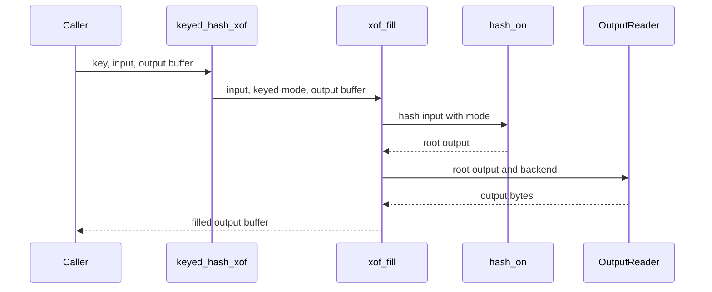

# PR #568 — comments and review threads

4 comment(s). **Every one needs a disposition** in
`review-debt.md`: addressed (with the commit hash) or declined (with the
reason posted in reply). Bot comments count.

## 1. coderabbitai — 

<!-- This is an auto-generated comment: summarize by coderabbit.ai -->
<!-- review_stack_entry_start -->

<a href="https://app.coderabbit.ai/change-stack/Blackcat-Informatics/purrdf/pull/568?scope=ghh_OusAJGA4HG8ljoOV0wJvVx8NmnZIjc2DdjmxOu0xZWA&amp;cs_source=review_comment"><picture><source media="(prefers-color-scheme: dark)" srcset="https://storage.googleapis.com/coderabbit_public_assets/review-stack-in-coderabbit-ui-dark.svg?v=3"><source media="(prefers-color-scheme: light)" srcset="https://storage.googleapis.com/coderabbit_public_assets/review-stack-in-coderabbit-ui.svg?v=3"></picture></a>

<!-- review_stack_entry_end -->
<!-- This is an auto-generated comment: rate limited by coderabbit.ai -->

> [!WARNING]
> ## Review limit reached
> 
> Your organization has reached its usage spending cap. Adjust your spending cap in the [billing tab](https://app.coderabbit.ai/settings/billing?tab=usage&orgId=b268aba6-a194-4fd6-8ca5-f1a13a313209).
> 
> **Next included review available in 3 minutes.**
> 
> [Check out review usage here](https://app.coderabbit.ai/dashboard/review-capacity?orgId=b268aba6-a194-4fd6-8ca5-f1a13a313209).
> 
> 

> 
<strong>View limit details</strong>

> <dl>
> <dd>
> 
> **Limit details:** You’ve used all 2 included reviews currently available. Your 83 included PR review attempts over the past 7 days set your current allowance at 2 reviews per hour.
> 
> [Learn how review limits work](https://docs.coderabbit.ai/management/rate-limits).
> 
> **Review configuration:**
> 
> 

> 
<strong>⚙️ Run configuration</strong>

> <dl>
> <dd>
> 
> - **Configuration used**: defaults
> - **Review profile**: CHILL
> - **Plan**: Team
> - **Run ID**: `af9a17e9-e069-41b2-94c2-09ece3372997`
> 
> </dd>
> </dl>
> 

> 
> 

> 
<strong>📥 Commits</strong>

> <dl>
> <dd>
> 
> Reviewing files that changed from the base of the PR and between 2c9c08dc50099c01c17f847156512fef94be6f6c and 415c8b9a4785e8721865451d52b3d11279ac8c94.
> 
> </dd>
> </dl>
> 

> 
> 

> 
<strong>📒 Files selected for processing: 2</strong>

> <dl>
> <dd>
> 
> * `crates/hash/PROVENANCE.md`
> * `docs/design/purrdf-simd.md`
> 
> </dd>
> </dl>
> 

> 
> </dd>
> </dl>
> 

<!-- end of auto-generated comment: rate limited by coderabbit.ai -->

<!-- walkthrough_start -->

<strong>📝 Walkthrough</strong>

<dl>
<dd>

BLAKE3 now supports keyed hashing, context-based key derivation, and extendable output. The changes propagate mode state through portable and SIMD paths, add streaming and one-shot APIs, and extend conformance tests and documentation.

**Changes: BLAKE3 modes and extended output**

|Layer / File(s)|Summary|
|:---|:---|
|**Mode-aware compression and backend kernels**   `crates/hash/src/blake3.rs`, `crates/hash/src/arch/*`|Compression and tree-kernel paths use mode-specific keys and flags. Portable and SIMD single-block compression can produce eight or sixteen output words.|
|**Streaming modes and XOF reader**   `crates/hash/src/blake3.rs`|Streaming supports keyed and derived-key constructors. One-shot functions expose keyed hashing, key derivation, and XOF output. The owned reader supports filling caller buffers and seeking within the output.|
|**Conformance coverage and supporting documentation**   `crates/hash-conformance/tests/blake3.rs`, `crates/hash-conformance/tests/vectors/*`, `Makefile`, `crates/hash/README.md`, `crates/hash/PROVENANCE.md`, `crates/hash/src/lib.rs`, `helpers-ledger.toml`, `CHANGELOG.md`|Official vectors and conformance tests cover all three modes, streaming buffers, backends, large outputs, and seek boundaries. Documentation and test selections describe or include the new coverage.|

<!-- change_assessment_start -->
**Priority:** ➖ Normal

**Estimated code review effort:** 4 (Complex) | ~45 minutes

<!-- change_assessment_commit:"2c9c08dc50099c01c17f847156512fef94be6f6c" -->
**Change:** Feature
<!-- change_assessment_end -->

### Sequence Diagram(s)

</dd>
</dl>

<!-- walkthrough_end -->

<strong>Merge Risk:</strong> <strong>🔵 Low</strong> · up to <code>2c9c0</code>

<dl>
<dd>

<!-- final_review_risk_start -->
<!-- final_review_risk_label
**Merge Risk:** **🔵 Low** · up to `2c9c0`
-->
<!-- final_review_risk_coverage:{"sourceCommitId":"2c9c08dc50099c01c17f847156512fef94be6f6c","coveredCommitId":"2c9c08dc50099c01c17f847156512fef94be6f6c","kind":"reviewed"} -->

The implementation can be merged with a small documentation correction: its provenance record currently misstates which BLAKE3 modes are public.
<!-- final_review_risk_end -->

</dd>
</dl>

<!-- pre_merge_checks_walkthrough_start -->

<strong>Pre-merge checks: <picture></picture> 4 · <picture></picture> 1</strong>

<dl>
<dd>

<strong><picture></picture> Failed checks: 1 warning</strong>

|     Check name     |                                              Status                                              | Explanation                                                                                                                                                                                               | Resolution                                                                         |
| :---------------- | :----------------------------------------------------------------------------------------------: | :-------------------------------------------------------------------------------------------------------------------------------------------------------------------------------------------------------- | :--------------------------------------------------------------------------------- |
| Docstring Coverage |  | Docstring coverage is 61.45% which is insufficient. The required threshold is 80.00%. Docstring coverage is scoped to functions touched by this diff. Analyzed 83 functions across 8 files. (7 skipped: … | Write docstrings for the functions missing them to satisfy the coverage threshold. |

<strong><picture></picture> Passed checks: 4 passed</strong>

<dl>
<dd>

|         Check name         |                                             Status                                             | Explanation                                                                                                                                                                                               |
| :------------------------ | :--------------------------------------------------------------------------------------------: | :-------------------------------------------------------------------------------------------------------------------------------------------------------------------------------------------------------- |
|      Description Check     |  | Check skipped - CodeRabbit’s high-level summary is enabled.                                                                                                                                               |
|         Title check        |  | The title clearly and concisely summarizes the main changes: keyed hashing, key derivation, and extended output support for BLAKE3.                                                                       |
|     Linked Issues check    |  | Issue `#562` requires keyed hashing, context-based key derivation, extendable output, streaming keyed and derived modes, official vectors on dispatched backends, no dependency, and existing dispatch beh… |
| Out of Scope Changes check |  | The changed kernel code, public APIs, conformance vectors, tests, documentation, provenance, WASM test lane, and helper metadata all support the BLAKE3 modes and backend conformance requested by issue… |

<strong>Full details: Linked Issues check</strong>

<dl>
<dd>

**Explanation**

Issue `#562` requires keyed hashing, context-based key derivation, extendable output, streaming keyed and derived modes, official vectors on dispatched backends, no dependency, and existing dispatch behavior. `crates/hash/src/blake3.rs` adds these APIs and carries `Mode` through portable, SIMD, tree, and streaming paths. The conformance test covers 35 official records, 131-byte output, both 1024- and 16384-byte streams, and every available `Backend`. The change summary reports no new dependency. The source also retains the existing backend availability and selection model.

</dd>
</dl>

<strong>Full details: Out of Scope Changes check</strong>

<dl>
<dd>

**Explanation**

The changed kernel code, public APIs, conformance vectors, tests, documentation, provenance, WASM test lane, and helper metadata all support the BLAKE3 modes and backend conformance requested by issue `#562`. No unrelated implementation or dependency change is demonstrated.

</dd>
</dl>

</dd>
</dl>

<strong>Full details: Docstring Coverage</strong>

<dl>
<dd>

**Explanation**

Docstring coverage is 61.45% which is insufficient. The required threshold is 80.00%. Docstring coverage is scoped to functions touched by this diff. Analyzed 83 functions across 8 files. (7 skipped: 7 unsupported.)

**Resolution**

Write docstrings for the functions missing them to satisfy the coverage threshold.

</dd>
</dl>

</dd>
</dl>

<!-- pre_merge_checks_walkthrough_end -->
<!-- finishing_touch_checkbox_start -->

<strong>✨ Finishing Touches: 💡 1</strong>

<dl>
<dd>

<!-- finishing_touch_suggestion:docstrings -->

<strong>📝 Generate docstrings: 💡</strong>

<dl>
<dd>

- [ ] <!-- {"checkboxId":"3e1879ae-f29b-4d0d-8e06-d12b7ba33d98"} --> Commit to this branch
- [ ] <!-- {"checkboxId":"7962f53c-55bc-4827-bfbf-6a18da830691"} --> Create a new PR

</dd>
</dl>

<strong>🧪 Generate unit tests (beta)</strong>

<dl>
<dd>

- [ ] <!-- {"checkboxId": "6ba7b810-9dad-11d1-80b4-00c04fd430c8", "radioGroupId": "utg-output-choice-group-unknown_comment_id"} --> Commit to this branch
- [ ] <!-- {"checkboxId": "f47ac10b-58cc-4372-a567-0e02b2c3d479", "radioGroupId": "utg-output-choice-group-unknown_comment_id"} --> Create a new PR

</dd>
</dl>

</dd>
</dl>

<!-- finishing_touch_checkbox_end -->

<!-- autopilot:start -->
- [ ] <!-- {"checkboxId":"2708ad07-9f24-4260-9c11-7dc76a49f2e3"} --> <strong title="Keep fixing CodeRabbit findings and required CI, and resolving merge conflicts">Autofix</strong> · Keep fixing CodeRabbit findings and required CI, and resolving merge conflicts
<!-- autopilot:end -->
<!-- tips_start -->

Comment `@coderabbitai help` to get the list of available commands.

<!-- tips_end -->

## 2. paudley — 

# BLAKE3 modes and extendable output

Complete keyed hashing, two-stage context derivation, extended output and their
streaming forms without adding dependencies or a second compression algorithm.
The existing unkeyed tree, short-input policy and hardware dispatch remain the
production path for every mode. Repository law requires portable deterministic
bytes, one implementation per job, normal hooks and protected integration.

## Task 1: Implement and qualify the complete modes

Thread one key/flags value through existing chunks, parents and all batched
kernels. Extend each existing single-block kernel to emit either eight chaining
words or all sixteen output words, specializing away unused output operations.
Expose keyed_hash, derive_key, hash_xof and keyed/derived XOF functions; streaming
constructors preserve mode across reset. An owned seekable output reader retains
root inputs and fills caller storage without allocation or rehashing input.

Freeze the official full-length vectors with provenance. Replay every input in
all three modes on every available backend, both stream buffer sizes, unrelated
update boundaries, reset/clone and seek/read boundaries. Check the first 32 bytes
against digest APIs and megabyte output against independent block/partition
controls. Retain existing frozen unkeyed and tree-counter controls. Execute native
and installed portable/SIMD WASM paths, and applicable architecture checks. No
elapsed-time or throughput measurements. Run strict affected compilation and
hygiene during development; run the required final gate on settled source.

## Task 2: Publish and integrate

Publish the implemented behavior after focused checks and normal hooks, while
assembly projections finish. This starts hosted qualification promptly; it does
not waive any merge requirement. Commit the generated assembly projection when
its complete run finishes. The final hosted matrix and review must cover the
resulting candidate before integration.

Review the complete issue against source and recorded results; resolve material
findings. Commit through normal hooks, push and open the closing PR. Resolve
actual hosted review and CI, merge only through ghprsq, verify closure/mirror and
remove the delivered branch and worktree. Update the portfolio tracker.

## Review and prior art

The existing original compression and SIMD batch implementations are the only
algorithm homes; official specification and frozen answers provide the oracle,
not upstream implementation bodies. Brief found no prior attempt, no comments
and no linked PR. Its narrow title search does not establish global recurrence.
No subagents are permitted. Owner analysis is not independent approval; hosted
source review will provide independent review before integration. Generic pool
or external consumer migrations would expand scope and are excluded. Seekable
output is included because it avoids rehashing megabyte masks and fits the same
retained root object. No new dependency, timing gate or fallback kernel is added.

## 3. paudley — 

@coderabbitai review

## 4. paudley — 

The provenance finding is valid. The working tree now states that the public
API exposes keyed hashing, key derivation and extended output, while PurRDF
content identities continue to use unkeyed BLAKE3-256. This correction will be
published with the generated assembly counts; the inline thread remains open
until that commit is pushed.

The separate docstring coverage warning does not identify a missing public API
contract. Every added public constructor, function and reader method has
Rustdoc, and strict missing_docs compilation passes. Its 83-function denominator
also includes existing private helpers, test functions and inherited trait
methods whose signatures changed during mode propagation. I am retaining the
public-documentation requirement and existing bot configuration, rather than
adding blanket private/test boilerplate to satisfy this heuristic. A specific
missing public contract would still need a correction.

