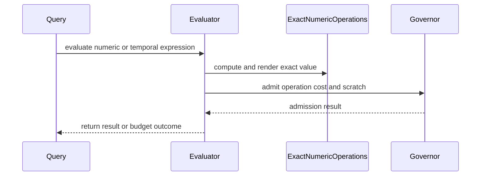

# PR #550 — comments and review threads

3 comment(s). **Every one needs a disposition** in
`review-debt.md`: addressed (with the commit hash) or declined (with the
reason posted in reply). Bot comments count.

## 1. coderabbitai — 

<!-- This is an auto-generated comment: summarize by coderabbit.ai -->
<!-- review_stack_entry_start -->

<a href="https://app.coderabbit.ai/change-stack/Blackcat-Informatics/purrdf/pull/550?scope=ghh_OusAJGA4HG8ljoOV0wJvVx8NmnZIjc2DdjmxOu0xZWA&amp;cs_source=review_comment"><picture><source media="(prefers-color-scheme: dark)" srcset="https://storage.googleapis.com/coderabbit_public_assets/review-stack-in-coderabbit-ui-dark.svg?v=3"><source media="(prefers-color-scheme: light)" srcset="https://storage.googleapis.com/coderabbit_public_assets/review-stack-in-coderabbit-ui.svg?v=3"></picture></a>

<!-- review_stack_entry_end -->
<!-- recent_review_start -->

No actionable comments were generated in the recent review. 🎉

<strong>ℹ️ Recent review info</strong>

<dl>
<dd>

<strong>⚙️ Run configuration</strong>

<dl>
<dd>

- **Configuration used**: defaults
- **Review profile**: CHILL
- **Plan**: Team
- **Run ID**: `6384f012-73de-4a1f-82d7-d5e802ca3ab1`

</dd>
</dl>

<strong>📥 Commits</strong>

<dl>
<dd>

Reviewing files that changed from the base of the PR and between 1c5ab44294fed66571ff76d43400e77d079fc9a6 and 4070fee39cf86505f30b1cd4492b8c61a184c0c1.

</dd>
</dl>

<strong>📒 Files selected for processing: 1</strong>

<dl>
<dd>

* `.github/workflows/ci.yaml`

</dd>
</dl>

**Included review availability:** This review used your included allowance. 4 included reviews remain after this review. Your included PR review attempts over the past 7 days set your current allowance at 6 reviews per hour.

</dd>
</dl>

<!-- recent_review_end -->
<!-- walkthrough_start -->

<strong>📝 Walkthrough</strong>

<dl>
<dd>

This pull request replaces bounded XSD numeric variants with exact integer and decimal values. It changes default division to preserve terminating quotients and round repeating quotients to 18 fractional digits using half-even. It also extends exact temporal-second handling and updates evaluator operations, bindings, documentation, tests, and governor evidence.

**Changes: Exact numeric and temporal behavior**

|Layer / File(s)|Summary|
|:---|:---|
|**Exact XSD values and division policy**   `crates/xsd/src/*`, `crates/xsd/tests/*`, `crates/xsd/benches/exact.rs`, `crates/xsd/examples/gen_exact_numeric_vectors.rs`|`XsdValue::Integer` and `XsdValue::Decimal` now use exact types at every size. Bounded decimal and rational conversions are removed. `DivisionPolicy` adds `ExactOrScale`; its default keeps terminating quotients exact and rounds repeating quotients to 18 fractional digits using half-even.|
|**Evaluator numeric and temporal operations**   `crates/sparql-eval/src/*`, `crates/sparql-eval/tests/*`, `crates/cdt/src/functions.rs`, `crates/geo-kernel/src/metric.rs`|Evaluation, casts, aggregates, and rendering use the exact numeric model. Temporal operations use admitted kernels, and `SECONDS` preserves long fractional seconds. Integer narrowing remains explicit where bounded indices are required.|
|**Bindings, APIs, and documentation**   `bindings/python/*`, `crates/cli/*`, `crates/rdf-capi/*`, `crates/rdf-wasm/*`, `README.md`, `CHANGELOG.md`, `docs/*`|Policy forms and defaults are updated across Python, CLI, C, and wasm documentation and tests. The book describes exact temporal seconds and whole-day `time` wrapping. Governor profile documentation advances to version 18.|
|**Shapes and parser behavior**   `crates/shapes/*`, `crates/rdf-core/src/xsd_regex/ecma_emit.rs`, `crates/sparql-conformance/src/rs_resultset.rs`|Temporal schema patterns accept arbitrary-length fractional seconds and account for `24:00` as a `time` midnight alias. Argument and result indices use checked conversions. Regex compatibility checks syntax parsing rather than Rust regex compilation size.|
|**Governor corpus and conformance evidence**   `vectors/sparql-governors/*`, `scripts/conformance-frozen/*`, `crates/sparql-algebra/tests/goldens/*`, `crates/sparql-conformance/tests/goldens/*`, `docs/CONFORMANCE.md`|The frozen corpus adds numeric-default and temporal-exact cases with fuel-boundary outputs. Evaluator traces and digests are updated, and the documented passing corpus increases from 50 to 54 cases.|

<!-- change_assessment_start -->
**Priority:** ➖ Normal

**Estimated code review effort:** 5 (Critical) | ~120 minutes

<!-- change_assessment_commit:"4070fee39cf86505f30b1cd4492b8c61a184c0c1" -->
**Change:** Feature
<!-- change_assessment_end -->

### Sequence Diagram(s)

</dd>
</dl>

<!-- walkthrough_end -->

<strong>Merge Risk:</strong> <strong>⚪ Minimal</strong> · up to <code>4070f</code>

<dl>
<dd>

<!-- final_review_risk_start -->
<!-- final_review_risk_label
**Merge Risk:** **⚪ Minimal** · up to `4070f`
-->
<!-- final_review_risk_coverage:{"sourceCommitId":"4070fee39cf86505f30b1cd4492b8c61a184c0c1","coveredCommitId":"4070fee39cf86505f30b1cd4492b8c61a184c0c1","kind":"reviewed"} -->

The test shard has 15 additional minutes before timeout, with no reported change to the tests it runs. This workflow adjustment presents no concrete merge-blocking risk.
<!-- final_review_risk_end -->

</dd>
</dl>

<!-- pre_merge_checks_walkthrough_start -->

<strong>Pre-merge checks: <picture></picture> 3 · <picture></picture> 2</strong>

<dl>
<dd>

<strong><picture></picture> Failed checks: 2 warnings</strong>

|         Check name         |                                              Status                                              | Explanation                                                                                                                                                                                               | Resolution                                                                                                                                                           |
| :------------------------ | :----------------------------------------------------------------------------------------------: | :-------------------------------------------------------------------------------------------------------------------------------------------------------------------------------------------------------- | :------------------------------------------------------------------------------------------------------------------------------------------------------------------- |
| Out of Scope Changes check |  | `crates/rdf-core/src/xsd_regex/ecma_emit.rs` changes ECMA-262 compatibility from matcher compilation to syntax parsing and adds an oversized-pattern test. This change addresses regex compilation-budge… | Remove the `crates/rdf-core/src/xsd_regex/ecma_emit.rs` change from this pull request, or link a requirement that directly justifies the regex compatibility change. |
|     Docstring Coverage     |  | Docstring coverage is 72.59% which is insufficient. The required threshold is 80.00%. Docstring coverage is scoped to functions touched by this diff. Analyzed 135 functions across 51 files. (1 skipped… | Write docstrings for the functions missing them to satisfy the coverage threshold.                                                                                   |

<strong><picture></picture> Passed checks: 3 passed</strong>

<dl>
<dd>

|      Check name     |                                             Status                                             | Explanation                                                                                                                                                                                               |
| :----------------- | :--------------------------------------------------------------------------------------------: | :-------------------------------------------------------------------------------------------------------------------------------------------------------------------------------------------------------- |
|  Description Check  |  | Check skipped - CodeRabbit’s high-level summary is enabled.                                                                                                                                               |
|     Title check     |  | The title clearly summarizes the primary changes: unified exact numeric values and half-even defaults for division.                                                                                       |
| Linked Issues check |  | Issue `#470` requires the exact tower as the public numeric API, exact terminating division, 18-place half-even fallback, retained explicit policies, exact temporal seconds, coverage across Rust, CLI, P… |

</dd>
</dl>

<strong>Full details: Out of Scope Changes check</strong>

<dl>
<dd>

**Explanation**

`crates/rdf-core/src/xsd_regex/ecma_emit.rs` changes ECMA-262 compatibility from matcher compilation to syntax parsing and adds an oversized-pattern test. This change addresses regex compilation-budget behavior, not issue `#470` numeric values, division, temporal seconds, bindings, governor vectors, or migration documentation.

</dd>
</dl>

<strong>Full details: Docstring Coverage</strong>

<dl>
<dd>

**Explanation**

Docstring coverage is 72.59% which is insufficient. The required threshold is 80.00%. Docstring coverage is scoped to functions touched by this diff. Analyzed 135 functions across 51 files. (1 skipped: 1 unsupported.)

</dd>
</dl>

</dd>
</dl>

<!-- pre_merge_checks_walkthrough_end -->

- [ ] <!-- {"checkboxId":"585bb3f6-faf5-4dbf-96d2-74e382adf19a"} --> Fix all pre-merge checks with AI
<!-- finishing_touch_checkbox_start -->

<strong>✨ Finishing Touches</strong>

<dl>
<dd>

<strong>🧪 Generate unit tests (beta)</strong>

<dl>
<dd>

- [ ] <!-- {"checkboxId": "6ba7b810-9dad-11d1-80b4-00c04fd430c8", "radioGroupId": "utg-output-choice-group-unknown_comment_id"} --> Commit to this branch
- [ ] <!-- {"checkboxId": "f47ac10b-58cc-4372-a567-0e02b2c3d479", "radioGroupId": "utg-output-choice-group-unknown_comment_id"} --> Create a new PR

</dd>
</dl>

</dd>
</dl>

<!-- finishing_touch_checkbox_end -->

<!-- autopilot:start -->
- [ ] <!-- {"checkboxId":"2708ad07-9f24-4260-9c11-7dc76a49f2e3"} --> <strong title="Keep fixing CodeRabbit findings and required CI, and resolving merge conflicts">Autofix</strong> · Keep fixing CodeRabbit findings and required CI, and resolving merge conflicts
<!-- autopilot:end -->
<!-- tips_start -->

Comment `@coderabbitai help` to get the list of available commands.

<!-- tips_end -->

## 2. paudley — 

Published `bd4d219bf` removes the two obsolete bounded AVG exports, corrects
public rustdoc for exact decimals and temporal comparison, and fixes the three
needless closure borrows reported by current hosted Clippy. The original AVG
consumers already use exact `numeric_div_with_policy`; the old implementations
remain private test controls. Breaking guidance names the removed helpers.

Affected all-target Clippy, warning-denied public rustdoc, metadata/license
regeneration and normal commit hooks pass. The original temporal peak admission,
refusal and release test passes after naming its synthetic counters accurately
as an allocation budget. Its assertions and the CodeQL policy are unchanged.

The repaired full local gate and 458-test installed WASM package passed on the
previous published source, with 42 current installed Python controls. The new
hosted run is in progress. The baseline assembly floor passed but its generated
document cell was stale (43 versus 42); the existing complete seven-configuration
projection producer is running at
https://github.com/Blackcat-Informatics/purrdf/actions/runs/38592881046.
Its patch, ordinary hosted parity, current reviews and final integration still
need acceptance. No merge or issue closure is claimed.

## 3. paudley — 

The final source run cancelled integration shard 5 at its 45-minute job limit
while the selected tests were still running. Cold compilation consumed about
42 minutes of that budget. The cancelled shard is not a pass.

Commit `4070fee39` raises only the test-shard budget to 60 minutes. Compiler,
profile, workers, test selection and assertions are unchanged. Standard
`actionlint` and the existing shard-selection checks pass; normal commit/push
hooks pass. Current CI and Docs are running. The source/package/projection
receipts retain their unchanged scope; final hosted completion remains required.

