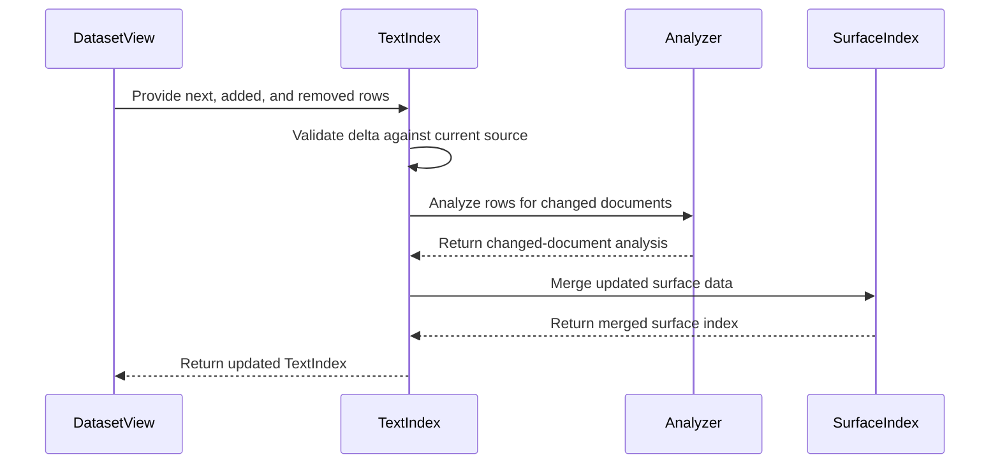

# PR #579 — comments and review threads

4 comment(s). **Every one needs a disposition** in
`review-debt.md`: addressed (with the commit hash) or declined (with the
reason posted in reply). Bot comments count.

## 1. coderabbitai — 

<!-- This is an auto-generated comment: summarize by coderabbit.ai -->
<!-- review_stack_entry_start -->

<a href="https://app.coderabbit.ai/change-stack/Blackcat-Informatics/purrdf/pull/579?scope=ghh_OusAJGA4HG8ljoOV0wJvVx8NmnZIjc2DdjmxOu0xZWA&amp;cs_source=review_comment"><picture><source media="(prefers-color-scheme: dark)" srcset="https://storage.googleapis.com/coderabbit_public_assets/review-stack-in-coderabbit-ui-dark.svg?v=3"><source media="(prefers-color-scheme: light)" srcset="https://storage.googleapis.com/coderabbit_public_assets/review-stack-in-coderabbit-ui.svg?v=3"></picture></a>

<!-- review_stack_entry_end -->
<!-- recent_review_start -->

No actionable comments were generated in the recent review. 🎉

<strong>ℹ️ Recent review info</strong>

<dl>
<dd>

<strong>⚙️ Run configuration</strong>

<dl>
<dd>

- **Configuration used**: defaults
- **Review profile**: CHILL
- **Plan**: Team
- **Run ID**: `8c47fddb-9779-47b7-b76a-c5b8058643dd`

</dd>
</dl>

<strong>📥 Commits</strong>

<dl>
<dd>

Reviewing files that changed from the base of the PR and between f329f812013779f1603cf959629fbf9a7b710bc4 and ede07f8599e2d97f599ace96ea8ca4df273fa861.

</dd>
</dl>

<strong>📒 Files selected for processing: 1</strong>

<dl>
<dd>

* `docs/WASM_TESTING.md`

</dd>
</dl>

<strong>🚧 Files skipped from review as they are similar to previous changes: 1</strong>

<dl>
<dd>

* docs/WASM_TESTING.md

</dd>
</dl>

**Included review availability:** This review used your included allowance. 0 included reviews remain after this review. Your included PR review attempts over the past 7 days set your current allowance at 2 reviews per hour.

</dd>
</dl>

<!-- recent_review_end -->
<!-- walkthrough_start -->

<strong>📝 Walkthrough</strong>

<dl>
<dd>

This pull request adds delta-based updates for `TextIndex` and document merge and retraction operations for `SurfaceIndex`. It also changes `xsd:anyURI` cast admission and parsing, and adds tests for both change areas.

**Changes: Incremental text indexing**

|Layer / File(s)|Summary|
|:---|:---|
|**Delta errors and index assembly**   `crates/text/src/error.rs`, `crates/text/src/lib.rs`, `crates/text/src/index.rs`|Adds `TextDeltaError` and re-exports it. Index assembly uses borrowed document facts and helpers for document counts, occurrence ordering, posting spans, and row digests.|
|**Surface document merging and retraction**   `crates/text/src/surface/postings.rs`, `crates/text/src/surface.rs`, `crates/text/src/surface/delta.rs`|Adds ordered posting merges and remapping, document removal, and document replacement. Tests compare surface results with fresh builds.|
|**TextIndex delta update**   `crates/text/src/index/delta.rs`, `crates/text/src/analysis.rs`, `crates/text/README.md`, `crates/text/tests/*`, `crates/rdf-wasm/src/interleaving.rs`, `Makefile`, `docs/WASM_TESTING.md`|Adds `TextIndex::with_delta` to validate changes, reanalyze changed documents, merge index data, and refresh fingerprints and coverage. Tests compare delta results with fresh builds and check retained data and unchanged snapshots. Documentation and WASM test selection include the update test. Test-only projection tracking is added to the analysis code and ledger.|

**xsd:anyURI casting**

|Layer / File(s)|Summary|
|:---|:---|
|**anyURI cast rules and validation**   `crates/sparql-eval/src/expr.rs`, `crates/sparql-eval/tests/*`, `crates/xsd/src/range.rs`, `crates/entail/src/owl_dl/parser.rs`, `crates/entail/src/report.rs`|Restricts modeled `xsd:anyURI` casts to URI and string-row sources and parses URI values before string casts. Tests cover normalization and rejected cast pairs. Value-space descriptions no longer classify `xsd:anyURI` as unmodeled.|

<!-- change_assessment_start -->
**Priority:** ➖ Normal

**Estimated code review effort:** 4 (Complex) | ~45 minutes

<!-- change_assessment_commit:"ede07f8599e2d97f599ace96ea8ca4df273fa861" -->
**Change:** Feature · **Severity of issue fixed:** Medium
<!-- change_assessment_end -->

### Sequence Diagram(s)

</dd>
</dl>

<!-- walkthrough_end -->

<strong>Merge Risk:</strong> <strong>⚪ Minimal</strong> · up to <code>ede07</code>

<dl>
<dd>

<!-- final_review_risk_start -->
<!-- final_review_risk_label
**Merge Risk:** **⚪ Minimal** · up to `ede07`
-->
<!-- final_review_risk_coverage:{"sourceCommitId":"ede07f8599e2d97f599ace96ea8ca4df273fa861","coveredCommitId":"ede07f8599e2d97f599ace96ea8ca4df273fa861","kind":"reviewed"} -->

No concrete issue in the selected change currently prevents merging after normal checks.
<!-- final_review_risk_end -->

</dd>
</dl>

<!-- pre_merge_checks_walkthrough_start -->

<strong>Pre-merge checks: <picture></picture> 3 · <picture></picture> 1 · <picture></picture> 1</strong>

<dl>
<dd>

<strong><picture></picture> Failed checks: 1 warning · 1 inconclusive</strong>

|      Check name     |                                                   Status                                                   | Explanation                                                                                                                                                                                               | Resolution                                                                                                                                                                        |
| :----------------- | :--------------------------------------------------------------------------------------------------------: | :-------------------------------------------------------------------------------------------------------------------------------------------------------------------------------------------------------- | :-------------------------------------------------------------------------------------------------------------------------------------------------------------------------------- |
|  Docstring Coverage |            | Docstring coverage is 65.82% which is insufficient. The required threshold is 80.00%. Docstring coverage is scoped to functions touched by this diff. Analyzed 79 functions across 16 files. (1 skipped:… | Write docstrings for the functions missing them to satisfy the coverage threshold.                                                                                                |
| Linked Issues check |  | Issue `#538` is supported. `TextIndex::with_delta` validates effective deltas, updates changed documents, merges lexical and surface postings, refreshes fingerprints and coverage, and compares results w… | Provide reviewable evidence for the GMEOW downstream anyURI replacement and deletion of superseded special cases, or otherwise identify those changes in the reviewed repository. |

<strong><picture></picture> Passed checks: 3 passed</strong>

<dl>
<dd>

|         Check name         |                                             Status                                             | Explanation                                                                                                                                                                                               |
| :------------------------ | :--------------------------------------------------------------------------------------------: | :-------------------------------------------------------------------------------------------------------------------------------------------------------------------------------------------------------- |
| Out of Scope Changes check |  | The text delta implementation, retained-posting helpers, allocation controls, source validation, and WASM registration support issue `#538`. The anyURI cast repair, modeled-datatype documentation, entai… |
|      Description Check     |  | Check skipped - CodeRabbit’s high-level summary is enabled.                                                                                                                                               |
|         Title check        |  | The title clearly and concisely identifies both primary changes: incremental text indexing and native xsd:anyURI integration.                                                                             |

<strong>Full details: Out of Scope Changes check</strong>

<dl>
<dd>

**Explanation**

The text delta implementation, retained-posting helpers, allocation controls, source validation, and WASM registration support issue `#538`. The anyURI cast repair, modeled-datatype documentation, entailment updates, native/WASM tests, and test-selection changes support issue `#571`. The repository evidence does not show a demonstrated unrelated change.

</dd>
</dl>

</dd>
</dl>

<strong>Full details: Docstring Coverage</strong>

<dl>
<dd>

**Explanation**

Docstring coverage is 65.82% which is insufficient. The required threshold is 80.00%. Docstring coverage is scoped to functions touched by this diff. Analyzed 79 functions across 16 files. (1 skipped: 1 unsupported.)

**Resolution**

Write docstrings for the functions missing them to satisfy the coverage threshold.

</dd>
</dl>

<strong>Full details: Linked Issues check</strong>

<dl>
<dd>

**Explanation**

Issue `#538` is supported. `TextIndex::with_delta` validates effective deltas, updates changed documents, merges lexical and surface postings, refreshes fingerprints and coverage, and compares results with fresh builds across the reported text and WASM tests. Issue `#571` is partly supported. The reviewed head contains native `XsdDatatype::AnyUri`, `XsdValue::AnyUri`, parsing, range behavior, and focused native tests. This PR repairs the SPARQL cast consumer and adds native/WASM cast coverage. The linked GMEOW downstream replacement and deletion of its special cases are stated in the description, but external pull requests do not provide reviewable repository evidence.

**Resolution**

Provide reviewable evidence for the GMEOW downstream anyURI replacement and deletion of superseded special cases, or otherwise identify those changes in the reviewed repository.

</dd>
</dl>

</dd>
</dl>

<!-- pre_merge_checks_walkthrough_end -->

- [ ] <!-- {"checkboxId":"585bb3f6-faf5-4dbf-96d2-74e382adf19a"} --> Fix all pre-merge checks with AI
<!-- finishing_touch_checkbox_start -->

<strong>✨ Finishing Touches</strong>

<dl>
<dd>

<strong>🧪 Generate unit tests (beta)</strong>

<dl>
<dd>

- [ ] <!-- {"checkboxId": "6ba7b810-9dad-11d1-80b4-00c04fd430c8", "radioGroupId": "utg-output-choice-group-unknown_comment_id"} --> Commit to this branch
- [ ] <!-- {"checkboxId": "f47ac10b-58cc-4372-a567-0e02b2c3d479", "radioGroupId": "utg-output-choice-group-unknown_comment_id"} --> Create a new PR

</dd>
</dl>

</dd>
</dl>

<!-- finishing_touch_checkbox_end -->

<!-- autopilot:start -->
- [ ] <!-- {"checkboxId":"2708ad07-9f24-4260-9c11-7dc76a49f2e3"} --> <strong title="Keep fixing CodeRabbit findings and required CI, and resolving merge conflicts">Autofix</strong> · Keep fixing CodeRabbit findings and required CI, and resolving merge conflicts
<!-- autopilot:end -->
<!-- tips_start -->

Comment `@coderabbitai help` to get the list of available commands.

<!-- tips_end -->

## 2. paudley — 

# Exact text-index delta updates

The complete contract is an actual TextIndex delta path, with added and removed
literal rows, whose results match a fresh build. BM25F, Fixed arithmetic,
partitioning, source evidence and ranking profiles keep their existing laws.
The corpus includes both RDF layers and both physical carrier profiles.
No partial surface-only PR or closure satisfies this contract.

The current implementation discards raw rows and lexical analysis after build.
SurfaceIndex stores sorted flat gram/phonetic postings and source-aligned
evidence. Re-running assemble over all retained analyses would repeat the
reported expensive computation and is not an incremental implementation.

Use the existing analyzer/scorer once, and implement ordered updates at the
existing physical homes. An owned update may move buffers; it must not retokenize
unchanged documents, regenerate their grams or rerun their phonetic encodings.
Canonical identifiers, both fingerprints, phrase and auxiliary answers must
agree with a fresh index. The current canonical fingerprint requires traversing
retained source/index data; distinguish this cost from rebuilding projections.
Do not claim sublinear total work without evidence. Preserve older snapshots.

## Task 1: Update surface postings and evidence

Extend FlatPostings at its existing home with an ordered remap/merge. Reuse
unchanged source text, term spelling, span shapes, codes and gram positions.
Surface document replacement removes every old source for an affected document,
merges the analyzed additions and retains canonical ordering/evidence. Validate
analyzer compatibility and ID maps. Compile this coherent production slice
before broader integration. Compare actual substring/phonetic results and
generation against fresh construction, including deletions and overlaps.

## Task 2: Wire the actual TextIndex delta path

Admit added/removed effective literal rows, validate their relation to the source
generation, and analyze only affected documents, including their retained rows.
Merge their lexical postings, token streams and Han occurrences into the existing
index. Apply exact subtraction/addition to partition and field statistics.
Wire the surface update through the same document remaps and rebind the final
generation. Keep graph/language partitioning, routing, stable scoped term identity,
coverage, auxiliary-only documents and typed failures. No default corpus cache
or new runtime dependency. Complete the chosen source/delta API against the
actual DatasetView and existing binding/digest implementation; do not accept a
delta that silently certifies a mismatched source.

The working source API is an owned update against the next immutable dataset
plus effective added/removed DatasetView inputs. Reconstruct the selected prior
source rows by reversing the delta and compare their digest with the index's
source_fingerprint before modifying it. Reuse collect_rows and the existing
digest recipe; factor that recipe for borrowed ordered rows rather than writing
another hash preimage. Coverage comes from the actual next source, including
nonliteral statements and all three RDF layers. This requires a source walk and
canonical hashing, but no permanent copy of raw literals in every TextIndex.

Analyze the complete next-source rows of affected document keys only. Assemble
that partial index through the existing analyzer and ranking profile, then merge
it into the retained core tables with canonical document/partition/term maps.
Postings compare by (partition, document), not document alone. Retained token
streams need only term-ID rebasing; Han occurrences need document-ID rebasing.
Sum document/field counts and lengths from the retained and replacement document
facts through the existing partition/field homes, preserving auxiliary-only
partitions. This metadata walk is deliberate: it avoids a second implementation
of ranking statistics without reanalyzing retained text. Surface document IDs
must follow the same monotone
maps before the ordered addition path is used. Recompute the existing canonical
index digest and bind the final generation once. This route is not implemented
or qualified by the surface tests; complete it before creating the PR.

## Task 3: Qualify and deliver the whole contract

Fresh-build oracle tests cover insert/retract/replace, empty/repeated/no-op
changes, multi-literal documents, annotations, named/default/graph-free carriers,
language/direction, ranking fields, lexical/Han/substring/phonetic/phrase evidence,
identities and invalid deltas. Fixed-work controls prove unchanged documents are
not analyzed and unchanged grams/codes are not rebuilt. Record allocation/layout
costs, source scans and old-snapshot ownership explicitly. No timing measurement.

Use standard host tools, eight Cargo jobs/four test threads and 16 GiB per job;
one Cargo invocation at a time. Focused checks during development, affected native
and wasm execution, then the required final gate on settled source. No agents or
fabricated independent review. Obtain hosted material review for the complete
PR, resolve findings, satisfy CI, merge only with ghprsq, verify closure/mirror,
and remove the delivered branch. Update the root REWORK_LIST.md at transitions.

## Evidence and ownership

Stage brief reports no earlier delivery branch, commit or PR for this issue.
The source inspection confirms the all-corpus construction described above.
Related scoring/dictionary fixes are already merged and provide existing homes,
not delta completion. Prior art and plan judgment are owner-performed because
subagents are disabled. Independent implementation acceptance remains pending.

## 3. paudley — 

# Integrated cast-table repair

The required integration-5 job fails the existing anyURI-to-hexBinary refusal.
Its dependent test aggregator fails for that same cause; all other hosted jobs
pass or carry their expected skips. Preserve the failing run as evidence.

## Production correction

At the existing cast-source admission home, native AnyUri must retain its
primitive row: only string and identity targets are admitted. Remove its stale
unmodelled-row registration. URI-to-string conversion reads the parsed native
value, including XML whitespace collapse; string-to-URI delegates that mapping
to the native parser instead of allocating a redundant normalized copy.
Preserve source errors and workspace admission through the existing homes.

Extend the existing operator table with both binary refusals and positive
string/self/string-input cases. Add the same governed public controls to the
existing portable cast target. Once the executing Makefile invocation finishes,
register that case and the existing text-delta case in the normal wasm-test
selection and its documented inventory. Do not edit the executing launcher.

## Existing anyURI contract

Issue 571's native model and downstream replacement are already delivered by
the linked native work and GMEOW PRs 1838/1839. The current downstream manifest
selects native main 0994332d9; PR 1839 records 82 passing final-pin native
consumer/identity/witness/selector cases, native ownership with no compatibility
fallback, both refreshed attestations and actual native leaf WASM qualification.
Full unrelated GMEOW corpus/browser qualification is still separately pending.
The remaining discovered SPARQL consumer repair and false unsupported-anyURI
descriptions are being corrected here. Reuse actual unchanged model/consumer
evidence rather than creating another implementation branch. Do not claim
closure until the contract audit and corrected native/WASM executions pass.

## Qualification and publication

Let the original full gate finish; its nested standard release builds are live,
not assumed hung. No second owned Cargo invocation runs concurrently. Run the
affected operator table, the complete portable cast target natively and its new
case on actual WASM, strict affected compilation and required hygiene/registration
checks. Reuse unaffected full-gate results with explicit scope; never relabel the
failed original run a pass. Run missing final-gate components once. Commit and
push normally, refresh hosted feedback/CI, then merge only through ghprsq after
the real delivery gates. No new follow-up issue or partial closure is created.

## 4. paudley — 

feat: add text index deltas and complete native URI integration

Closes #538
Closes #571

## Result

TextIndex::with_delta validates an effective literal multiset against its source
generation, analyzes changed documents and merges lexical and surface postings.
Canonical identities, exact BM25F statistics, ranking and source evidence match
fresh construction. Retain unchanged token, gram, pronunciation and alignment
buffers. Preserve asserted/annotation multiplicity, graph-free carriers and
explicit old snapshots. Source scans, sorting, hashing and metadata traversal
remain; cloning an old snapshot copies buffers.

Complete native anyURI cast integration: admit URI/string pairs in the proper
primitive directions, read collapsed native values for string conversion, reject
malformed sources and leave normalization at the native parser. Correct stale
unsupported-URI descriptions. The native model and downstream replacement
already landed; GMEOW PRs 1838/1839 delete its superseded implementation and final
dependency readback retains it. Broader GMEOW class/corpus work and issue 566
are not claimed complete.

## Validation

The text package passes 353 tests in 33 suites, including 195 chained fresh-build
comparisons and fixed-work/allocation controls. Actual public native/WASM delta,
ranking and surface execution passes. The corrected cast target passes 23 native
operator cases and three governed cases on native and actual WASM; its numeric
transcript is unchanged. Strict affected all-target checks and helper hygiene pass.

The single original make check fails only the old cast test. Every other native
workspace target/doc test passes and remains applicable. Corrected focused targets
pass, followed by the omitted JSON consumer, core hygiene and full release WASM
recipes. The original failure is not relabelled as a pass. Normal hooks and
publication pass. No timing performance evidence is used.

Final hosted qualification has 50 successes and five configured skips. The
actual CI merge of head ede07f859 with main d839dd72a matches the predicted tree.
Main's independent role-source correction and portable case integrate cleanly;
the combined inventory has 138 cases and 143 executions. No source conflict or
unnecessary synchronization commit is introduced.

Independent source reviews cover all runtime changes without actionable findings.
Final complete review/inline/thread reads have no unresolved feedback. The default
80% docstring-ratio warning is declined as a release condition: new public APIs
have Rustdoc and strict checks pass; the repository imposes no diff-wide ratio
over private helpers/tests. The final count correction is checked against the
combined selections. Completion assessment is owner-authored under the zero-
subagent workflow; no independent acceptance execution is invented.

## Scope and evidence

Text index/analysis/surface modules, typed errors and public tests implement
incremental indexing through existing reader/scorer/hash homes. Evaluator casts
and tests complete URI integration; XSD/entailment prose is corrected. Observer
and portable registrations retain normal gates. No runtime dependency, semantic
Cargo feature, custom toolchain/cache or duplicate scoring/statistics body is
added. No requirement is deferred; the emergency ledger has no entry.

Authoritative plan: .stage/purrdf-text-update-a-textindex-by-delta/plan.md,
with remediation-plan.md. Selected evidence:
.stage/purrdf-text-update-a-textindex-by-delta. Current acceptance is validation.md;
completion evidence is tasks/completion-review.md and issue571-contract-audit.md.
Normal ghprsq integration, issue verification, mirror readback and cleanup follow.

Defect-Class: none

