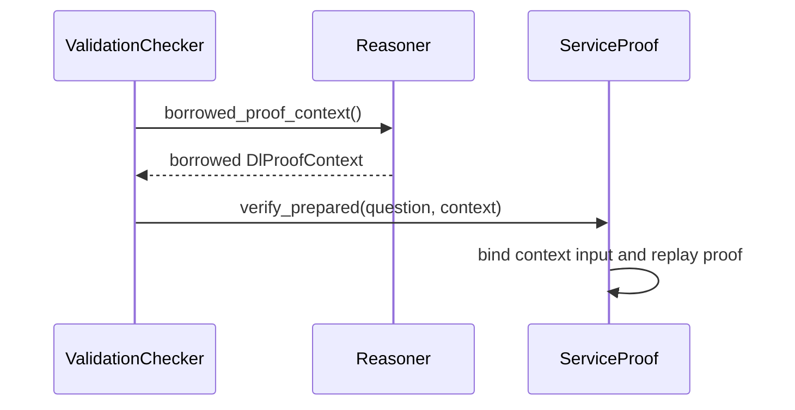

# PR #595 — comments and review threads

5 comment(s). **Every one needs a disposition** in
`review-debt.md`: addressed (with the commit hash) or declined (with the
reason posted in reply). Bot comments count.

## 1. coderabbitai — 

<!-- This is an auto-generated comment: summarize by coderabbit.ai -->
<!-- review_stack_entry_start -->

<a href="https://app.coderabbit.ai/change-stack/Blackcat-Informatics/purrdf/pull/595?scope=REDACTED&amp;cs_source=review_comment"><picture><source media="(prefers-color-scheme: dark)" srcset="https://storage.googleapis.com/coderabbit_public_assets/review-stack-in-coderabbit-ui-dark.svg?v=3"><source media="(prefers-color-scheme: light)" srcset="https://storage.googleapis.com/coderabbit_public_assets/review-stack-in-coderabbit-ui.svg?v=3"></picture></a>

<!-- review_stack_entry_end -->
<!-- This is an auto-generated comment: rate limited by coderabbit.ai -->

> [!WARNING]
> ## Review limit reached
> 
> Your organization has reached its usage spending cap. Adjust your spending cap in the [billing tab](https://app.coderabbit.ai/settings/billing?tab=usage&orgId=b268aba6-a194-4fd6-8ca5-f1a13a313209).
> 
> **Next included review available in 47 minutes.**
> 
> [Check out review usage here](https://app.coderabbit.ai/dashboard/review-capacity?orgId=b268aba6-a194-4fd6-8ca5-f1a13a313209).
> 
> <details>
> <summary><strong>View limit details</strong></summary>
> <dl>
> <dd>
> 
> **Limit details:** You’ve used the included review currently available. Your 91 included PR review attempts over the past 7 days set your current allowance at 1 review per hour.
> 
> [Learn how review limits work](https://docs.coderabbit.ai/management/rate-limits).
> 
> **Review configuration:**
> 
> <details>
> <summary><strong>⚙️ Run configuration</strong></summary>
> <dl>
> <dd>
> 
> - **Configuration used**: defaults
> - **Review profile**: CHILL
> - **Plan**: Team
> - **Run ID**: `22992a14-f3e8-4069-ae6d-a5bc49a85ced`
> 
> </dd>
> </dl>
> </details>
> 
> <details>
> <summary><strong>📥 Commits</strong></summary>
> <dl>
> <dd>
> 
> Reviewing files that changed from the base of the PR and between 925b4a7e79d07273a73572060a93cbec55bacd3a and fe234d4e56ddd8859bae9d1b2d2a54a6f4626bcb.
> 
> </dd>
> </dl>
> </details>
> 
> <details>
> <summary><strong>📒 Files selected for processing: 4</strong></summary>
> <dl>
> <dd>
> 
> * `crates/entail/src/owl_dl/proof.rs`
> * `crates/entail/src/owl_dl/proof/schema_tests.rs`
> * `crates/entail/src/reasoner/proof/current.rs`
> * `docs/WASM_TESTING.md`
> 
> </dd>
> </dl>
> </details>
> 
> </dd>
> </dl>
> </details>

<!-- end of auto-generated comment: rate limited by coderabbit.ai -->

<!-- walkthrough_start -->

<details>
<summary><strong>📝 Walkthrough</strong></summary>
<dl>
<dd>

Proof contexts can now own or borrow prepared knowledge bases. Proof verification accepts prepared contexts, and native validation uses borrowed-context verification. Tests cover parity, binding checks, stop signals, and reuse of the prepared reasoner.

**Changes: Borrowed proof checking**

|Layer / File(s)|Summary|
|:---|:---|
|**Context storage and borrowing API** <br> `crates/entail/src/owl_dl/proof.rs`, `crates/entail/src/reasoner/mod.rs`, `crates/entail/src/reasoner/proof/current.rs`|`DlProofContext` supports owned and borrowed knowledge bases. `Reasoner::borrowed_proof_context` returns a context borrowing the prepared knowledge base, and proof replay APIs accept either lifetime.|
|**Prepared proof verification** <br> `crates/entail/src/reasoner/proof.rs`, `crates/validate/src/regime.rs`|`ServiceProof::verify_prepared` checks against the prepared context identity and performs the existing replay checks. Native validation obtains a borrowed context and uses prepared verification.|
|**Borrowed-context coverage and registration** <br> `crates/entail/src/reasoner/borrowed_tests.rs`, `crates/entail/src/reasoner/mod.rs`, `crates/entail/src/owl_dl/proof.rs`, `crates/entail/src/owl_dl/proof/schema_tests.rs`, `crates/entail/tests/current_clash_support.rs`, `Makefile`, `docs/WASM_TESTING.md`|Tests cover borrowed and owned context parity, input and question checks, stop signals, and reasoner reuse. The new independent prepared-consumer test is registered in the test harness and WASM test command, and the WASM test table lists six cases.|

<!-- change_assessment_start -->
**Priority:** ⬇️ Low


**Estimated code review effort:** 3 (Moderate) | ~25 minutes

<!-- change_assessment_commit:"925b4a7e79d07273a73572060a93cbec55bacd3a" -->
**Change:** Feature
<!-- change_assessment_end -->

### Sequence Diagram(s)



</dd>
</dl>
</details>

<!-- walkthrough_end -->
<details>
<summary><strong>Merge Risk:</strong> <strong>🔵 Low</strong> · up to <code>925b4</code></summary>
<dl>
<dd>

<!-- final_review_risk_start -->
<!-- final_review_risk_label
**Merge Risk:** **🔵 Low** · up to `925b4`
-->
<!-- final_review_risk_coverage:{"sourceCommitId":"925b4a7e79d07273a73572060a93cbec55bacd3a","coveredCommitId":"925b4a7e79d07273a73572060a93cbec55bacd3a","kind":"reviewed"} -->

The WASM test documentation understates the selected cases and executions. Correct the totals; this does not otherwise block merging.
<!-- final_review_risk_end -->

</dd>
</dl>
</details>
<!-- pre_merge_checks_walkthrough_start -->

<details>
<summary><strong>Pre-merge checks: <sup><picture></picture></sup> 4 · <sup><picture></picture></sup> 1</strong></summary>
<dl>
<dd>

<strong><sup><picture></picture></sup> Failed checks: 1 warning</strong>

|     Check name     |                                              Status                                              | Explanation                                                                                                                                                                                               | Resolution                                                                         |
| :---------------- | :----------------------------------------------------------------------------------------------: | :-------------------------------------------------------------------------------------------------------------------------------------------------------------------------------------------------------- | :--------------------------------------------------------------------------------- |
| Docstring Coverage |  | Docstring coverage is 77.55% which is insufficient. The required threshold is 80.00%. Docstring coverage is scoped to functions touched by this diff. Analyzed 49 functions across 8 files. (2 skipped: … | Write docstrings for the functions missing them to satisfy the coverage threshold. |

<details>
<summary><strong><sup><picture></picture></sup> Passed checks: 4 passed</strong></summary>
<dl>
<dd>

|         Check name         |                                             Status                                             | Explanation                                                                                                                                                                                               |
| :------------------------ | :--------------------------------------------------------------------------------------------: | :-------------------------------------------------------------------------------------------------------------------------------------------------------------------------------------------------------- |
|     Linked Issues check    |  | The PR meets the coding requirements in `#594`. `DlProofContext<'kb>` supports owned and borrowed `Kb` storage through one constructor path. `Reasoner::borrowed_proof_context` borrows the prepared knowl… |
| Out of Scope Changes check |  | The changes stay within `#594`. The lifetime changes, shared context constructor, prepared verification method, validation routing, ownership tests, WASM registration, and testing documentation directly… |
|      Description Check     |  | Check skipped - CodeRabbit’s high-level summary is enabled.                                                                                                                                               |
|         Title check        |  | The title clearly and concisely describes the main change: reusing prepared proof contexts and preserving source identity. It matches the pull request objectives and changed APIs.                       |

<details>
<summary><strong>Full details: Linked Issues check</strong></summary>
<dl>
<dd>

**Explanation**

The PR meets the coding requirements in `#594`. `DlProofContext&lt;'kb&gt;` supports owned and borrowed `Kb` storage through one constructor path. `Reasoner::borrowed_proof_context` borrows the prepared knowledge base and returns `ProofsNotRecorded` for unrecorded reasoners. The lifetime prevents mutation during the borrow. `verify_prepared` binds the consumer input identity and reuses the existing claim, receipt, trust-base, and native replay checks without canonicalizing the ontology again. The validation path uses this method after question preparation. Added tests cover storage parity, repeated verification, input and question checks, unrecorded proofs, stop signals, reasoner reuse, and lifetime enforcement. The PR also reports the required native, Clippy, hook, and WASM checks as passing.

</dd>
</dl>
</details>

<details>
<summary><strong>Full details: Out of Scope Changes check</strong></summary>
<dl>
<dd>

**Explanation**

The changes stay within `#594`. The lifetime changes, shared context constructor, prepared verification method, validation routing, ownership tests, WASM registration, and testing documentation directly support borrowed proof-context behavior and its validation. The diff adds no unrelated semantic feature, source filtering, resource cap, machine probe, or runtime dependency. The PR does not claim the excluded `#1803` work.

</dd>
</dl>
</details>

</dd>
</dl>
</details>

<details>
<summary><strong>Full details: Docstring Coverage</strong></summary>
<dl>
<dd>

**Explanation**

Docstring coverage is 77.55% which is insufficient. The required threshold is 80.00%. Docstring coverage is scoped to functions touched by this diff. Analyzed 49 functions across 8 files. (2 skipped: 2 unsupported.)

**Resolution**

Write docstrings for the functions missing them to satisfy the coverage threshold.

</dd>
</dl>
</details>

</dd>
</dl>
</details>

<!-- pre_merge_checks_walkthrough_end -->
<!-- finishing_touch_checkbox_start -->

<details>
<summary><strong>✨ Finishing Touches: 💡 1</strong></summary>
<dl>
<dd>

<!-- finishing_touch_suggestion:docstrings -->
<details open>
<summary><strong>📝 Generate docstrings: 💡</strong></summary>
<dl>
<dd>

- [ ] <!-- {"checkboxId":"3e1879ae-f29b-4d0d-8e06-d12b7ba33d98"} --> Commit to this branch
- [ ] <!-- {"checkboxId":"7962f53c-55bc-4827-bfbf-6a18da830691"} --> Create a new PR

</dd>
</dl>
</details>
<details open>
<summary><strong>🧪 Generate unit tests (beta)</strong></summary>
<dl>
<dd>

- [ ] <!-- {"checkboxId": "6ba7b810-9dad-11d1-80b4-00c04fd430c8", "radioGroupId": "utg-output-choice-group-unknown_comment_id"} --> Commit to this branch
- [ ] <!-- {"checkboxId": "f47ac10b-58cc-4372-a567-0e02b2c3d479", "radioGroupId": "utg-output-choice-group-unknown_comment_id"} --> Create a new PR

</dd>
</dl>
</details>

</dd>
</dl>
</details>

<!-- finishing_touch_checkbox_end -->

<!-- autopilot:start -->
- [ ] <!-- {"checkboxId":"2708ad07-9f24-4260-9c11-7dc76a49f2e3"} --> <strong title="Keep fixing CodeRabbit findings and required CI, and resolving merge conflicts">Autofix</strong> · Keep fixing CodeRabbit findings and required CI, and resolving merge conflicts
<!-- autopilot:end -->
<!-- tips_start -->


<sub>Comment `@coderabbitai help` to get the list of available commands.</sub>

<!-- tips_end -->

## 2. paudley — 

@coderabbitai Fixed the WASM summary using a fresh inventory of every exact selection in the current Makefile: 165 named cases in 28 integration targets, with 175 executions across 33 scalar/SIMD invocations. The inventory covers all current targets, including the graph-free carrier lanes. Added descriptions for the touched fixture, service-assumption check and immutable storage access.

This final push changes documentation only. The executable Rust and test bodies are unchanged, so the passing native and scalar WASM evidence remains applicable. Normal signed hooks passed again. Please refresh the documentation checklist against this update. The actual optimized npm/WASM package CI job remains a separate qualification; the issue stays open until that job passes.

## 3. coderabbitai — 

<!-- This is an auto-generated reply by CodeRabbit -->
> [!TIP]
> For best results, initiate chat on the files or code changes.

<details>
<summary>🧩 Analysis chain</summary>

🏁 Script executed:

```shell
#!/bin/bash
set -euo pipefail
git log -3 --format='%h %s' --stat
fd -i 'WASM_TESTING|Makefile'
ast-grep outline Makefile || true
rg -n -C 4 '165|175|28|33|graph.free|fixture|assumption|immutable|optimized|npm|borrow' docs/WASM_TESTING.md
rg -n -A 200 '^wasm-test' Makefile
git show --format=fuller --stat HEAD
```

Length of output: 35834

---

🏁 Script executed:

```shell
#!/bin/bash
set -euo pipefail
git show --format=short --no-ext-diff HEAD
python - <<'PY'
from pathlib import Path
import re, shlex
s = Path('Makefile').read_text()
s = s[s.index('\nwasm-test:')+1:]
m = re.search(r'\n[^\s#][^\n]*:', s[s.index('\n')+1:])
if m:
    s = s[:s.index('\n')+1+m.start()]
s = s.replace('\\\n', ' ')
pat = r'cargo test --locked --target wasm32-unknown-unknown -p (\S+) --test (\S+) -- --exact\s+(.*?)(?=&&|;|\n|$)'
rows = []
for m in re.finditer(pat, s):
    cases = shlex.split(m[3])
    rows.append((m[1], m[2], cases))
unique = {(p,t,c) for p,t,cs in rows for c in cs}
print('INVENTORY')
for p,t,cs in rows:
    print(p, t, len(cs))
print('named cases:',len(unique))
print('integration targets:',len({(p,t) for p,t,cs in rows}))
print('executions:',sum(len(cs) for p,t,cs in rows))
print('invocations:',len(rows))
PY
sed -n '1,145p' docs/WASM_TESTING.md
```

Length of output: 24487

---

</details>

`@paudley`, I checked commit `533831fa` and refreshed the documentation checklist.

- [x] **Inventory totals match the Makefile:** 165 named cases in 28 integration targets, with 175 executions across 33 scalar/SIMD invocations.
- [x] **The inventory includes graph-free carrier selections.**
- [x] **The final commit changes documentation only.** The three Rust additions are doc comments for the fixture, service-assumption check, and immutable storage access. Executable Rust and test bodies are unchanged.
- [x] **The six-case `current_clash_support` description includes borrowed-context replay and reasoner reuse.**
- [ ] **The detailed table still needs alignment with the Makefile:**
  - `triple_carrier` selects **six** cases, not five.
  - `rules_runtime` selects **five** `triple_` cases, not four.
  - `host_identity` selects **three** `triple_` cases, not two.
  - The table omits `purrdf-xsd / any_uri` and `purrdf-sparql-eval / statement_indexes`. The latter runs in both scalar and SIMD builds.
- [ ] **Optimized npm/WASM package CI remains a separate qualification.** The issue must stay open until that job passes.

The documentation-only diff does not invalidate your reported native and scalar WASM results. I did not rerun those tests or independently verify the hook results.

Thanks for clarifying the package qualification boundary.

---

<details>
<summary>✏️ Learnings added</summary>

```
Learnt from: paudley
URL: https://github.com/Blackcat-Informatics/purrdf/pull/595

Timestamp: 2026-10-17T21:54:52.123Z
Learning: For Blackcat-Informatics/purrdf, focused scalar/SIMD execution through `make wasm-test` does not establish optimized npm/WASM package qualification. For PR #595, the associated qualification issue must remain open until the actual optimized npm/WASM package CI job passes.
```

> Note: Learnings are effective only in the context of similar code segments. To apply general coding guidelines, please configure [review instructions](https://docs.coderabbit.ai/guides/review-instructions). You can manage existing learnings in the [app](https://app.coderabbit.ai/learnings).

</details>

_You are interacting with an AI system._

## 4. paudley — 

@coderabbitai The detailed table now matches all 28 selected targets. It includes the three exact anyURI cases, both statement-index cases in scalar and SIMD, all shared BLAKE3 selections, and the corrected six/five/three graph-free case counts. The table is contiguous Markdown. A direct source/table comparison found no missing or extra target, and the complete selection inventory still gives 165 named cases, 175 executions and 33 invocations.

This additional commit changes only the documentation table. Normal signed hooks passed; executable Rust, test bodies and proof fixtures remain unchanged. The existing native/scalar WASM results are reused for that unchanged execution. The three added function descriptions are also retained. Packaged npm/WASM qualification is still separately pending and the issue remains open. Please refresh the documentation checklist.

## 5. coderabbitai — 

<!-- This is an auto-generated reply by CodeRabbit -->
> [!TIP]
> For best results, initiate chat on the files or code changes.

<details>
<summary>🧩 Analysis chain</summary>

🏁 Script executed:

```shell
#!/bin/bash
set -euo pipefail
git log -3 --format='%h %s' --stat
git show --format=short --no-ext-diff HEAD
ast-grep outline Makefile || true
ast-grep outline docs/WASM_TESTING.md || true
sed -n '1,200p' docs/WASM_TESTING.md
python - <<'PY'
from pathlib import Path
import re, shlex
s = Path('Makefile').read_text()
s = s[s.index('\nwasm-test:')+1:]
m = re.search(r'\n[^\s#][^\n]*:', s[s.index('\n')+1:])
if m:
    s = s[:s.index('\n')+1+m.start()]
s = s.replace('\\\n', ' ')
pat = r'cargo test --locked --target wasm32-unknown-unknown -p (\S+) --test (\S+) -- --exact\s+(.*?)(?=&&|;|\n|$)'
rows = [(m[1], m[2], shlex.split(m[3])) for m in re.finditer(pat, s)]
for p,t,cs in rows:
    print(f'{p} / {t}: {len(cs)}: {" ".join(cs)}')
print('named cases:',len({(p,t,c) for p,t,cs in rows for c in cs}))
print('integration targets:',len({(p,t) for p,t,cs in rows}))
print('executions:',sum(len(cs) for p,t,cs in rows))
print('invocations:',len(rows))
doc = Path('docs/WASM_TESTING.md').read_text()
table = []
for line in doc.splitlines():
    if line.startswith('|'):
        cells = [c.strip() for c in line.strip('|').split('|')]
        if len(cells) >= 2:
            p = re.findall(r'`([^`]+)`', cells[0])
            t = re.findall(r'`([^`]+)`', cells[1])
            if len(p)==1 and len(t)==1:
                table.append((p[0],t[0]))
actual = {(p,t) for p,t,cs in rows}
print('parsed table targets:', len(table))
print('missing table targets:', sorted(actual-set(table)))
print('extra table targets:', sorted(set(table)-actual))
PY
```

Length of output: 43898

---

🏁 Script executed:

```shell
#!/bin/bash
set -euo pipefail
python - <<'PY'
from pathlib import Path
import re, shlex
s = Path('Makefile').read_text()
s = s[s.index('\nwasm-test:')+1:]
m = re.search(r'\n[^\s#][^\n]*:', s[s.index('\n')+1:])
if m:
    s = s[:s.index('\n')+1+m.start()]
s = s.replace('\\\n', ' ')
pat = r'cargo test --locked --target wasm32-unknown-unknown -p (\S+) --test (\S+) -- --exact\s+(.*?)(?=&&|;|\n|$)'
actual = {}
for m in re.finditer(pat,s):
    actual.setdefault((m[1],m[2]),set()).update(shlex.split(m[3]))
doc = Path('docs/WASM_TESTING.md').read_text()
table = set()
explicit = {}
indexes = []
for i,line in enumerate(doc.splitlines()):
    if not line.startswith('|'):
        continue
    cells = [c.strip() for c in line.strip('|').split('|')]
    names = re.findall(r'`([^`]+)`',cells[0])
    if len(names)!=2:
        continue
    key = tuple(names)
    table.add(key)
    indexes.append(i)
    cases = re.findall(r'`([^`]+)`',cells[2])
    cases = [c for c in cases if c not in ('make wasm-test','triple_')]
    explicit.setdefault(key,set()).update(cases)
print('Unique table targets:',len(table))
print('Missing targets:',sorted(set(actual)-table))
print('Extra targets:',sorted(table-set(actual)))
print('Table data rows contiguous:',indexes == list(range(min(indexes),max(indexes)+1)))
print('Explicit table cases not selected:',[(key,sorted(cs-actual.get(key,set()))) for key,cs in explicit.items() if cs-actual.get(key,set())])
for key in [('purrdf-xsd','any_uri'),('purrdf-sparql-eval','statement_indexes'),('purrdf-hash-conformance','blake3')]:
    print(key,'exact case coverage:', explicit.get(key)==actual[key])
PY
git show 533831fa --format=short -- crates/entail/src/owl_dl/proof.rs crates/entail/src/owl_dl/proof/schema_tests.rs crates/entail/src/reasoner/proof/current.rs
rg -n -C2 '///.*(fixture|assumption|storage)|//.*(fixture|assumption|storage)' crates/entail/src/owl_dl/proof.rs crates/entail/src/owl_dl/proof/schema_tests.rs crates/entail/src/reasoner/proof/current.rs
```

Length of output: 13384

---

</details>

`@paudley` I checked commit `fe234d4e` and refreshed the documentation checklist.

- [x] **Target coverage:** The table covers all 28 selected targets, with no missing or extra target.
- [x] **Selection totals:** The Makefile confirms 165 named cases, 175 executions, and 33 scalar/SIMD invocations.
- [x] **Added selections:** The table includes all three `any_uri` cases, both `statement_indexes` cases on scalar and SIMD, and all shared BLAKE3 selections.
- [x] **Graph-free counts:** `triple_carrier`, `rules_runtime`, and `host_identity` correctly report six, five, and three cases.
- [x] **Markdown structure:** The table rows are contiguous.
- [x] **Commit scope:** The latest commit changes only `docs/WASM_TESTING.md`. Executable Rust, test bodies, and proof fixtures are unchanged.
- [x] **Function descriptions:** All three descriptions remain present.
- [ ] **Optimized npm/WASM package qualification:** Still pending. Consistent with your earlier guidance, the qualification issue remains open until that CI job passes.

The documentation mismatch is addressed. This documentation-only update does not invalidate your reported native and scalar WASM results. I did not rerun tests or independently verify the signed hooks.


---

<details>
<summary>🧠 Learnings used</summary>

```
Learnt from: paudley
URL: https://github.com/Blackcat-Informatics/purrdf/pull/595

Timestamp: 2026-10-17T21:54:52.305Z
Learning: For Blackcat-Informatics/purrdf, focused scalar/SIMD execution through `make wasm-test` does not establish optimized npm/WASM package qualification. For PR #595, the associated qualification issue must remain open until the actual optimized npm/WASM package CI job passes.
```

</details>

_You are interacting with an AI system._

