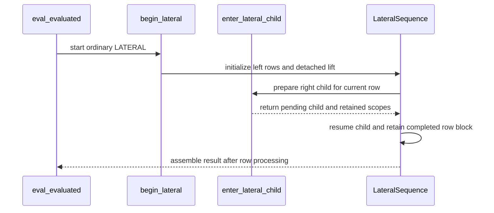

# PR #546 — comments and review threads

1 comment(s). **Every one needs a disposition** in
`review-debt.md`: addressed (with the commit hash) or declined (with the
reason posted in reply). Bot comments count.

## 1. coderabbitai — 

<!-- This is an auto-generated comment: summarize by coderabbit.ai -->
<!-- review_stack_entry_start -->

<a href="https://app.coderabbit.ai/change-stack/Blackcat-Informatics/purrdf/pull/546?scope=ghh_OusAJGA4HG8ljoOV0wJvVx8NmnZIjc2DdjmxOu0xZWA&amp;cs_source=review_comment"><picture><source media="(prefers-color-scheme: dark)" srcset="https://storage.googleapis.com/coderabbit_public_assets/review-stack-in-coderabbit-ui-dark.svg?v=3"><source media="(prefers-color-scheme: light)" srcset="https://storage.googleapis.com/coderabbit_public_assets/review-stack-in-coderabbit-ui.svg?v=3"></picture></a>

<!-- review_stack_entry_end -->
<!-- This is an auto-generated comment: skip review by coderabbit.ai -->

> [!IMPORTANT]
> ## Review skipped
> 
> Review was skipped as selected files did not have any reviewable changes.
> 
> 
> 
> 
> 
> 

> 
<strong>⚙️ Run configuration</strong>

> <dl>
> <dd>
> 
> - **Configuration used**: defaults
> - **Review profile**: CHILL
> - **Plan**: Team
> - **Run ID**: `6ce6b54a-f8e5-41c2-a304-e7df62d77597`
> 
> </dd>
> </dl>
> 

> 
> 

> 
<strong>📥 Commits</strong>

> <dl>
> <dd>
> 
> Reviewing files that changed from the base of the PR and between cb164c1085f9558602ceb08e3414a49822432157 and 9e87ee8a2e825fb5237a938ebe148e3ddc9327db.
> 
> </dd>
> </dl>
> 

> 
> You can disable this status message by setting the `reviews.review_status` to `false` in the CodeRabbit configuration file.
> 
> Use the checkbox below for a quick retry:
> - [ ] <!-- {"checkboxId":"e9bb8d72-00e8-4f67-9cb2-caf3b22574fe"} --> 🔍 Trigger review

<!-- end of auto-generated comment: skip review by coderabbit.ai -->

<!-- walkthrough_start -->

<strong>📝 Walkthrough</strong>

<dl>
<dd>

The PR adds resumable evaluation paths for SPARQL FILTER, EXISTS, and LATERAL operations. It also adds shared projected views and updates independent test coverage, CI timeouts, and documentation records.

**Changes: Resumable SPARQL Evaluation**

|Layer / File(s)|Summary|
|:---|:---|
|**Projected ownership and child paths**   `crates/lex/src/allocation/*`, `crates/rdf-core/src/small.rs`, `crates/sparql-algebra/src/walk.rs`, `crates/sparql-eval/src/workspace.rs`|Adds shared projected views that retain their original allocation, adds `NodeRef::at_path`, and exposes the projected workspace wrapper and selected test fixtures within the crate.|
|**VM expression ownership and FILTER resumption**   `crates/sparql-eval/src/vm/*`, `crates/sparql-eval/src/cdt_agg.rs`, `crates/sparql-eval/src/cdt_unfold.rs`, `crates/sparql-eval/src/modifier.rs`, `crates/sparql-eval/src/property_fn_eval.rs`, `crates/sparql-eval/src/shapes/barrier.rs`|The VM resolves EXISTS sites through retained expression owners and operand paths. It can suspend and resume FILTER rows. Call sites now pass expression context where needed.|
|**Resumable FILTER and EXISTS evaluation**   `crates/sparql-eval/src/expr.rs`|FILTER and EXISTS evaluation retain child state across suspension. Prepared copied patterns retain their owners, and tests cover restoration and expression ownership.|
|**Iterative evaluation and scope restoration**   `crates/sparql-eval/src/eval.rs`, `crates/sparql-eval/src/governor/lift.rs`, `crates/sparql-eval/src/modifier.rs`|FILTER, Slice, and LATERAL use an iterative evaluation path. Shared node boundaries and transferable restore tokens manage scope and node state.|
|**Per-row LATERAL sequences**   `crates/sparql-eval/src/binop.rs`, `crates/sparql-eval/tests/stack_refusal.rs`|LATERAL prepares and evaluates its right child per left row, retains scopes until child completion, and assembles completed row blocks. Stack-refusal tests now distinguish native and WASM behavior.|

**Float-Environment Refusal Evidence**

|Layer / File(s)|Summary|
|:---|:---|
|**MXCSR refusal helpers and tests**   `crates/hnsw/tests/float_environment*.rs`, `crates/hnsw/tests/support/fixture.rs`, `crates/rdf-core/src/distance/*tests.rs`|HNSW tests use shared FTZ refusal helpers. RDF-core tests expect MXCSR evidence on supported x86 targets and check x87 control-word restoration.|

**Query Scope Counter Coverage**

|Layer / File(s)|Summary|
|:---|:---|
|**Decision and admission counter tests**   `crates/rdf-core/src/query_scope/counters.rs`|Tests cover separate undecided and rejected counts, callback failure, and admission behavior when temporary capacity is exhausted.|

**CI Job Timeouts**

|Layer / File(s)|Summary|
|:---|:---|
|**Test and package job budgets**   `.github/workflows/ci.yaml`|The test-shard, wasm-package, and pytest timeouts increase from 30 to 45 minutes. Comments describe the work included in each budget.|

**Python Retrieval Test Matching**

|Layer / File(s)|Summary|
|:---|:---|
|**Compiled producer-call matching**   `bindings/python/tests/test_retrieval.py`|The producer-call matcher captures nested arguments and matches through the closing brace and trailing LIMIT.|

**Geometry Measurement Call**

|Layer / File(s)|Summary|
|:---|:---|
|**Coordinate copier argument**   `crates/geo-kernel/src/measure.rs`|`geometry_n_with_memory` passes the optional copier by value to `Option::map`.|

**Documentation and Measurement Records**

|Layer / File(s)|Summary|
|:---|:---|
|**Qualified API references**   `crates/retrieval/src/search.rs`, `crates/sparql-eval/src/engine.rs`, `crates/sparql-eval/src/geo/relation.rs`, `crates/sparql-eval/src/property_fn_eval.rs`|Documentation links now qualify crate items, including `fuse`, `TermValue`, relation identity, and `PfCursor::take_work`.|
|**Conformance and SIMD records**   `docs/CONFORMANCE.md`, `docs/design/purrdf-simd.md`|The documented Python binding pass count and SIMD audit counts are updated.|

<!-- change_assessment_start -->
**Priority:** ➖ Normal

**Estimated code review effort:** 5 (Critical) | ~90 minutes

<!-- change_assessment_commit:"cb164c1085f9558602ceb08e3414a49822432157" -->
**Change:** Bug fix
<!-- change_assessment_end -->

### Sequence Diagram(s)

**Possibly related PRs**
- [Blackcat-Informatics/purrdf#205](https://github.com/Blackcat-Informatics/purrdf/pull/205): Adds correlated LATERAL evaluation, which this PR refactors into resumable per-row states.
- [Blackcat-Informatics/purrdf#398](https://github.com/Blackcat-Informatics/purrdf/pull/398): Adds seeded correlated EXISTS evaluation, which this PR changes to support suspension and resumption.

**Suggested labels:** `bug`

</dd>
</dl>

<!-- walkthrough_end -->

<strong>Merge Risk:</strong> <strong>🔵 Low</strong> · up to <code>cb164</code>

<dl>
<dd>

<!-- final_review_risk_start -->
<!-- final_review_risk_label
**Merge Risk:** **🔵 Low** · up to `cb164`
-->
<!-- final_review_risk_coverage:{"sourceCommitId":"cb164c1085f9558602ceb08e3414a49822432157","coveredCommitId":"cb164c1085f9558602ceb08e3414a49822432157","kind":"reviewed"} -->

The nested evaluator rework appears sound for normal and error paths. If evaluation panics, some per-query bookkeeping can remain stale for a later evaluation on the same context. This is a narrow follow-up item, not a blocker.
<!-- final_review_risk_end -->

</dd>
</dl>

<!-- pre_merge_checks_walkthrough_start -->

<strong>Pre-merge checks: <picture></picture> 2 · <picture></picture> 1 · <picture></picture> 2</strong>

<dl>
<dd>

<strong><picture></picture> Failed checks: 1 warning · 2 inconclusive</strong>

|         Check name         |                                                   Status                                                   | Explanation                                                                                                                                                                                               | Resolution                                                                                                                                                                                                                                        |
| :------------------------ | :--------------------------------------------------------------------------------------------------------: | :-------------------------------------------------------------------------------------------------------------------------------------------------------------------------------------------------------- | :------------------------------------------------------------------------------------------------------------------------------------------------------------------------------------------------------------------------------------------------ |
| Out of Scope Changes check |            | The evaluator work in `crates/sparql-eval` is in scope. Several changes have no demonstrated connection to `#531` or nested evaluator suspension, including the Python retrieval regex change, the `crates… | Remove unrelated production, test, and documentation changes from this pull request, or link each change to a concrete `#531` coding requirement and provide evidence of that connection.                                                           |
|     Linked Issues check    |  | `#531` requires refreshing the retained test artifact with normal Cargo under the canonical target path, preserving the exact directory-identity assertion, and completing the previously unexecuted local… | Provide reviewable evidence from a normal Cargo build and the completed local gate. The evidence must show the affected executable uses the canonical `CARGO_TARGET_TMPDIR` path and that the exact identity assertion remains enabled and passe… |
|     Docstring Coverage     |  | Docstring coverage is 50.60% which is insufficient. The required threshold is 80.00%. Docstring coverage is scoped to functions touched by this diff. Analyzed 166 functions across 27 files. (4 skipped… | Write docstrings for the functions missing them to satisfy the coverage threshold.                                                                                                                                                                |

<strong><picture></picture> Passed checks: 2 passed</strong>

<dl>
<dd>

|     Check name    |                                             Status                                             | Explanation                                                                                                         |
| :--------------- | :--------------------------------------------------------------------------------------------: | :------------------------------------------------------------------------------------------------------------------ |
| Description Check |  | Check skipped - CodeRabbit’s high-level summary is enabled.                                                         |
|    Title check    |  | The title clearly and concisely describes the main change: suspending nested evaluator children on admitted frames. |

</dd>
</dl>

<strong>Full details: Linked Issues check</strong>

<dl>
<dd>

**Explanation**

`#531` requires refreshing the retained test artifact with normal Cargo under the canonical target path, preserving the exact directory-identity assertion, and completing the previously unexecuted local-gate steps. The PR description reports a full local gate, but the reviewed changes and summary provide no receipt or other reviewable evidence that the affected artifact was refreshed or that those specific steps completed. The evaluator suspension implementation and its tests are present.

**Resolution**

Provide reviewable evidence from a normal Cargo build and the completed local gate. The evidence must show the affected executable uses the canonical `CARGO_TARGET_TMPDIR` path and that the exact identity assertion remains enabled and passes.

</dd>
</dl>

<strong>Full details: Out of Scope Changes check</strong>

<dl>
<dd>

**Explanation**

The evaluator work in `crates/sparql-eval` is in scope. Several changes have no demonstrated connection to `#531` or nested evaluator suspension, including the Python retrieval regex change, the `crates/geo-kernel/src/measure.rs` ownership change, HNSW floating-point test refactoring, and unrelated retrieval and SIMD documentation edits. These are production or test changes outside the linked evaluator follow-up.

</dd>
</dl>

<strong>Full details: Docstring Coverage</strong>

<dl>
<dd>

**Explanation**

Docstring coverage is 50.60% which is insufficient. The required threshold is 80.00%. Docstring coverage is scoped to functions touched by this diff. Analyzed 166 functions across 27 files. (4 skipped: 3 unsupported, 1 too large.)

</dd>
</dl>

</dd>
</dl>

<!-- pre_merge_checks_walkthrough_end -->
<!-- finishing_touch_checkbox_start -->

<strong>✨ Finishing Touches: 💡 2</strong>

<dl>
<dd>

<!-- finishing_touch_suggestion:docstrings -->

<strong>📝 Generate docstrings: 💡</strong>

<dl>
<dd>

- [ ] <!-- {"checkboxId":"3e1879ae-f29b-4d0d-8e06-d12b7ba33d98"} --> Commit to this branch
- [ ] <!-- {"checkboxId":"7962f53c-55bc-4827-bfbf-6a18da830691"} --> Create a new PR

</dd>
</dl>

<!-- finishing_touch_suggestion:resolve_merge_conflict -->

<strong>⚔️ Resolve merge conflicts: 💡</strong>

<dl>
<dd>

- [ ] <!-- {"checkboxId":"c3a5b2e1-4d7f-4a8c-b9d6-e1f2c3d4a5b6"} --> Resolve merge conflict in branch `paudley/531-evaluator-delivery-follow-up-relocated`

</dd>
</dl>

<strong>🧪 Generate unit tests (beta)</strong>

<dl>
<dd>

- [ ] <!-- {"checkboxId": "6ba7b810-9dad-11d1-80b4-00c04fd430c8", "radioGroupId": "utg-output-choice-group-unknown_comment_id"} --> Commit to this branch
- [ ] <!-- {"checkboxId": "f47ac10b-58cc-4372-a567-0e02b2c3d479", "radioGroupId": "utg-output-choice-group-unknown_comment_id"} --> Create a new PR

</dd>
</dl>

</dd>
</dl>

<!-- finishing_touch_checkbox_end -->

<!-- autopilot:start -->
- [ ] <!-- {"checkboxId":"2708ad07-9f24-4260-9c11-7dc76a49f2e3"} --> <strong title="Keep fixing CodeRabbit findings and required CI, and resolving merge conflicts">Autofix</strong> · Keep fixing CodeRabbit findings and required CI, and resolving merge conflicts
<!-- autopilot:end -->
<!-- tips_start -->

Comment `@coderabbitai help` to get the list of available commands.

<!-- tips_end -->

