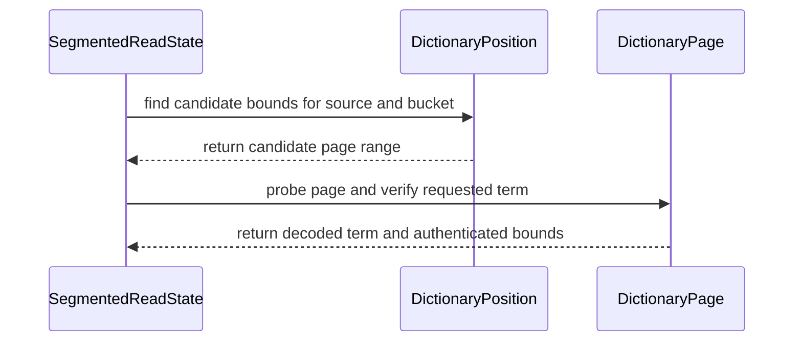

# PR #561 — comments and review threads

2 comment(s). **Every one needs a disposition** in
`review-debt.md`: addressed (with the commit hash) or declined (with the
reason posted in reply). Bot comments count.

## 1. coderabbitai — 

<!-- This is an auto-generated comment: summarize by coderabbit.ai -->
<!-- review_stack_entry_start -->

<a href="https://app.coderabbit.ai/change-stack/Blackcat-Informatics/purrdf/pull/561?scope=ghh_OusAJGA4HG8ljoOV0wJvVx8NmnZIjc2DdjmxOu0xZWA&amp;cs_source=review_comment"><picture><source media="(prefers-color-scheme: dark)" srcset="https://storage.googleapis.com/coderabbit_public_assets/review-stack-in-coderabbit-ui-dark.svg?v=3"><source media="(prefers-color-scheme: light)" srcset="https://storage.googleapis.com/coderabbit_public_assets/review-stack-in-coderabbit-ui.svg?v=3"></picture></a>

<!-- review_stack_entry_end -->
<!-- recent_review_start -->

No actionable comments were generated in the recent review. 🎉

<strong>ℹ️ Recent review info</strong>

<dl>
<dd>

<strong>⚙️ Run configuration</strong>

<dl>
<dd>

- **Configuration used**: defaults
- **Review profile**: CHILL
- **Plan**: Team
- **Run ID**: `7427e1e9-18b2-49a8-bbe6-9c19d5952d2a`

</dd>
</dl>

<strong>📥 Commits</strong>

<dl>
<dd>

Reviewing files that changed from the base of the PR and between a94af3ab284022bc824dc99bbb2e70b59ad0b07e and 225e078dac493840d293ecb4e03cfea10a254498.

</dd>
</dl>

<strong>📒 Files selected for processing: 4</strong>

<dl>
<dd>

* `crates/rdf-core/src/ir/segmented/session.rs`
* `crates/rdf-core/tests/segmented.rs`
* `docs/design/purrdf-segmented-query-storage.md`
* `helpers-ledger.toml`

</dd>
</dl>

<strong>🚧 Files skipped from review as they are similar to previous changes: 1</strong>

<dl>
<dd>

* helpers-ledger.toml

</dd>
</dl>

**Included review availability:** This review used your included allowance. 2 included reviews remain after this review. Your included PR review attempts over the past 7 days set your current allowance at 4 reviews per hour.

</dd>
</dl>

<!-- recent_review_end -->
<!-- walkthrough_start -->

<strong>📝 Walkthrough</strong>

<dl>
<dd>

The segmented builder now grows storage with input and packs dictionary records to block-byte limits. The reader retains authenticated dictionary ID ranges as budgeted routing metadata and uses them to locate terms. Tests, design documentation, and capacity-proof records reflect these changes.

**Changes: Segmented storage**

|Layer / File(s)|Summary|
|:---|:---|
|**Byte-aware block construction**   `crates/rdf-core/src/ir/segmented/format.rs`, `crates/rdf-core/src/ir/segmented/build.rs`, `crates/rdf-core/tests/segmented.rs`, `crates/sparql-eval/tests/segmented_query.rs`, `docs/design/purrdf-segmented-query-storage.md`, `helpers-ledger.toml`|Dictionary blocks now stop before an encoded record exceeds the byte limit and report how many records they contain. Builder storage grows as input arrives, while construction limits remain enforced. Tests and supporting records cover these behaviors.|
|**Authenticated dictionary routing**   `crates/rdf-core/src/ir/segmented/session.rs`, `crates/rdf-core/src/ir/segmented/session/cache.rs`, `crates/rdf-core/tests/segmented.rs`, `docs/design/purrdf-segmented-query-storage.md`|The reader retains authenticated, source-qualified dictionary ID ranges and uses them to narrow term-page searches. Cache accounting includes routing capacity, and routing entries can remain after payload eviction.|

<!-- change_assessment_start -->
**Priority:** ➖ Normal

**Estimated code review effort:** 4 (Complex) | ~45 minutes

<!-- change_assessment_commit:"225e078dac493840d293ecb4e03cfea10a254498" -->
**Change:** Bug fix · **Severity of issue fixed:** Medium
<!-- change_assessment_end -->

### Sequence Diagram(s)

</dd>
</dl>

<!-- walkthrough_end -->

<strong>Merge Risk:</strong> <strong>⚪ Minimal</strong> · up to <code>225e0</code>

<dl>
<dd>

<!-- final_review_risk_start -->
<!-- final_review_risk_label
**Merge Risk:** **⚪ Minimal** · up to `225e0`
-->
<!-- final_review_risk_coverage:{"sourceCommitId":"225e078dac493840d293ecb4e03cfea10a254498","coveredCommitId":"225e078dac493840d293ecb4e03cfea10a254498","kind":"reviewed"} -->

The previously identified routing-budget failure is addressed; no actionable merge-blocking risk remains after normal checks.
<!-- final_review_risk_end -->

</dd>
</dl>

<!-- pre_merge_checks_walkthrough_start -->

<strong>Pre-merge checks: <picture></picture> 4 · <picture></picture> 1</strong>

<dl>
<dd>

<strong><picture></picture> Failed checks: 1 warning</strong>

|     Check name     |                                              Status                                              | Explanation                                                                                                                                                                                               | Resolution                                                                         |
| :---------------- | :----------------------------------------------------------------------------------------------: | :-------------------------------------------------------------------------------------------------------------------------------------------------------------------------------------------------------- | :--------------------------------------------------------------------------------- |
| Docstring Coverage |  | Docstring coverage is 40.00% which is insufficient. The required threshold is 80.00%. Docstring coverage is scoped to functions touched by this diff. Analyzed 35 functions across 8 files. (2 skipped: … | Write docstrings for the functions missing them to satisfy the coverage threshold. |

<strong><picture></picture> Passed checks: 4 passed</strong>

<dl>
<dd>

|         Check name         |                                             Status                                             | Explanation                                                                                                                                                                                               |
| :------------------------ | :--------------------------------------------------------------------------------------------: | :-------------------------------------------------------------------------------------------------------------------------------------------------------------------------------------------------------- |
|      Description Check     |  | Check skipped - CodeRabbit’s high-level summary is enabled.                                                                                                                                               |
|         Title check        |  | The title clearly summarizes both main changes: byte-based dictionary block packing and builder capacity growth with input.                                                                               |
|     Linked Issues check    |  | Issue `#560` requires byte-based dictionary packing and resident capacity growth during input. `format::record_block` admits records until the encoded fence and framing would exceed `block_bytes`, retur… |
| Out of Scope Changes check |  | The changed builder and format code implement Issue `#560` directly. Session routing and cache changes support lookup of byte-packed variable-population blocks and preserve the stated ownership and resi… |

<strong>Full details: Linked Issues check</strong>

<dl>
<dd>

**Explanation**

Issue `#560` requires byte-based dictionary packing and resident capacity growth during input. `format::record_block` admits records until the encoded fence and framing would exceed `block_bytes`, returns the consumed count, and returns `ConstructionLimit` when the first record cannot fit. `SegmentedBuilder::new` creates an empty `RdfDatasetBuilder` and keeps term, byte, and row ceilings as admission limits. The header and lookup code accept variable dictionary and reverse block populations. The supplied validation summary reports coverage for packing, refusal, allocation growth, unequal block counts, and lookup.

</dd>
</dl>

<strong>Full details: Out of Scope Changes check</strong>

<dl>
<dd>

**Explanation**

The changed builder and format code implement Issue `#560` directly. Session routing and cache changes support lookup of byte-packed variable-population blocks and preserve the stated ownership and residency behavior. Tests, design documentation, and helper-ledger corrections support validation and maintenance of these changes. No unrelated current change is demonstrated.

</dd>
</dl>

</dd>
</dl>

<strong>Full details: Docstring Coverage</strong>

<dl>
<dd>

**Explanation**

Docstring coverage is 40.00% which is insufficient. The required threshold is 80.00%. Docstring coverage is scoped to functions touched by this diff. Analyzed 35 functions across 8 files. (2 skipped: 2 unsupported.)

**Resolution**

Write docstrings for the functions missing them to satisfy the coverage threshold.

</dd>
</dl>

</dd>
</dl>

<!-- pre_merge_checks_walkthrough_end -->

- [ ] <!-- {"checkboxId":"585bb3f6-faf5-4dbf-96d2-74e382adf19a"} --> Fix all pre-merge checks with AI
<!-- finishing_touch_checkbox_start -->

<strong>✨ Finishing Touches: 💡 1</strong>

<dl>
<dd>

<!-- finishing_touch_suggestion:docstrings -->

<strong>📝 Generate docstrings: 💡</strong>

<dl>
<dd>

- [ ] <!-- {"checkboxId":"3e1879ae-f29b-4d0d-8e06-d12b7ba33d98"} --> Commit to this branch
- [ ] <!-- {"checkboxId":"7962f53c-55bc-4827-bfbf-6a18da830691"} --> Create a new PR

</dd>
</dl>

<strong>🧪 Generate unit tests (beta)</strong>

<dl>
<dd>

- [ ] <!-- {"checkboxId": "6ba7b810-9dad-11d1-80b4-00c04fd430c8", "radioGroupId": "utg-output-choice-group-unknown_comment_id"} --> Commit to this branch
- [ ] <!-- {"checkboxId": "f47ac10b-58cc-4372-a567-0e02b2c3d479", "radioGroupId": "utg-output-choice-group-unknown_comment_id"} --> Create a new PR

</dd>
</dl>

</dd>
</dl>

<!-- finishing_touch_checkbox_end -->

<!-- autopilot:start -->
- [ ] <!-- {"checkboxId":"2708ad07-9f24-4260-9c11-7dc76a49f2e3"} --> <strong title="Keep fixing CodeRabbit findings and required CI, and resolving merge conflicts">Autofix</strong> · Keep fixing CodeRabbit findings and required CI, and resolving merge conflicts
<!-- autopilot:end -->
<!-- tips_start -->

Comment `@coderabbitai help` to get the list of available commands.

<!-- tips_end -->

## 2. paudley — 

The public construction, packing, refusal, reader ownership and spare-capacity
routing contracts are documented in Rust and the storage design guide. The
repository's documentation checks pass. The generic 80% docstring warning names
no missing public contract, so I’m declining an additional private-function quota
and the generated-docstring/test follow-ons. The actual growth, fit, refusal,
ownership, native/portable and full-consumer regressions are already covered.

