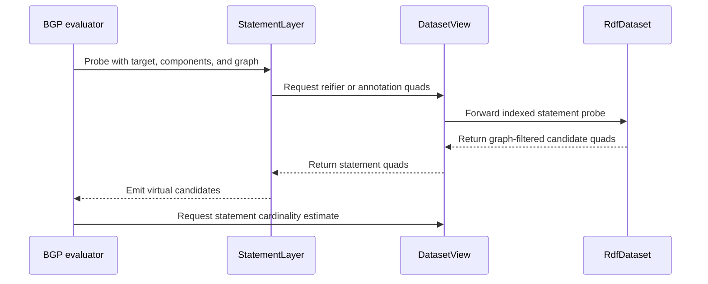

# PR #555 — comments and review threads

5 comment(s). **Every one needs a disposition** in
`review-debt.md`: addressed (with the commit hash) or declined (with the
reason posted in reply). Bot comments count.

## 1. paudley — 

# Ordered statement access

## Contract and constraints

Deliver the complete issue contract: range-addressed triple-to-reifier access,
component probes and annotation predicate/object probes used by DatasetView,
the statement layer and planner. Preserve RDF identity, graphs, multiplicity,
first read errors and exact physical admission. Native resident carriers should
index these directions; other backends must retain correct scanning defaults
and identify them honestly in EXPLAIN. Prove real queries on ten million
reifiers with six annotations, and unchanged RDF 1.2 conformance.

Use the existing ordinal-permutation and allocation homes; no dependency,
second sorting implementation, graph slot in graph-free storage, or silent
allocation fallback. Follow backend-contract C0/C1/C2 and applicable G clauses.
The consumer ADR cited by the issue is unavailable locally; no claim of having
read it is made. Main is protected. Use standard Cargo directories, bounded
jobs and fixed-work evidence; elapsed time is not acceptance.

Stage intake reports no earlier branch, PR or cited commit for this issue in
its searched scope. The newly landed triple-only carrier already provides
target and annotation orders and is the implementation precedent. The recent
segmented repair supplies bound-reifier delegation and must remain intact.
Statistics beyond these access paths belong to their existing separate issue,
but estimates for the new probes are part of this delivery.

No subagents are used. Owner review is not independent review. Obtain actual
forge source review during publication; never invent a reviewer verdict.

## Task 1: Resident target range and admission

Share the existing cached ordinal construction, replace resident reifiers_of
with target-order bisection, and include the new retained allocation in both
query warming paths. Check filtered-scan parity for shared targets, multiple
graphs, missing targets and empty data; verify warm/refusal/retry ownership.
Compile affected production callers, review the actual diff, commit and push.

## Task 2: Complete statement access and production consumers

The native probe-order certificate requires matching statement rows to remain
in frozen row order. Three cyclic component orders do not satisfy that for
every partially bound probe. Use seven lazy component-mask orders with the
original row as tie-breaker; use three native annotation-value masks. Retain
the compact carrier's three physical asserted/annotation orders, and share the
ordinal builder, publication and range iterator. Charge the full retained
query-output set (eight reifier orders including target; three annotations)
before publication. Test every mask against the original filtered stream.

Implement reusable component and annotation orders for both physical carrier
forms, expose typed DatasetView probes with correct defaults and capabilities,
and wire statement traversal, partial triple binding and planner estimates.
Preserve graph pruning, missing-constant behavior, residual nested matches,
bound-reifier access and error precedence. Check native, graph-free, pack,
paged and segmented answers and EXPLAIN's real index-versus-scan claims.
Update the governor profile and frozen receipts if charged candidate work
changes. Check actual memory certificates and exhaustion, not only answers.
Commit and push the coherent completed unit through normal hooks.

## Task 3: Scale, portability and final delivery

Run actual ten-million-reifier/six-annotation queries from the issue. Record
matching candidate work and physical access evidence; compare smaller fixed
work controls without timing. Run affected portable execution and RDF 1.2
conformance; regenerate projections and manual claims together. After fixes
settle run the single required full gate. Resolve actual material source review,
publish the complete PR and plan, satisfy hosted checks, merge through ghprsq,
verify closure/archive/mirror and remove the completed branch/worktree. Update
the root tracker at publication and landing. No constituent is complete merely
because Task 1 passes.

## 2. coderabbitai — 

<!-- This is an auto-generated comment: summarize by coderabbit.ai -->
<!-- review_stack_entry_start -->

<a href="https://app.coderabbit.ai/change-stack/Blackcat-Informatics/purrdf/pull/555?scope=REDACTED&amp;cs_source=review_comment"><picture><source media="(prefers-color-scheme: dark)" srcset="https://storage.googleapis.com/coderabbit_public_assets/review-stack-in-coderabbit-ui-dark.svg?v=3"><source media="(prefers-color-scheme: light)" srcset="https://storage.googleapis.com/coderabbit_public_assets/review-stack-in-coderabbit-ui.svg?v=3"></picture></a>

<!-- review_stack_entry_end -->
<!-- recent_review_start -->

No actionable comments were generated in the recent review. 🎉

<strong>ℹ️ Recent review info</strong>

<dl>
<dd>

<strong>⚙️ Run configuration</strong>

<dl>
<dd>

- **Configuration used**: defaults
- **Review profile**: CHILL
- **Plan**: Team
- **Run ID**: `2d878537-6529-4d14-8a88-47a1d2b59554`

</dd>
</dl>

<strong>📥 Commits</strong>

<dl>
<dd>

Reviewing files that changed from the base of the PR and between 2c13dbe4ddc6a74d85499f3fa39c70abb9655cab and 29f3ae565521ae28ef65fbb1270f3be1b5450827.

</dd>
</dl>

<strong>📒 Files selected for processing: 2</strong>

<dl>
<dd>

* `crates/sparql-eval/tests/fallible_query.rs`
* `crates/sparql-eval/tests/service_resolver.rs`

</dd>
</dl>

**Included review availability:** This review used your included allowance. 4 included reviews remain after this review. Your included PR review attempts over the past 7 days set your current allowance at 5 reviews per hour.

</dd>
</dl>

<!-- recent_review_end -->
<!-- walkthrough_start -->

<strong>📝 Walkthrough</strong>

<dl>
<dd>

Resident datasets now provide indexed RDF 1.2 statement probes and cardinality estimates. SPARQL evaluation uses these probes for candidate selection and planning. Query explanations report statement-index support, and the governor profile advances to version 19.

**Changes: Statement Indexes and Query Evaluation**

|Layer / File(s)|Summary|
|:---|:---|
|**Statement probe contracts and resident indexes**   `crates/rdf-core/src/dataset_view.rs`, `crates/rdf-core/src/ir/...`, `crates/rdf-core/src/lib.rs`, `crates/rdf-core/tests/...`, `helpers-ledger.toml`|Dataset views expose statement-index support, probes, and optional cardinality estimates. Resident datasets add cached ordinal indexes for reifier targets, reifier components, and annotation predicate/object pairs. Storage accounting, index warming, allocation handling, tests, and capacity-proof hashes are updated.|
|**Statement probes in SPARQL evaluation**   `crates/rdf-core/src/ir/triple/read.rs`, `crates/sparql-eval/src/statement_layer.rs`, `crates/sparql-eval/src/bgp.rs`, `crates/sparql-eval/src/bgp/window.rs`, `crates/sparql-eval/src/path_relation.rs`, `crates/sparql-eval/tests/...`, `crates/sparql-eval/Cargo.toml`, `Makefile`|Statement evaluation uses target, component, and annotation probes. BGP evaluation passes quoted-triple components to candidate scans and includes statement counts in cardinality estimates. Tests cover query results, candidate counts, graph handling, and native, compact, baseline WASM, and SIMD WASM runs.|
|**Query explanation and profile reporting**   `crates/sparql-eval/src/engine.rs`, `crates/sparql-eval/src/governor/...`, `crates/sparql-eval/tests/...`, `docs/SPARQL-GOVERNOR-PROFILE.md`, `docs/design/purrdf-backend-contract.md`|Query explanations report statement-index support as `range` or `scan-default`. The governor profile advances to version 19. Documentation and tests cover index availability, statement estimates, and reporting across dataset views.|

<!-- change_assessment_start -->
**Priority:** ➖ Normal

**Estimated code review effort:** 4 (Complex) | ~45 minutes

<!-- change_assessment_commit:"29f3ae565521ae28ef65fbb1270f3be1b5450827" -->
**Change:** Feature · **Severity of issue fixed:** Medium
<!-- change_assessment_end -->

### Sequence Diagram(s)

</dd>
</dl>

<!-- walkthrough_end -->

<strong>Merge Risk:</strong> <strong>⚪ Minimal</strong> · up to <code>29f3a</code>

<dl>
<dd>

<!-- final_review_risk_start -->
<!-- final_review_risk_label
**Merge Risk:** **⚪ Minimal** · up to `29f3a`
-->
<!-- final_review_risk_coverage:{"sourceCommitId":"29f3ae565521ae28ef65fbb1270f3be1b5450827","coveredCommitId":"29f3ae565521ae28ef65fbb1270f3be1b5450827","kind":"reviewed"} -->

The updated tests allow the expected indexed-versus-scanning descriptor difference while preserving checks of the rest of each explanation. No concrete merge-blocking risk is evident in the reviewed changes.
<!-- final_review_risk_end -->

</dd>
</dl>

<!-- pre_merge_checks_walkthrough_start -->

<strong>Pre-merge checks: <picture></picture> 4 · <picture></picture> 1</strong>

<dl>
<dd>

<strong><picture></picture> Failed checks: 1 warning</strong>

|     Check name     |                                              Status                                              | Explanation                                                                                                                                                                                   | Resolution                                                                         |
| :---------------- | :----------------------------------------------------------------------------------------------: | :-------------------------------------------------------------------------------------------------------------------------------------------------------------------------------------------- | :--------------------------------------------------------------------------------- |
| Docstring Coverage |  | Docstring coverage is 51.91% which is insufficient. The required threshold is 80.00%. Docstring coverage is scoped to functions touched by this diff. Analyzed 131 functions across 24 files. | Write docstrings for the functions missing them to satisfy the coverage threshold. |

<strong><picture></picture> Passed checks: 4 passed</strong>

<dl>
<dd>

|         Check name         |                                             Status                                             | Explanation                                                                                                                                                                                               |
| :------------------------ | :--------------------------------------------------------------------------------------------: | :-------------------------------------------------------------------------------------------------------------------------------------------------------------------------------------------------------- |
|      Description Check     |  | Check skipped - CodeRabbit’s high-level summary is enabled.                                                                                                                                               |
|         Title check        |  | The title clearly and concisely describes the main change: adding indexes for structural reifiers and annotation values.                                                                                  |
|     Linked Issues check    |  | Issue `#491` is open and directly linked. The PR adds DatasetView probes for reifier targets, triple components, and annotation predicate/object values. Native resident storage builds lazy ordinal range… |
| Out of Scope Changes check |  | The changes remain within issue `#491`. Production changes implement DatasetView access, native indexes, statement traversal, planner estimates, and EXPLAIN reporting. Pack, paged, segmented, and stacke… |

</dd>
</dl>

</dd>
</dl>

<!-- pre_merge_checks_walkthrough_end -->

- [ ] <!-- {"checkboxId":"585bb3f6-faf5-4dbf-96d2-74e382adf19a"} --> Fix all pre-merge checks with AI
<!-- finishing_touch_checkbox_start -->

<strong>✨ Finishing Touches: 💡 1</strong>

<dl>
<dd>

<!-- finishing_touch_suggestion:docstrings -->

<strong>📝 Generate docstrings: 💡</strong>

<dl>
<dd>

- [ ] <!-- {"checkboxId":"3e1879ae-f29b-4d0d-8e06-d12b7ba33d98"} --> Commit to this branch
- [ ] <!-- {"checkboxId":"7962f53c-55bc-4827-bfbf-6a18da830691"} --> Create a new PR

</dd>
</dl>

<strong>🧪 Generate unit tests (beta)</strong>

<dl>
<dd>

- [ ] <!-- {"checkboxId": "6ba7b810-9dad-11d1-80b4-00c04fd430c8", "radioGroupId": "utg-output-choice-group-unknown_comment_id"} --> Commit to this branch
- [ ] <!-- {"checkboxId": "f47ac10b-58cc-4372-a567-0e02b2c3d479", "radioGroupId": "utg-output-choice-group-unknown_comment_id"} --> Create a new PR

</dd>
</dl>

</dd>
</dl>

<!-- finishing_touch_checkbox_end -->

<!-- autopilot:start -->
- [ ] <!-- {"checkboxId":"2708ad07-9f24-4260-9c11-7dc76a49f2e3"} --> <strong title="Keep fixing CodeRabbit findings and required CI, and resolving merge conflicts">Autofix</strong> · Keep fixing CodeRabbit findings and required CI, and resolving merge conflicts
<!-- autopilot:end -->
<!-- tips_start -->

Comment `@coderabbitai help` to get the list of available commands.

<!-- tips_end -->

## 3. paudley — 

The docstring-percentage warning is declined as a blanket target. The new public
probe/support methods and fields document their graph, ordering, availability
and estimate semantics, and the backend/profile guides are updated. The metric
counts 120 touched functions, including private implementations, forwarding
methods and test cases; it identifies no concrete undocumented public contract.
Hosted rustdoc passes. No checker or threshold was changed.

The completed source review reports no actionable correctness or availability
finding on the current head. The local full gate and remaining hosted checks
must still finish before merge.

## 4. paudley — 

The three CI finding classes are repaired and published at `2c13dbe4d`.

Merged-scope estimates now saturate consistently; the original u64 boundary
control passes. All twelve affected EXPLAIN controls pass with backend access
descriptors explicitly asserted and every other receipt byte preserved. Shared
formatting remains in one core home.

The existing trace generator changed nine of 712 cases, reflecting fewer
visited candidates under profile 19. All solution bytes and other node charges
are unchanged. Both original query/update trace checks pass. Strict affected
library/test compilation and helper hygiene pass. The forty existing capacity
proof contracts and authority identities are unchanged; only their constructor
closure registration follows the formatting move. Normal commit hooks passed.

The repaired head is pushed. The required final gate is running; this is not
yet a merge-readiness claim. Review and hosted checks must cover the new delta.
The statistics implementation continues in its separate branch during these
checks and does not hold up a ready merge.

## 5. paudley — 

Published the remaining operational receipt assertions at `29f3ae565`.
Both complete affected test files pass: 17 fallible-query cases and 13 SERVICE
cases, including cold/warm/configured/stopped entries, request-source accounting,
capability denial and first-failure evidence. Every non-descriptor receipt byte
and all original behavior assertions remain compared. The shared helper explicitly
asserts scan-default access; no descriptor is simply ignored.

The preceding CI round completed with 47 successful checks. Its only failing
test jobs were these two files, followed by their aggregate. The new head is
pushed through normal hooks and CI is running again. The full local gate remains
live; it is executing the benchmark lane validator tests, whose standard nested
Cargo build is active. No full-gate pass is claimed while it runs.

Production source is unchanged from the last reviewed head. Refresh review and
the integration assessment for this two-file delta before merging.

