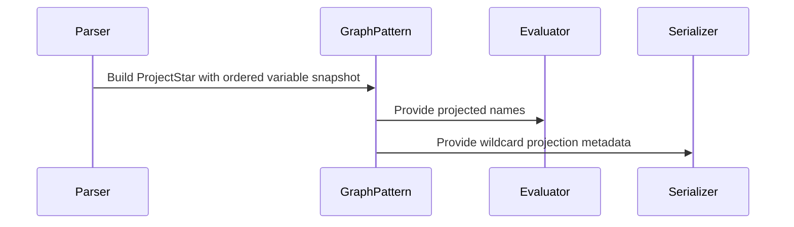

# PR #547 — comments and review threads

2 comment(s). **Every one needs a disposition** in
`review-debt.md`: addressed (with the commit hash) or declined (with the
reason posted in reply). Bot comments count.

## 1. coderabbitai — 

<!-- This is an auto-generated comment: summarize by coderabbit.ai -->
<!-- review_stack_entry_start -->

<a href="https://app.coderabbit.ai/change-stack/Blackcat-Informatics/purrdf/pull/547?scope=ghh_OusAJGA4HG8ljoOV0wJvVx8NmnZIjc2DdjmxOu0xZWA&amp;cs_source=review_comment"><picture><source media="(prefers-color-scheme: dark)" srcset="https://storage.googleapis.com/coderabbit_public_assets/review-stack-in-coderabbit-ui-dark.svg?v=3"><source media="(prefers-color-scheme: light)" srcset="https://storage.googleapis.com/coderabbit_public_assets/review-stack-in-coderabbit-ui.svg?v=3"></picture></a>

<!-- review_stack_entry_end -->
<!-- This is an auto-generated comment: review paused by coderabbit.ai -->

> [!NOTE]
> ## Reviews paused
> 
> It looks like this branch is under active development. To avoid overwhelming you with review comments due to an influx of new commits, CodeRabbit has automatically paused this review. You can configure this behavior by changing the `reviews.auto_review.auto_pause_after_reviewed_commits` setting.
> 
> Use the following commands to manage reviews:
> - `@coderabbitai resume` to resume automatic reviews.
> - `@coderabbitai review` to trigger a single review.
> 
> Use the checkboxes below for quick actions:
> - [ ] <!-- {"checkboxId":"7f6cc2e2-2e4e-497a-8c31-c9e4573e93d1"} --> ▶️ Resume reviews
> - [ ] <!-- {"checkboxId":"e9bb8d72-00e8-4f67-9cb2-caf3b22574fe"} --> 🔍 Trigger review

<!-- end of auto-generated comment: review paused by coderabbit.ai -->
<!-- recent_review_start -->

No actionable comments were generated in the recent review. 🎉

<strong>ℹ️ Recent review info</strong>

<dl>
<dd>

<strong>⚙️ Run configuration</strong>

<dl>
<dd>

- **Configuration used**: defaults
- **Review profile**: CHILL
- **Plan**: Team
- **Run ID**: `19e84a4b-ed69-4ce3-8754-43ad14c88b9a`

</dd>
</dl>

<strong>📥 Commits</strong>

<dl>
<dd>

Reviewing files that changed from the base of the PR and between 635afd0aef968a73493279b2e37552a790e2922e and 6864852b8f8aab38fc2d4072a5d652316ccd95ea.

</dd>
</dl>

<strong>📒 Files selected for processing: 2</strong>

<dl>
<dd>

* `crates/sparql-eval/src/eval.rs`
* `crates/sparql-eval/src/governor/soundness.rs`

</dd>
</dl>

**Included review availability:** This review used your included allowance. 4 included reviews remain after this review. Your included PR review attempts over the past 7 days set your current allowance at 8 reviews per hour.

</dd>
</dl>

<!-- recent_review_end -->
<!-- walkthrough_start -->

<strong>📝 Walkthrough</strong>

<dl>
<dd>

The parser now represents eligible `SELECT *` queries with `ProjectStar` and shared ordered projection snapshots. Serialization, evaluation, and algebra consumers handle the new variant. GTS identity remapping uses iterative canonical comparison. Wasm stack refusals use normalized wording and HTTP 400 responses.

**Changes: Persistent `SELECT *` projections**

|Layer / File(s)|Summary|
|:---|:---|
|**Projection representation and parser**   `crates/sparql-algebra/src/algebra.rs`, `crates/sparql-algebra/src/projection.rs`, `crates/sparql-algebra/src/parser.rs`, `crates/sparql-algebra/src/parser/machine.rs`|The algebra adds `ProjectStar` and shared ordered projection snapshots. The parser tracks ordinary and contextual visibility and builds persistent wildcard projections.|
|**Serialization, evaluation, and rewrites**   `crates/sparql-algebra/src/serialize.rs`, `crates/sparql-algebra/src/substitute.rs`, `crates/sparql-eval/src/*`|Serialization preserves wildcard projections when their saved names match the inner pattern. Evaluation and rewrites accept both projection forms.|
|**Downstream consumers and validation**   `crates/purrdf/src/reasoning.rs`, `crates/shapes/src/*`, `crates/rdf/src/projections/dataset_description.rs`, `crates/slice/src/ownership.rs`, `crates/sparql-conformance/src/run.rs`|Traversal, reasoning, validation, planning, and conformance checks descend through `ProjectStar` and use `projected_names()`.|
|**Compatibility and regression coverage**   `CHANGELOG.md`, `docs/MIGRATION-4.0.md`, `crates/sparql-algebra/tests/*`, `crates/sparql-eval/tests/*`|Migration documentation describes the breaking variant. Tests cover projection order, memory accounting, serialization, nested queries, and equivalent evaluation results.|

**GTS term identity remapping**

|Layer / File(s)|Summary|
|:---|:---|
|**Shared identity remapping and cycle checks**   `crates/gts/src/writer.rs`|Acyclic graphs use iterative canonical identity comparison with bounded pair-order caching. Cyclic graphs retain path-sensitive ordering. Cycle checks use active-term bitmaps.|
|**Equivalence and scaling tests**   `crates/gts/src/writer.rs`|Tests compare optimized remapping with expanded identity ordering and measure allocation, traversal work, retained bytes, and snapshot round trips.|

**Wasm stack refusals and typed errors**

|Layer / File(s)|Summary|
|:---|:---|
|**Error behavior**   `crates/rdf-wasm/src/operation.rs`, `crates/sparql-eval/src/protocol.rs`, `crates/rdf-wasm/js/src/purrdf_jspi.mjs`|Evaluator stack exhaustion maps to a 400 refusal with normalized wording. Poison errors receive the `purrdf-wasm-poisoned` code.|
|**Parity and response tests**   `crates/rdf-wasm/js/tests/*`, `crates/rdf-wasm/src/protocol.rs`, `crates/sparql-eval/tests/protocol.rs`|Tests compare synchronous and asynchronous nesting boundaries and validate Cloudflare stack-refusal and XPath-pattern responses.|
|**Status documentation**   `crates/rdf-wasm/js/README.md`, `crates/rdf-wasm/js/cloudflare.d.ts`|The status table and error declarations list evaluator stack exhaustion as a 400 refusal.|

<!-- change_assessment_start -->
**Priority:** ➖ Normal

**Estimated code review effort:** 4 (Complex) | ~60 minutes

<!-- change_assessment_commit:"6864852b8f8aab38fc2d4072a5d652316ccd95ea" -->
**Change:** Feature · **Severity of issue fixed:** Medium
<!-- change_assessment_end -->

### Sequence Diagram(s)

</dd>
</dl>

<!-- walkthrough_end -->

<strong>Merge Risk:</strong> <strong>🟡 Moderate</strong> · up to <code>68648</code>

<dl>
<dd>

<!-- final_review_risk_start -->
<!-- final_review_risk_label
**Merge Risk:** **🟡 Moderate** · up to `68648`
-->
<!-- final_review_risk_coverage:{"sourceCommitId":"6864852b8f8aab38fc2d4072a5d652316ccd95ea","coveredCommitId":"6864852b8f8aab38fc2d4072a5d652316ccd95ea","kind":"reviewed"} -->

Analysis of deeply nested SELECT * queries may use quadratic work and memory. This affects only unusual query shapes, but the concern should be resolved or accepted before merge.
<!-- final_review_risk_end -->

</dd>
</dl>

<!-- pre_merge_checks_walkthrough_start -->

<strong>Pre-merge checks: <picture></picture> 3 · <picture></picture> 2</strong>

<dl>
<dd>

<strong><picture></picture> Failed checks: 2 warnings</strong>

|      Check name     |                                              Status                                              | Explanation                                                                                                                                                                                               | Resolution                                                                                                                                                                                                                                        |
| :----------------- | :----------------------------------------------------------------------------------------------: | :-------------------------------------------------------------------------------------------------------------------------------------------------------------------------------------------------------- | :------------------------------------------------------------------------------------------------------------------------------------------------------------------------------------------------------------------------------------------------ |
| Linked Issues check |  | Issue `#365` objectives are implemented for poison codes, stack-lane refusal parity, position-independent messages, HTTP 400 classification, reduced asynchronous regression, nested `SELECT *` projection… | Add and record the synchronous-path benchmark before governed dispatch. Add reviewable Node subprocess tests for unsettled `resolveService` and `resolveLoad` handlers with no other event-loop activity. If `#365`'s non-breaking 3.x constraint … |
|  Docstring Coverage |  | Docstring coverage is 69.96% which is insufficient. The required threshold is 80.00%. Docstring coverage is scoped to functions touched by this diff. Analyzed 223 functions across 54 files.             | Write docstrings for the functions missing them to satisfy the coverage threshold.                                                                                                                                                                |

<strong><picture></picture> Passed checks: 3 passed</strong>

<dl>
<dd>

|         Check name         |                                             Status                                             | Explanation                                                                                                                                                                                               |
| :------------------------ | :--------------------------------------------------------------------------------------------: | :-------------------------------------------------------------------------------------------------------------------------------------------------------------------------------------------------------- |
|      Description Check     |  | Check skipped - CodeRabbit’s high-level summary is enabled.                                                                                                                                               |
|         Title check        |  | The title clearly describes two substantial changes: asynchronous host-error handling and compact deep term representations. It does not mention the major nested SELECT * projection and ProjectStar AP… |
| Out of Scope Changes check |  | The changed areas remain connected to `#365`. `ProjectStar` and projection snapshots address nested `SELECT *` cost. GTS identity-key changes address deep identity traversal cost. Poison, stack, HTTP, d… |

</dd>
</dl>

<strong>Full details: Linked Issues check</strong>

<dl>
<dd>

**Explanation**

Issue `#365` objectives are implemented for poison codes, stack-lane refusal parity, position-independent messages, HTTP 400 classification, reduced asynchronous regression, nested `SELECT *` projections, and GTS identity traversal. Two coding requirements remain unverified and are not reported: a synchronous-path benchmark before governed dispatch, and Node subprocess tests that keep unsettled `resolveService` and `resolveLoad` handlers alive until their deadlines. The reported idle deadline checks do not prove this behavior. The new public `GraphPattern::ProjectStar` variant also conflicts with `#365`'s stated non-breaking 3.x constraint; the migration guide requires a 4.0 release.

**Resolution**

Add and record the synchronous-path benchmark before governed dispatch. Add reviewable Node subprocess tests for unsettled `resolveService` and `resolveLoad` handlers with no other event-loop activity. If `#365`'s non-breaking 3.x constraint applies, preserve source compatibility; otherwise reconcile the API break with the issue requirements.

</dd>
</dl>

</dd>
</dl>

<!-- pre_merge_checks_walkthrough_end -->

- [ ] <!-- {"checkboxId":"585bb3f6-faf5-4dbf-96d2-74e382adf19a"} --> Fix all pre-merge checks with AI
<!-- finishing_touch_checkbox_start -->

<strong>✨ Finishing Touches: 💡 1</strong>

<dl>
<dd>

<!-- finishing_touch_suggestion:docstrings -->

<strong>📝 Generate docstrings: 💡</strong>

<dl>
<dd>

- [ ] <!-- {"checkboxId":"3e1879ae-f29b-4d0d-8e06-d12b7ba33d98"} --> Commit to this branch
- [ ] <!-- {"checkboxId":"7962f53c-55bc-4827-bfbf-6a18da830691"} --> Create a new PR

</dd>
</dl>

<strong>🧪 Generate unit tests (beta)</strong>

<dl>
<dd>

- [ ] <!-- {"checkboxId": "6ba7b810-9dad-11d1-80b4-00c04fd430c8", "radioGroupId": "utg-output-choice-group-unknown_comment_id"} --> Commit to this branch
- [ ] <!-- {"checkboxId": "f47ac10b-58cc-4372-a567-0e02b2c3d479", "radioGroupId": "utg-output-choice-group-unknown_comment_id"} --> Create a new PR

</dd>
</dl>

</dd>
</dl>

<!-- finishing_touch_checkbox_end -->

<!-- autopilot:start -->
- [ ] <!-- {"checkboxId":"2708ad07-9f24-4260-9c11-7dc76a49f2e3"} --> <strong title="Keep fixing CodeRabbit findings and required CI, and resolving merge conflicts">Autofix</strong> · Keep fixing CodeRabbit findings and required CI, and resolving merge conflicts
<!-- autopilot:end -->
<!-- tips_start -->

Comment `@coderabbitai help` to get the list of available commands.

<!-- tips_end -->

## 2. paudley — 

Complete asynchronous host errors and compact nested projections

Closes #365

The WASM package gives poisoned instances a stable error code and reports the
same stack endpoint, code and wording in synchronous and asynchronous calls.
Evaluation-stack refusals are HTTP 400 while real execution faults remain
HTTP 500. The deep suspension regression retains its answers and frame proof
while using fewer scheduled turns.

Nested SELECT star projections retain shared ordered snapshots instead of a
growing name array at every parsed level. Parser, serializer, evaluator, planner,
SHACL and other consumers use the same projection view. Correlated substitution
borrows names; streamed schemas retain workspace grants; query clones admit
each retained shared projection node once. The public algebra variant is a
source-breaking change documented in the 4.0 migration guide.

GTS identity comparisons reuse nested terms under the original ordering law and
preserve frozen bytes. Already-landed otherwise-idle deadlines and iterative
deep returned terms are included in installed-package acceptance; their unchanged
code is not represented as a new patch.

The final normal make wasm-pkg-test passed all 458 tests, TypeScript, packed
installation and high-width identity ABI controls on the integrated source.
Original 181/281/180 nesting floors, exact lane agreement, poison/HTTP neighbors,
hung SERVICE/LOAD deadlines and 20,000-level remote-term controls remain intact.
All current hosted checks pass, including native, portable, conformance, book,
Python, package and seven assembly configurations.

The three current source findings have executed regressions and strict Clippy
passes. The reviewer accepted them and resolved their threads. The requested
node-analysis admission alternative was already implemented; the actual parent
projection now has a bound, cache-survival and release control. The reviewer
withdrew that finding. Unrestricted total analysis storage is not claimed linear.
The generic documentation percentage suggestion is declined: public API and
breaking migration documentation are present and repository documentation gates
pass; comments repeating internal/test signatures add no contract.

Original independent task reviews and full native qualification retain their
recorded scope. Affected checks and the final combined package qualify later
changes. The owner maps all requirements in the current contract assessment
under the zero-subagent workflow; no fresh independent auditor is invented.
The retained synchronous comparison uses fixed-work instructions on its original
source. No timing performance claim or exclusive campaign is introduced.

The branch integrates the evaluator landing through a normal hooked merge with
no conflict. The clean final prediction uses current main without another base
delta. Rejected tooling work is absent. Normal installed tools and directories
were used, with no hook, compiler, cache or acceptance criterion bypass.

The authoritative plan is
.stage/post-v3-0-asynchronous-wasm-lane-and/plan.md. Select that Stage directory
for separate evidence archival. No requirement is moved to another ticket.

Defect-Class: none

