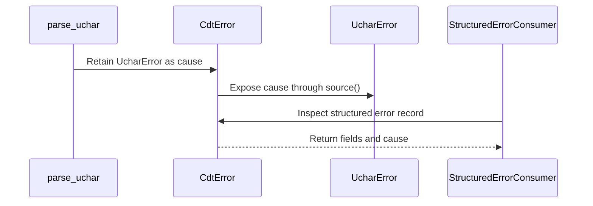

# PR review evidence

Source payload: review-evidence.json
Observed items: 1; PR head: 0803c697bd21608b250b4925bfb423b86a3fa808.
Every item needs an explicit disposition; bot comments count.
Dispositions apply to the recorded item revision; edited feedback is reconsidered.

Coverage:
- comments: complete
- reviews: complete
- inline_comments: complete
- threads: complete

## github:comment:IC_kwDOTKq-Ms8AAAABfDxsmg — coderabbitai (comment)
https://github.com/Blackcat-Informatics/purrdf/pull/697#issuecomment-6379302042
state=None resolved=None path=None

No actionable comments were generated in the recent review.

<strong><picture></picture> Recent review info</strong>

<dl>
<dd>

<strong><picture><source media="(prefers-color-scheme: dark)" srcset="https://storage.googleapis.com/coderabbit_public_assets/review-comment-icons-v1/cog-dark.svg"></picture> Run configuration</strong>

<dl>
<dd>

- **Source mode**: Auto
- **Repository**: Unavailable
- **Branch**: Unavailable
- **File**: No configuration file from this repository applied
- **Commit**: Unavailable
- **Layers**: Organization UI
- **Review profile**: CHILL
- **Plan**: Advanced
- **Run ID**: `d53f9709-f309-4281-9bbe-1ee3af189be6`

</dd>
</dl>

<strong><picture><source media="(prefers-color-scheme: dark)" srcset="https://storage.googleapis.com/coderabbit_public_assets/review-comment-icons-v1/git-commit-horizontal-dark.svg"></picture> Commits</strong>

<dl>
<dd>

Reviewing files that changed from the base of the PR and between 6c9c66fcf3790d5fdb9fa62e857c4e6f544aad8f and 0803c697bd21608b250b4925bfb423b86a3fa808.

</dd>
</dl>

<strong><picture><source media="(prefers-color-scheme: dark)" srcset="https://storage.googleapis.com/coderabbit_public_assets/review-comment-icons-v1/file-plus-corner-dark.svg"></picture> Files selected for processing: 7</strong>

<dl>
<dd>

* `crates/cdt/src/error.rs`
* `crates/cdt/src/memory.rs`
* `crates/cdt/src/parse.rs`
* `crates/cdt/tests/adversarial.rs`
* `crates/cdt/tests/grammar_productions.rs`
* `crates/cdt/tests/structured_errors.rs`
* `crates/lex/src/terminals.rs`

</dd>
</dl>

**Included review availability:** This review used your included allowance. 8 included reviews remain after this review. Your included PR review attempts over the past 7 days set your current allowance at 10 reviews per hour.

</dd>
</dl>

<strong>📝 Summary</strong>

<dl>
<dd>

## Summary by CodeRabbit

* **New Features**
  * Errors now provide structured diagnostic details, including error codes, relevant locations, limits, and underlying causes where available.
  * Unicode escape errors now include distinct, readable messages for different failure types.
* **Bug Fixes**
  * Parser and storage errors now retain more of the original error information, making failures easier to inspect.

CDT errors now provide structured records for parser, type, comparison, and reader failures. Escape and language-tag errors retain native causes when available. Tests check error fields, source chains, and allocation-free inspection.

**Changes: CDT Error Reporting**

|Layer / File(s)|Summary|
|:---|:---|
|**Structured error contracts**   `crates/cdt/src/error.rs`, `crates/cdt/src/memory.rs`, `crates/lex/src/terminals.rs`|CDT parser, type, and reader errors now expose structured records. Parser and reader errors expose applicable causes through error-source chains. `UcharError` now implements `Display` and `Error`.|
|**Parser cause retention**   `crates/cdt/src/parse.rs`|Unicode escape and language-tag failures retain native parser errors. Locally generated escape and direction-suffix failures set no cause.|
|**Structured error validation**   `crates/cdt/tests/structured_errors.rs`, `crates/cdt/tests/adversarial.rs`, `crates/cdt/tests/grammar_productions.rs`|Tests check diagnostic fields, offsets, causes, source chains, and allocation-free inspection. Existing tests accommodate the added language-tag error field.|

<strong>Priority: <picture></picture> Normal</strong>

**Estimated code review effort:** 3 (Moderate) | ~25 minutes

**Change:** Feature

### Sequence Diagram(s)

**Possibly related issues**

- Issue 558 — This PR implements structured error reporting for the CDT error family; the issue covers structured fields and native causes across the wider workspace.

</dd>
</dl>

<strong>Merge Risk:</strong> <strong><picture></picture> Minimal</strong> · up to <code>0803c</code>

<dl>
<dd>

<!-- final_review_risk_label
**Merge Risk:** **⚪ Minimal** · up to `0803c`
-->
<!-- final_review_risk_coverage:{"sourceCommitId":"0803c697bd21608b250b4925bfb423b86a3fa808","coveredCommitId":"0803c697bd21608b250b4925bfb423b86a3fa808","kind":"reviewed"} -->

No actionable issue is identified in the CDT error-reporting change; it is mergeable after normal checks.

</dd>
</dl>

<strong>Security architecture risk:</strong> <strong><picture></picture> Minimal</strong> · up to <code>0803c</code>

<dl>
<dd>

The changes expose diagnostic information without changing input acceptance, resource limits, or failure classification. The retained native causes contain diagnostic classifications rather than additional input text or capabilities. No introduced or worsened security concern was identified.

**Retained concerns**
No architecture-level concerns identified.

<strong>Security review details</strong>

<dl>
<dd>

**Security Blast Radius**
- _inferred_ — The assessed exposure is caller-visible diagnostic information from CDT parsing and reading. The new native causes add classifications, not credentials, service identities, executable callbacks, or additional raw input payloads.

**Trust Boundaries and Controls**
- _observed_ — Attacker-supplied lexical content continues through the same decoder and language-tag validation calls. Retaining their failures changes diagnostic observation, not acceptance decisions; input-size and canonical-size controls remain in the reader entrypoint.

**Resilience and Maintainability Implications**
- _observed_ — Structured records borrow existing diagnostic payloads and nested causes rather than creating replacement strings or boxed cause chains. This preserves diagnostic ownership while avoiding a new allocation requirement for inspection.

</dd>
</dl>

</dd>
</dl>

<strong>Pre-merge checks: <picture></picture> 4 · <picture></picture> 1</strong>

<dl>
<dd>

<strong><picture></picture> Failed checks: 1 warning</strong>

|     Check name     |                                              Status                                              | Explanation                                                                                                                                                                                 | Resolution                                                                         |
| :---------------- | :----------------------------------------------------------------------------------------------: | :------------------------------------------------------------------------------------------------------------------------------------------------------------------------------------------ | :--------------------------------------------------------------------------------- |
| Docstring Coverage |  | Docstring coverage is 35.29% which is insufficient. The required threshold is 80.00%. Docstring coverage is scoped to functions touched by this diff. Analyzed 17 functions across 7 files. | Write docstrings for the functions missing them to satisfy the coverage threshold. |

<strong><picture></picture> Passed checks: 4 passed</strong>

<dl>
<dd>

|         Check name         |                                             Status                                             | Explanation                                                                                                                                                                                               |
| :------------------------ | :--------------------------------------------------------------------------------------------: | :-------------------------------------------------------------------------------------------------------------------------------------------------------------------------------------------------------- |
|         Title check        |  | The title "Preserve native CDT failure fields and source chains" matches the main change: CDT errors now keep native UCHAR and language-tag decoder causes, expose structured fields, and wire source() … |
|      Description check     |  | The description explains the problem (discarded UCHAR and language-tag decoder failures, and limited structured inspection), the changes (inline native causes, borrowed structured inspection, standard… |
|     Linked Issues check    |  | The PR addresses the active coding requirements in `#696`. `CdtError`, `CdtTypeErrorKind`, `CdtTypeError`, and `ReadError` use borrowed structured records with offsets, bounds, text, classifications, re… |
| Out of Scope Changes check |  | The changed files remain within `#696`. Error records, source-chain wiring, parser construction updates, `UcharError` traits, memory handling, and focused tests directly implement the linked issue. The … |

<strong>Full details: Title check</strong>

<dl>
<dd>

**Explanation**

The title "Preserve native CDT failure fields and source chains" matches the main change: CDT errors now keep native UCHAR and language-tag decoder causes, expose structured fields, and wire source() chains. It is specific and concise, and it names the CDT crate's error model rather than file lists or vague terms.

</dd>
</dl>

<strong>Full details: Description check</strong>

<dl>
<dd>

**Explanation**

The description explains the problem (discarded UCHAR and language-tag decoder failures, and limited structured inspection), the changes (inline native causes, borrowed structured inspection, standard source() chains, UcharError trait implementations), and the public regression tests. It also lists validation and scope limits. This is directly related to the changeset.

</dd>
</dl>

<strong>Full details: Linked Issues check</strong>

<dl>
<dd>

**Explanation**

The PR addresses the active coding requirements in `#696`. `CdtError`, `CdtTypeErrorKind`, `CdtTypeError`, and `ReadError` use borrowed structured records with offsets, bounds, text, classifications, reasons, and nested causes. `BadEscape` and `BadLanguageTag` retain native decoder causes, while local refusals retain no fabricated cause. `ReadError` preserves lexical and storage failures and exposes both through source chains. Construction sites and `UcharError` standard traits are updated. The new integration tests cover disposed input, parser and storage failures, comparison classifications, accepted neighbours, offsets, bounds, source chains, and allocation behavior. The reported validation covers the CDT suite and strict Clippy checks. Existing display matching remains unchanged.

</dd>
</dl>

<strong>Full details: Out of Scope Changes check</strong>

<dl>
<dd>

**Explanation**

The changed files remain within `#696`. Error records, source-chain wiring, parser construction updates, `UcharError` traits, memory handling, and focused tests directly implement the linked issue. The evidence shows no dependency change, WASM semantic matrix, upstream work, or unrelated crate change. Parent issue `#558` remains context only, as required.

</dd>
</dl>

</dd>
</dl>

</dd>
</dl>

