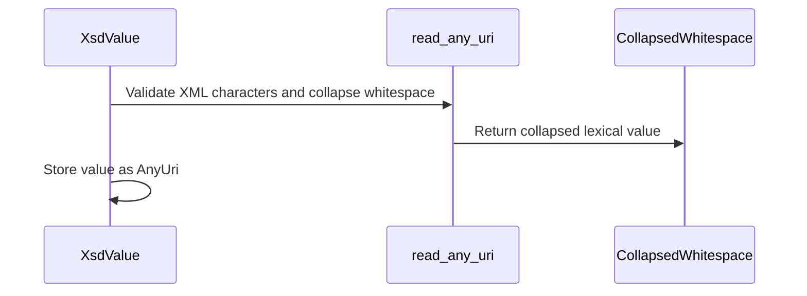

# PR #573 — comments and review threads

2 comment(s). **Every one needs a disposition** in
`review-debt.md`: addressed (with the commit hash) or declined (with the
reason posted in reply). Bot comments count.

## 1. coderabbitai — 

<!-- This is an auto-generated comment: summarize by coderabbit.ai -->
<!-- review_stack_entry_start -->

<a href="https://app.coderabbit.ai/change-stack/Blackcat-Informatics/purrdf/pull/573?scope=[redacted]&amp;cs_source=review_comment"><picture><source media="(prefers-color-scheme: dark)" srcset="https://storage.googleapis.com/coderabbit_public_assets/review-stack-in-coderabbit-ui-dark.svg?v=3"><source media="(prefers-color-scheme: light)" srcset="https://storage.googleapis.com/coderabbit_public_assets/review-stack-in-coderabbit-ui.svg?v=3"></picture></a>

<!-- review_stack_entry_end -->
<!-- This is an auto-generated comment: rate limited by coderabbit.ai -->

> [!WARNING]
> ## Review limit reached
> 
> Your organization has reached its usage spending cap. Adjust your spending cap in the [billing tab](https://app.coderabbit.ai/settings/billing?tab=usage&orgId=b268aba6-a194-4fd6-8ca5-f1a13a313209).
> 
> **Next included review available in 9 minutes.**
> 
> [Check out review usage here](https://app.coderabbit.ai/dashboard/review-capacity?orgId=b268aba6-a194-4fd6-8ca5-f1a13a313209).
> 
> 

> 
<strong>View limit details</strong>

> <dl>
> <dd>
> 
> **Limit details:** You’ve used all 2 included reviews currently available. Your 85 included PR review attempts over the past 7 days set your current allowance at 2 reviews per hour.
> 
> [Learn how review limits work](https://docs.coderabbit.ai/management/rate-limits).
> 
> **Review configuration:**
> 
> 

> 
<strong>⚙️ Run configuration</strong>

> <dl>
> <dd>
> 
> - **Configuration used**: defaults
> - **Review profile**: CHILL
> - **Plan**: Team
> - **Run ID**: `0badd2cc-73a1-4239-baa7-32c32f5fe5b1`
> 
> </dd>
> </dl>
> 

> 
> 

> 
<strong>📥 Commits</strong>

> <dl>
> <dd>
> 
> Reviewing files that changed from the base of the PR and between ac4094981aa2ca02763512eb0a306a8750e7ed5a and 128dda6bfa9926c3bab6ab9e19c148182ee9fec7.
> 
> </dd>
> </dl>
> 

> 
> 

> 
<strong>📒 Files selected for processing: 3</strong>

> <dl>
> <dd>
> 
> * `crates/xsd/src/range.rs`
> * `crates/xsd/src/value.rs`
> * `crates/xsd/tests/any_uri.rs`
> 
> </dd>
> </dl>
> 

> 
> </dd>
> </dl>
> 

<!-- end of auto-generated comment: rate limited by coderabbit.ai -->

<!-- recent_review_start -->

No actionable comments were generated in the recent review. 🎉

<strong>ℹ️ Recent review info</strong>

<dl>
<dd>

<strong>⚙️ Run configuration</strong>

<dl>
<dd>

- **Configuration used**: defaults
- **Review profile**: CHILL
- **Plan**: Team
- **Run ID**: `cd854554-0eb5-4c0d-bc92-b38c07275293`

</dd>
</dl>

<strong>📥 Commits</strong>

<dl>
<dd>

Reviewing files that changed from the base of the PR and between 410a927d9e97d8485711d98b535158ed3e4ce059 and ac4094981aa2ca02763512eb0a306a8750e7ed5a.

</dd>
</dl>

<strong>📒 Files selected for processing: 13</strong>

<dl>
<dd>

* `Makefile`
* `crates/entail/src/datatypes.rs`
* `crates/xsd/Cargo.toml`
* `crates/xsd/README.md`
* `crates/xsd/src/datatype.rs`
* `crates/xsd/src/lib.rs`
* `crates/xsd/src/ops.rs`
* `crates/xsd/src/range.rs`
* `crates/xsd/src/simple.rs`
* `crates/xsd/src/temporal.rs`
* `crates/xsd/src/value.rs`
* `crates/xsd/tests/any_uri.rs`
* `crates/xsd/tests/exact_governance.rs`

</dd>
</dl>

**Included review availability:** This review used your included allowance. 0 included reviews remain after this review. Your included PR review attempts over the past 7 days set your current allowance at 2 reviews per hour.

</dd>
</dl>

<!-- recent_review_end -->
<!-- walkthrough_start -->

<strong>📝 Walkthrough</strong>

<dl>
<dd>

The XSD crate now supports `xsd:anyURI` as a distinct datatype. Parsing validates XML characters and collapses whitespace. The implementation adds value operations and length-based range handling, with tests in the XSD crate and entailment crate.

**Changes: XSD anyURI support**

|Layer / File(s)|Summary|
|:---|:---|
|**Datatype parsing and value behavior**   `crates/xsd/src/datatype.rs`, `crates/xsd/src/simple.rs`, `crates/xsd/src/value.rs`, `crates/xsd/src/ops.rs`, `crates/xsd/src/temporal.rs`|Adds `AnyUri` datatype and value variants. Parsing validates XML characters and stores collapsed whitespace. Equality compares anyURI values directly. Arithmetic operations reject anyURI operands with `TypeMismatch`.|
|**anyURI range and length semantics**   `crates/xsd/src/range.rs`|Adds a text space separate from strings. Length and cardinality operations use the character count after whitespace collapse.|
|**Test coverage and integration**   `crates/xsd/tests/any_uri.rs`, `crates/xsd/tests/exact_governance.rs`, `crates/entail/src/datatypes.rs`, `crates/xsd/Cargo.toml`, `Makefile`, `crates/xsd/README.md`, `crates/xsd/src/lib.rs`|Adds parsing, value, range, and entailment tests. Registers the integration test and adds it to the WebAssembly test lane. Updates datatype coverage documentation.|

<!-- change_assessment_start -->
**Priority:** ➖ Normal

**Estimated code review effort:** 3 (Moderate) | ~20 minutes

<!-- change_assessment_commit:"ac4094981aa2ca02763512eb0a306a8750e7ed5a" -->
**Change:** Feature
<!-- change_assessment_end -->

### Sequence Diagram(s)

</dd>
</dl>

<!-- walkthrough_end -->

<strong>Merge Risk:</strong> <strong>⚪ Minimal</strong> · up to <code>ac409</code>

<dl>
<dd>

<!-- final_review_risk_start -->
<!-- final_review_risk_label
**Merge Risk:** **⚪ Minimal** · up to `ac409`
-->
<!-- final_review_risk_coverage:{"sourceCommitId":"ac4094981aa2ca02763512eb0a306a8750e7ed5a","coveredCommitId":"ac4094981aa2ca02763512eb0a306a8750e7ed5a","kind":"reviewed"} -->

This change adds native xsd:anyURI support with accompanying tests. No actionable merge-blocking risk was identified from the supplied review context.
<!-- final_review_risk_end -->

</dd>
</dl>

<!-- pre_merge_checks_walkthrough_start -->

<strong>Pre-merge checks: <picture></picture> 5</strong>

<dl>
<dd>

|         Check name         |                                             Status                                             | Explanation                                                                                                                                                                                               |
| :------------------------ | :--------------------------------------------------------------------------------------------: | :-------------------------------------------------------------------------------------------------------------------------------------------------------------------------------------------------------- |
|      Description Check     |  | Check skipped - CodeRabbit’s high-level summary is enabled.                                                                                                                                               |
|         Title check        |  | The title clearly and concisely identifies the main change: native xsd:anyURI values and data-range support.                                                                                              |
|     Docstring Coverage     |  | Docstring coverage is 82.76% which is sufficient. The required threshold is 80.00%. Docstring coverage is scoped to functions touched by this diff. Analyzed 29 functions across 10 files. (3 skipped: 3… |
|     Linked Issues check    |  | Check skipped because no linked issues were found for this pull request.                                                                                                                                  |
| Out of Scope Changes check |  | Check skipped because no linked issues were found for this pull request.                                                                                                                                  |

<strong>Full details: Docstring Coverage</strong>

<dl>
<dd>

**Explanation**

Docstring coverage is 82.76% which is sufficient. The required threshold is 80.00%. Docstring coverage is scoped to functions touched by this diff. Analyzed 29 functions across 10 files. (3 skipped: 3 unsupported.)

</dd>
</dl>

</dd>
</dl>

<!-- pre_merge_checks_walkthrough_end -->
<!-- finishing_touch_checkbox_start -->

<strong>✨ Finishing Touches</strong>

<dl>
<dd>

<strong>📝 Generate docstrings</strong>

<dl>
<dd>

- [ ] <!-- {"checkboxId":"3e1879ae-f29b-4d0d-8e06-d12b7ba33d98"} --> Commit to this branch
- [ ] <!-- {"checkboxId":"7962f53c-55bc-4827-bfbf-6a18da830691"} --> Create a new PR

</dd>
</dl>

<strong>🧪 Generate unit tests (beta)</strong>

<dl>
<dd>

- [ ] <!-- {"checkboxId": "6ba7b810-9dad-11d1-80b4-00c04fd430c8", "radioGroupId": "utg-output-choice-group-unknown_comment_id"} --> Commit to this branch
- [ ] <!-- {"checkboxId": "f47ac10b-58cc-4372-a567-0e02b2c3d479", "radioGroupId": "utg-output-choice-group-unknown_comment_id"} --> Create a new PR

</dd>
</dl>

</dd>
</dl>

<!-- finishing_touch_checkbox_end -->

<!-- autopilot:start -->
- [ ] <!-- {"checkboxId":"2708ad07-9f24-4260-9c11-7dc76a49f2e3"} --> <strong title="Keep fixing CodeRabbit findings and required CI, and resolving merge conflicts">Autofix</strong> · Keep fixing CodeRabbit findings and required CI, and resolving merge conflicts
<!-- autopilot:end -->
<!-- tips_start -->

Comment `@coderabbitai help` to get the list of available commands.

<!-- tips_end -->

## 2. paudley — 

feat(xsd): model native anyURI values and range semantics

Advances #572 and Blackcat-Informatics/gmeow-ontology#1803.

The native datatype engine now owns anyURI parsing, XML character validation, fixed whitespace collapse, primitive value identity, retained storage and range semantics. This lets the downstream reasoner delete its ad-hoc normalization, membership, equality and capacity paths. Relative references, empty values, case and percent spelling are preserved; strings remain a separate primitive. Unsupported ordering and arithmetic do not acquire invented semantics.

The XSD value and admitted-reader implementations share the existing XML terminal and CollapsedWhitespace formatter. Range enumeration, complements, intersections and length facets use a distinct anyURI stratum. Positive-length cardinality remains an honest lower bound. XsdValue::facet_length is the single character/octet measure used by the native range engine and downstream adapter. The entailment literal prepass uses the same primitive. No new runtime dependency, feature switch, fallback or compatibility alias was added.

Validation: the complete purrdf-xsd crate suite passed. Three new anyURI cases passed natively and under actual WASM/Node execution. The admitted-parser allocation/refusal test and production entailment-prepass regression passed. XSD and entailment all-target clippy passed with warnings denied. After extracting the shared facet method, the affected 3 anyURI plus 36 data-range tests, XSD all-target clippy and all 3 exact WASM cases passed again. All three commits passed normal configured hooks and were pushed.

CodeRabbit reviewed ac4094981 with no actionable comments and minimal reported merge risk; its documentation coverage was 82.76% over 29 touched functions across 10 files, with 3 unsupported functions skipped. The final 128dda6bf change only moves the already-tested length measure into a public native method and delegates the old private calculation to it; that delta passed the affected checks above. CodeRabbit explicitly rate-limited the additional review. No local independent reviewer API is available; this limitation is recorded rather than represented as a final-head independent review.

Hosted workspace CI is pending on the final head, with no failed checks observed in the full current check inventory. The user explicitly authorized pushing and merging with subsequent hosted CI findings tracked, so pending hosted CI is not represented as a pass. No local GMEOW corpus producer or machine probes ran.

Integration: origin/main remains 410a927d9e97; merge-tree predicts the clean candidate bc13dfb30b5a5162c78b146d0ada5ffdca9c23c1. There are no base-side changes or conflicts to resolve. Evidence covers this native implementation; GMEOW pin/deletion tests are ongoing in its existing isolated issue worktree. Issue 572 stays open until that downstream acceptance lands; issue 1803 is a broader ownership contract and remains open.

Authoritative plan: /home/paudley/Active/purrdf/.worktrees/572-model-the-xsd-anyuri-value-space-in-the/.stage/model-the-xsd-anyuri-value-space-in-the/plan.md
Selected evidence: /home/paudley/Active/purrdf/.worktrees/572-model-the-xsd-anyuri-value-space-in-the/.stage/model-the-xsd-anyuri-value-space-in-the

Defect-Class: none

