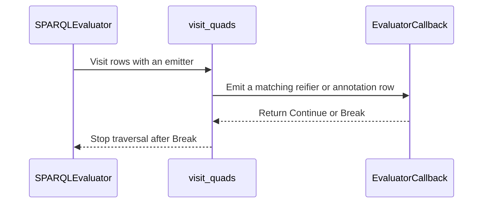

<!-- This is an auto-generated comment: summarize by coderabbit.ai -->
<!-- review_stack_entry_start -->

<a href="https://app.coderabbit.ai/change-stack/Blackcat-Informatics/purrdf/pull/552?cs_source=review_comment"><picture><source media="(prefers-color-scheme: dark)" srcset="https://storage.googleapis.com/coderabbit_public_assets/review-stack-in-coderabbit-ui-dark.svg?v=3"><source media="(prefers-color-scheme: light)" srcset="https://storage.googleapis.com/coderabbit_public_assets/review-stack-in-coderabbit-ui.svg?v=3"></picture></a>

<!-- review_stack_entry_end -->
<!-- recent_review_start -->

No actionable comments were generated in the recent review. 🎉

<strong>ℹ️ Recent review info</strong>

<dl>
<dd>

<strong>⚙️ Run configuration</strong>

<dl>
<dd>

- **Configuration used**: defaults
- **Review profile**: CHILL
- **Plan**: Team
- **Run ID**: `fca2c779-8911-4e2a-9053-45cb6c3ae29c`

</dd>
</dl>

<strong>📥 Commits</strong>

<dl>
<dd>

Reviewing files that changed from the base of the PR and between 85cdcc90511c3fcd65e402870f8260721de98733 and 47725646e241105c0df76233976543865ae66dfe.

</dd>
</dl>

<strong>📒 Files selected for processing: 16</strong>

<dl>
<dd>

* `crates/rdf-core/examples/segmented_fixture.rs`
* `crates/rdf-core/src/ir/mod.rs`
* `crates/rdf-core/src/ir/segmented/file.rs`
* `crates/rdf-core/src/ir/segmented/mod.rs`
* `crates/rdf-core/src/ir/segmented/query.rs`
* `crates/rdf-core/src/ir/segmented/query/view.rs`
* `crates/rdf-core/src/ir/segmented/session.rs`
* `crates/rdf-core/src/lib.rs`
* `crates/rdf-core/tests/segmented_stack.rs`
* `crates/sparql-eval/src/bgp.rs`
* `crates/sparql-eval/src/bgp/window.rs`
* `crates/sparql-eval/src/path_relation.rs`
* `crates/sparql-eval/src/statement_layer.rs`
* `crates/sparql-eval/tests/segmented_query.rs`
* `docs/design/purrdf-segmented-query-storage.md`
* `helpers-ledger.toml`

</dd>
</dl>

**Included review availability:** This review used your included allowance. 5 included reviews remain after this review. Your included PR review attempts over the past 7 days set your current allowance at 6 reviews per hour.

</dd>
</dl>

<!-- recent_review_end -->
<!-- walkthrough_start -->

<strong>📝 Walkthrough</strong>

<dl>
<dd>

The changes add a non-WASM file-backed segmented provider, manage query storage capacity through budgeted growth, revise segmented row retrieval, and add early termination to statement traversal. New tests measure memory use and query results across segmented layouts.

**Changes: Segmented query execution**

|Layer / File(s)|Summary|
|:---|:---|
|**File-backed provider and exports**   `crates/rdf-core/src/ir/segmented/file.rs`, `crates/rdf-core/src/ir/segmented/mod.rs`, `crates/rdf-core/src/ir/mod.rs`, `crates/rdf-core/src/lib.rs`, `crates/rdf-core/examples/segmented_fixture.rs`|A non-WASM `SegmentedFileProvider` reads within the file length captured at construction and reports provider errors. The crate exports it, and the fixture uses it in place of its local provider. `SegmentedBytes` uses a non-exhaustive debug formatter.|
|**Managed query storage and admission**   `crates/rdf-core/src/ir/segmented/query.rs`, `crates/rdf-core/src/ir/segmented/session.rs`, `crates/rdf-core/tests/segmented_stack.rs`, `docs/design/purrdf-segmented-query-storage.md`, `helpers-ledger.toml`|Query storage reserves capacity as request and cache entries are added. Representative interning reserves for a push. Tests measure representative growth and memory use under large configured limits. The design document records storage admission behavior and layout measurements; the ledger updates recorded source hashes.|
|**Segmented row retrieval**   `crates/rdf-core/src/ir/segmented/query/view.rs`, `crates/rdf-core/src/ir/segmented/session.rs`, `crates/sparql-eval/tests/segmented_query.rs`, `docs/design/purrdf-segmented-query-storage.md`|Segmented queries translate patterns and retrieve rows through callbacks. Resident reifier and annotation queries use bound subject lookups where available and filter candidates against the pattern. The regression test checks query results and resource evidence across claim counts and block layouts.|
|**Early termination during row traversal**   `crates/sparql-eval/src/statement_layer.rs`, `crates/sparql-eval/src/bgp.rs`, `crates/sparql-eval/src/bgp/window.rs`, `crates/sparql-eval/src/path_relation.rs`|Statement visitors and evaluator callbacks return `ControlFlow`. Traversal stops when a callback signals a break, including after sink limits, stop signals, insertion errors, or conversion errors.|

<!-- change_assessment_start -->
**Priority:** ➖ Normal

**Estimated code review effort:** 4 (Complex) | ~45 minutes

<!-- change_assessment_commit:"47725646e241105c0df76233976543865ae66dfe" -->
**Change:** Bug fix · **Severity of issue fixed:** Medium
<!-- change_assessment_end -->

### Sequence Diagram(s)

</dd>
</dl>

<!-- walkthrough_end -->

<strong>Merge Risk:</strong> <strong>⚪ Minimal</strong> · up to <code>47725</code>

<dl>
<dd>

<!-- final_review_risk_start -->
<!-- final_review_risk_label
**Merge Risk:** **⚪ Minimal** · up to `47725`
-->
<!-- final_review_risk_coverage:{"sourceCommitId":"47725646e241105c0df76233976543865ae66dfe","coveredCommitId":"47725646e241105c0df76233976543865ae66dfe","kind":"reviewed"} -->

No merge-blocking behavior is established. Complete the pending local gate and hosted checks before merging.
<!-- final_review_risk_end -->

</dd>
</dl>

<!-- pre_merge_checks_walkthrough_start -->

<strong>Pre-merge checks: <picture></picture> 4 · <picture></picture> 1</strong>

<dl>
<dd>

<strong><picture></picture> Failed checks: 1 warning</strong>

|     Check name     |                                              Status                                              | Explanation                                                                                                                                                                                               | Resolution                                                                         |
| :---------------- | :----------------------------------------------------------------------------------------------: | :-------------------------------------------------------------------------------------------------------------------------------------------------------------------------------------------------------- | :--------------------------------------------------------------------------------- |
| Docstring Coverage |  | Docstring coverage is 26.47% which is insufficient. The required threshold is 80.00%. Docstring coverage is scoped to functions touched by this diff. Analyzed 34 functions across 14 files. (2 skipped:… | Write docstrings for the functions missing them to satisfy the coverage threshold. |

<strong><picture></picture> Passed checks: 4 passed</strong>

<dl>
<dd>

|         Check name         |                                             Status                                             | Explanation                                                                                                                                                                                               |
| :------------------------ | :--------------------------------------------------------------------------------------------: | :-------------------------------------------------------------------------------------------------------------------------------------------------------------------------------------------------------- |
|      Description Check     |  | Check skipped - CodeRabbit’s high-level summary is enabled.                                                                                                                                               |
|         Title check        |  | The title clearly and concisely describes the main changes: bounding segmented query growth and stopping completed LIMIT scans.                                                                           |
|     Linked Issues check    |  | The PR addresses the active coding requirements in `#551`. `SegmentedStackQuery::intern` uses `reserve_for_push`, and the added query-storage test checks bounded growth and copy behavior. Query request … |
| Out of Scope Changes check |  | The changes remain connected to `#551`. The file provider supports the persisted-image regression fixture. The re-export, debug formatting, allocation controls, helper metadata, documentation, and focus… |

</dd>
</dl>

<strong>Full details: Docstring Coverage</strong>

<dl>
<dd>

**Explanation**

Docstring coverage is 26.47% which is insufficient. The required threshold is 80.00%. Docstring coverage is scoped to functions touched by this diff. Analyzed 34 functions across 14 files. (2 skipped: 2 unsupported.)

</dd>
</dl>

</dd>
</dl>

<!-- pre_merge_checks_walkthrough_end -->

- [ ] <!-- {"checkboxId":"585bb3f6-faf5-4dbf-96d2-74e382adf19a"} --> Fix all pre-merge checks with AI
<!-- finishing_touch_checkbox_start -->

<strong>✨ Finishing Touches: 💡 1</strong>

<dl>
<dd>

<!-- finishing_touch_suggestion:docstrings -->

<strong>📝 Generate docstrings: 💡</strong>

<dl>
<dd>

- [ ] <!-- {"checkboxId":"3e1879ae-f29b-4d0d-8e06-d12b7ba33d98"} --> Commit to this branch
- [ ] <!-- {"checkboxId":"7962f53c-55bc-4827-bfbf-6a18da830691"} --> Create a new PR

</dd>
</dl>

<strong>🧪 Generate unit tests (beta)</strong>

<dl>
<dd>

- [ ] <!-- {"checkboxId": "6ba7b810-9dad-11d1-80b4-00c04fd430c8", "radioGroupId": "utg-output-choice-group-6179955496"} --> Commit to this branch
- [ ] <!-- {"checkboxId": "f47ac10b-58cc-4372-a567-0e02b2c3d479", "radioGroupId": "utg-output-choice-group-6179955496"} --> Create a new PR

</dd>
</dl>

</dd>
</dl>

<!-- finishing_touch_checkbox_end -->

<!-- autopilot:start -->
- [ ] <!-- {"checkboxId":"2708ad07-9f24-4260-9c11-7dc76a49f2e3"} --> <strong title="Keep fixing CodeRabbit findings and required CI, and resolving merge conflicts">Autofix</strong> · Keep fixing CodeRabbit findings and required CI, and resolving merge conflicts
<!-- autopilot:end -->
<!-- tips_start -->

Comment `@coderabbitai help` to get the list of available commands.

<!-- tips_end -->
<!-- This is an auto-generated reply by CodeRabbit -->
<!-- CodeRabbit review command invocation: v2:cbbc8efeaaa262f5b0e76b0447e9233453dbf69dca18bb719a9a836abefdc02b -->

✅ Action performed

Review finished.

> Note: CodeRabbit is an incremental review system and does not re-review already reviewed commits. This command is applicable only when automatic reviews are paused.

