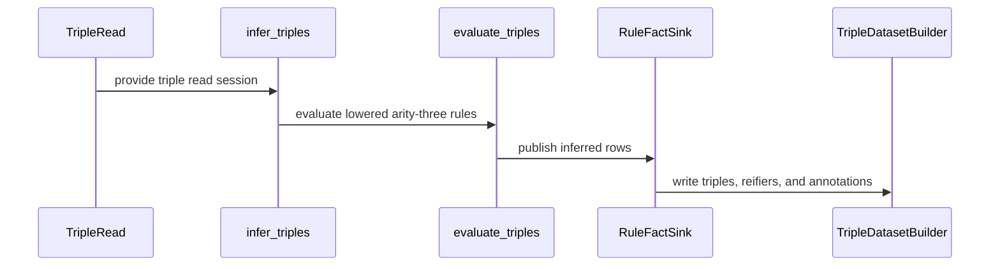

<!-- This is an auto-generated comment: summarize by coderabbit.ai -->
<!-- review_stack_entry_start -->

<a href="https://app.coderabbit.ai/change-stack/Blackcat-Informatics/purrdf/pull/549?scope=REDACTED&amp;cs_source=review_comment"><picture><source media="(prefers-color-scheme: dark)" srcset="https://storage.googleapis.com/coderabbit_public_assets/review-stack-in-coderabbit-ui-dark.svg?v=3"><source media="(prefers-color-scheme: light)" srcset="https://storage.googleapis.com/coderabbit_public_assets/review-stack-in-coderabbit-ui.svg?v=3"></picture></a>

<!-- review_stack_entry_end -->
<!-- recent_review_start -->

No actionable comments were generated in the recent review. 🎉

<strong>ℹ️ Recent review info</strong>

<dl>
<dd>

<strong>⚙️ Run configuration</strong>

<dl>
<dd>

- **Configuration used**: defaults
- **Review profile**: CHILL
- **Plan**: Team
- **Run ID**: `cc0aa6cd-6182-4bd4-bc59-5f1285b851bf`

</dd>
</dl>

<strong>📥 Commits</strong>

<dl>
<dd>

Reviewing files that changed from the base of the PR and between 1885414d87ce8221e460623c8c5d8ca6b1a0af5a and da57b25004adfddabb31c64f1273348f7ead277f.

</dd>
</dl>

<strong>📒 Files selected for processing: 1</strong>

<dl>
<dd>

* `scripts/check-simd-asm.py`

</dd>
</dl>

**Included review availability:** This review used your included allowance. 4 included reviews remain after this review. Your included PR review attempts over the past 7 days set your current allowance at 6 reviews per hour.

</dd>
</dl>

<!-- recent_review_end -->
<!-- walkthrough_start -->

<strong>📝 Walkthrough</strong>

<dl>
<dd>

The pull request adds a graph-free `TripleDataset` carrier and extends Datalog, SRL inference, SPARQL evaluation, and text indexing to support triple-shaped data. It adds named-graph capability checks, tests, benchmarks, documentation, and WASM test selections.

**Changes: Graph-free triple carrier**

|Layer / File(s)|Summary|
|:---|:---|
|**Triple storage and builder**   `crates/rdf-core/src/ir/builder/triple.rs`, `crates/rdf-core/src/ir/triple.rs`, `crates/lex/src/allocation.rs`, `crates/rdf-core/benches/ir_layout.rs`|Adds a compact triple builder and dataset with separate triple, reifier, and annotation tables. Pattern queries use lazy ordinal permutations.|
|**Frozen terms and conversion**   `crates/rdf-core/src/ir/frozen_terms.rs`, `crates/rdf-core/src/ir/dataset.rs`, `crates/rdf-core/src/ir/builder.rs`, `crates/rdf-core/src/ir/validate.rs`|Moves frozen lexical storage and term metadata into `FrozenTerms`. Adds conversion from `RdfDataset` when named graphs are absent and adapts validation to accept row iterators.|
|**Triple reads and public API**   `crates/rdf-core/src/ir/triple/read.rs`, `crates/rdf-core/src/dataset_view.rs`, `crates/rdf-core/src/ir/mod.rs`, `crates/rdf-core/src/lib.rs`, `crates/rdf/src/lib.rs`|Adds fallible triple read sessions, graphless view operations, and typed named-graph refusals. Re-exports the triple carrier, builder, and read types.|

**Arity-aware Datalog execution**

|Layer / File(s)|Summary|
|:---|:---|
|**Clause and store shapes**   `crates/datalog/src/clause.rs`, `crates/datalog/src/store.rs`, `crates/datalog/src/dictionary.rs`, `crates/datalog/src/guard.rs`, `crates/datalog/src/admission.rs`|Generalizes clauses, stores, guards, and admission APIs over arity. Triple stores use three positions and predicate-only partition keys.|
|**Planning, cache, and proofs**   `crates/datalog/src/plan.rs`, `crates/datalog/src/cache.rs`, `crates/datalog/src/proof.rs`|Carries arity through plans, cache entries, and proof APIs. Triple clause hashes and proof encodings use distinct domains.|
|**Evaluation and scheduling**   `crates/datalog/src/seminaive.rs`, `crates/datalog/src/seminaive/evidence.rs`, `crates/datalog/src/seminaive/factors.rs`, `crates/datalog/src/chase.rs`, `crates/datalog/src/schedule.rs`|Generalizes joins, derivations, chase, evidence, and schedules to shaped facts. Base reads require scheduled evaluation; scheduled programs can retain a base snapshot.|
|**Runtime validation and identity domains**   `crates/datalog/tests/rules_runtime.rs`, `crates/datalog/README.md`, `crates/hash/README.md`|Adds runtime coverage for triple evaluation, base snapshots, no-output rules, and store behavior. Documents triple and quad shapes and registers triple-specific hash domains.|

**SRL triple inference**

|Layer / File(s)|Summary|
|:---|:---|
|**Carrier-specific rule lowering**   `crates/shapes/src/srl/lower.rs`|Selects triple or quad rule shapes during lowering. Triple rules represent base reads as metadata and use `NoOutput` for legal empty heads.|
|**Triple inference and publication**   `crates/shapes/src/srl/document.rs`, `crates/shapes/src/srl/eval.rs`, `crates/shapes/src/rules.rs`, `crates/shapes/src/term.rs`, `crates/shapes/src/srl/mod.rs`|Adds `infer_triples` and evaluates triple reads through the arity-three engine. Inferred rows are published to the matching carrier, with source read errors preserved. Tests compare quad and triple inference.|

**SPARQL triple-carrier support**

|Layer / File(s)|Summary|
|:---|:---|
|**Named-graph admission**   `crates/sparql-eval/src/dataset_spec.rs`, `crates/sparql-eval/src/eval.rs`, `crates/sparql-eval/tests/host_identity.rs`|Checks named-graph support before graph-dependent query evaluation. Tests cover graph-request refusals and compare default-graph query results across carrier types.|
|**Retained-result conformance**   `crates/sparql-conformance/src/compare.rs`, `crates/sparql-conformance/src/lib.rs`, `crates/sparql-conformance/src/run.rs`, `crates/sparql-conformance/tests/triple_carrier.rs`|Adds retained evaluation outcomes and shared verdict accounting. The triple-carrier test runs supported cases from the SPARQL 1.0, 1.1, and 1.2 corpora and records named-graph refusals.|

**Graph-free text profiles**

|Layer / File(s)|Summary|
|:---|:---|
|**Corpus profiles and index shapes**   `crates/text/src/corpus.rs`, `crates/text/src/index.rs`, `crates/text/src/lib.rs`|Adds `GraphFree` alongside the default `GraphLanguage` profile. Graph-free indexes use language-only partitions and separate identity domains.|
|**Profile-aware retrieval and validation**   `crates/text/src/dictionary.rs`, `crates/text/src/dictionary_relation.rs`, `crates/text/src/occurrence_dictionary.rs`, `crates/text/src/relation.rs`, `crates/text/src/score.rs`, `crates/text/tests/*`|Propagates corpus profiles through matching, relations, and scoring. Tests cover graph-free indexing, retrieval, RDF 1.2 partitions, and named-graph refusals.|

**Cross-cutting validation and documentation**

|Layer / File(s)|Summary|
|:---|:---|
|**Audit, tools, and shared validation**   `crates/helper-census/src/*`, `crates/lex/src/constructors.rs`, `helpers-ledger.toml`, `scripts/*`|Extends helper-census authority checks to frozen term ownership and allows `variant_from!` to generate conversions for const-generic targets. The SIMD assembly tooling adds consumer-bench support and uses local runtime contexts.|
|**Test selection and documentation**   `Makefile`, `docs/WASM_TESTING.md`, `docs/book/*`, `docs/design/purrdf-backend-contract.md`, `crates/*/README.md`, `crates/purrdf/tests/base_surface.rs`|Adds WASM selections and documents triple storage, reads, inference, and graph-free text indexing. Adds a facade-level triple inference test.|

<!-- change_assessment_start -->
**Priority:** ➖ Normal

**Estimated code review effort:** 4 (Complex) | ~60 minutes

<!-- change_assessment_commit:"da57b25004adfddabb31c64f1273348f7ead277f" -->

<!-- change_assessment_end -->

### Sequence Diagram(s)

</dd>
</dl>

<!-- walkthrough_end -->

<strong>Merge Risk:</strong> <strong>🔵 Low</strong> · up to <code>da57b</code>

<dl>
<dd>

<!-- final_review_risk_start -->
<!-- final_review_risk_label
**Merge Risk:** **🔵 Low** · up to `da57b`
-->
<!-- final_review_risk_coverage:{"sourceCommitId":"da57b25004adfddabb31c64f1273348f7ead277f","coveredCommitId":"da57b25004adfddabb31c64f1273348f7ead277f","kind":"reviewed"} -->

Over-limit runs can incur avoidable work before failing, and the derivations API documentation can mislead users about its index. These bounded issues remain for follow-up; no broader failure is established.
<!-- final_review_risk_end -->

</dd>
</dl>

<!-- pre_merge_checks_walkthrough_start -->

<strong>Pre-merge checks: <picture></picture> 4 · <picture></picture> 1</strong>

<dl>
<dd>

<strong><picture></picture> Failed checks: 1 warning</strong>

|     Check name     |                                              Status                                              | Explanation                                                                                                                                                                                   | Resolution                                                                         |
| :---------------- | :----------------------------------------------------------------------------------------------: | :-------------------------------------------------------------------------------------------------------------------------------------------------------------------------------------------- | :--------------------------------------------------------------------------------- |
| Docstring Coverage |  | Docstring coverage is 73.39% which is insufficient. The required threshold is 80.00%. Docstring coverage is scoped to functions touched by this diff. Analyzed 699 functions across 54 files. | Write docstrings for the functions missing them to satisfy the coverage threshold. |

<strong><picture></picture> Passed checks: 4 passed</strong>

<dl>
<dd>

|         Check name         |                                             Status                                             | Explanation                                                                                                                                                                                               |
| :------------------------ | :--------------------------------------------------------------------------------------------: | :-------------------------------------------------------------------------------------------------------------------------------------------------------------------------------------------------------- |
|      Description Check     |  | Check skipped - CodeRabbit’s high-level summary is enabled.                                                                                                                                               |
|         Title check        |  | The title clearly and concisely describes the main change: adding a graph-free RDF carrier with triple rule execution.                                                                                    |
|     Linked Issues check    |  | Issue `#492` is open and directly linked. The PR adds `TripleDataset` with 12-byte `TripleIds` rows and 8-byte reifier rows. The tests verify SPO, POS, and OSP access, lazy indexes, annotation rows, and… |
| Out of Scope Changes check |  | The changed Datalog generalization, carrier adapters, text profile, canonical tests, conformance tests, documentation, helper proofs, WASM selection, and assembly checks support implementation or qual… |

</dd>
</dl>

</dd>
</dl>

<!-- pre_merge_checks_walkthrough_end -->

- [ ] <!-- {"checkboxId":"585bb3f6-faf5-4dbf-96d2-74e382adf19a"} --> Fix all pre-merge checks with AI
<!-- finishing_touch_checkbox_start -->

<strong>✨ Finishing Touches: 💡 1</strong>

<dl>
<dd>

<!-- finishing_touch_suggestion:docstrings -->

<strong>📝 Generate docstrings: 💡</strong>

<dl>
<dd>

- [ ] <!-- {"checkboxId":"3e1879ae-f29b-4d0d-8e06-d12b7ba33d98"} --> Commit to this branch
- [ ] <!-- {"checkboxId":"7962f53c-55bc-4827-bfbf-6a18da830691"} --> Create a new PR

</dd>
</dl>

<strong>🧪 Generate unit tests (beta)</strong>

<dl>
<dd>

- [ ] <!-- {"checkboxId": "6ba7b810-9dad-11d1-80b4-00c04fd430c8", "radioGroupId": "utg-output-choice-group-unknown_comment_id"} --> Commit to this branch
- [ ] <!-- {"checkboxId": "f47ac10b-58cc-4372-a567-0e02b2c3d479", "radioGroupId": "utg-output-choice-group-unknown_comment_id"} --> Create a new PR

</dd>
</dl>

</dd>
</dl>

<!-- finishing_touch_checkbox_end -->

<!-- autopilot:start -->
- [ ] <!-- {"checkboxId":"2708ad07-9f24-4260-9c11-7dc76a49f2e3"} --> <strong title="Keep fixing CodeRabbit findings and required CI, and resolving merge conflicts">Autofix</strong> · Keep fixing CodeRabbit findings and required CI, and resolving merge conflicts
<!-- autopilot:end -->
<!-- tips_start -->

Comment `@coderabbitai help` to get the list of available commands.

<!-- tips_end -->
