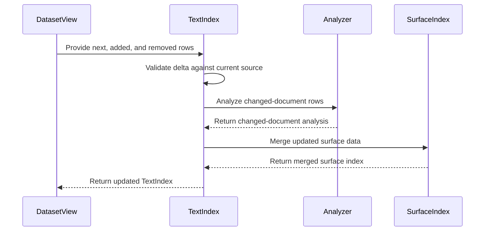

# PR #579 — comments and review threads

2 comment(s). **Every one needs a disposition** in
`review-debt.md`: addressed (with the commit hash) or declined (with the
reason posted in reply). Bot comments count.

## 1. coderabbitai — 

<!-- This is an auto-generated comment: summarize by coderabbit.ai -->
<!-- review_stack_entry_start -->

<a href="https://app.coderabbit.ai/change-stack/Blackcat-Informatics/purrdf/pull/579?scope=ghh_OusAJGA4HG8ljoOV0wJvVx8NmnZIjc2DdjmxOu0xZWA&amp;cs_source=review_comment"><picture><source media="(prefers-color-scheme: dark)" srcset="https://storage.googleapis.com/coderabbit_public_assets/review-stack-in-coderabbit-ui-dark.svg?v=3"><source media="(prefers-color-scheme: light)" srcset="https://storage.googleapis.com/coderabbit_public_assets/review-stack-in-coderabbit-ui.svg?v=3"></picture></a>

<!-- review_stack_entry_end -->
<!-- recent_review_start -->

No actionable comments were generated in the recent review. 🎉

<strong>ℹ️ Recent review info</strong>

<dl>
<dd>

<strong>⚙️ Run configuration</strong>

<dl>
<dd>

- **Configuration used**: defaults
- **Review profile**: CHILL
- **Plan**: Team
- **Run ID**: `3a93ce9f-5597-4aba-ab11-15fd6e8e205e`

</dd>
</dl>

<strong>📥 Commits</strong>

<dl>
<dd>

Reviewing files that changed from the base of the PR and between 0994332d93bc89747f95e5a942715faf36129648 and f90f628dbaa2e8cec31f5a993984b0911125b285.

</dd>
</dl>

<strong>📒 Files selected for processing: 12</strong>

<dl>
<dd>

* `crates/rdf-wasm/src/interleaving.rs`
* `crates/text/README.md`
* `crates/text/src/analysis.rs`
* `crates/text/src/error.rs`
* `crates/text/src/index.rs`
* `crates/text/src/index/delta.rs`
* `crates/text/src/lib.rs`
* `crates/text/src/surface.rs`
* `crates/text/src/surface/delta.rs`
* `crates/text/src/surface/postings.rs`
* `crates/text/tests/determinism.rs`
* `crates/text/tests/wasm_determinism.rs`

</dd>
</dl>

**Included review availability:** This review used your included allowance. 0 included reviews remain after this review. Your included PR review attempts over the past 7 days set your current allowance at 2 reviews per hour.

</dd>
</dl>

<!-- recent_review_end -->
<!-- walkthrough_start -->

<strong>📝 Walkthrough</strong>

<dl>
<dd>

The pull request adds delta updates for `TextIndex` and document merge and retraction operations for `SurfaceIndex`. It adds typed delta errors and tests that compare updated indexes with fresh builds.

**Changes: Incremental text indexing**

|Layer / File(s)|Summary|
|:---|:---|
|**Delta error contract**   `crates/text/src/error.rs`, `crates/text/src/lib.rs`|Adds `TextDeltaError` variants for invalid additions, source and analyzer mismatches, overlapping sources, and term-capacity failures. The crate root re-exports the new error.|
|**Surface index merge and retraction**   `crates/text/src/surface/postings.rs`, `crates/text/src/surface.rs`, `crates/text/src/surface/delta.rs`|Adds ordered posting merge and remapping, document removal, and document replacement. Tests compare resulting surface indexes with fresh builds.|
|**TextIndex delta update**   `crates/text/src/index.rs`, `crates/text/src/index/delta.rs`, `crates/text/src/analysis.rs`, `crates/text/tests/*`, `crates/text/README.md`, `crates/rdf-wasm/src/interleaving.rs`|Adds `TextIndex::with_delta` to validate changes, reanalyze changed documents, merge index data, and refresh fingerprints and coverage. Tests compare delta results with fresh builds and check retained data and unchanged snapshots. The README documents the update behavior. Test-only projection tracking is registered in the ledger.|

<!-- change_assessment_start -->
**Priority:** ➖ Normal

**Estimated code review effort:** 4 (Complex) | ~45 minutes

<!-- change_assessment_commit:"f90f628dbaa2e8cec31f5a993984b0911125b285" -->
**Change:** Feature · **Severity of issue fixed:** Medium
<!-- change_assessment_end -->

### Sequence Diagram(s)

</dd>
</dl>

<!-- walkthrough_end -->

<strong>Merge Risk:</strong> <strong>⚪ Minimal</strong> · up to <code>f90f6</code>

<dl>
<dd>

<!-- final_review_risk_start -->
<!-- final_review_risk_label
**Merge Risk:** **⚪ Minimal** · up to `f90f6`
-->
<!-- final_review_risk_coverage:{"sourceCommitId":"f90f628dbaa2e8cec31f5a993984b0911125b285","coveredCommitId":"f90f628dbaa2e8cec31f5a993984b0911125b285","kind":"reviewed"} -->

This adds incremental delta updates for text and surface indexes and checks them against fresh builds. The update consumes the index, and the documentation tells callers to clone first if they need to keep a snapshot. No unresolved correctness or availability problems were found, and the change looks ready to merge.
<!-- final_review_risk_end -->

</dd>
</dl>

<!-- pre_merge_checks_walkthrough_start -->

<strong>Pre-merge checks: <picture></picture> 4 · <picture></picture> 1</strong>

<dl>
<dd>

<strong><picture></picture> Failed checks: 1 warning</strong>

|     Check name     |                                              Status                                              | Explanation                                                                                                                                                                                               | Resolution                                                                         |
| :---------------- | :----------------------------------------------------------------------------------------------: | :-------------------------------------------------------------------------------------------------------------------------------------------------------------------------------------------------------- | :--------------------------------------------------------------------------------- |
| Docstring Coverage |  | Docstring coverage is 64.38% which is insufficient. The required threshold is 80.00%. Docstring coverage is scoped to functions touched by this diff. Analyzed 73 functions across 11 files. (1 skipped:… | Write docstrings for the functions missing them to satisfy the coverage threshold. |

<strong><picture></picture> Passed checks: 4 passed</strong>

<dl>
<dd>

|         Check name         |                                             Status                                             | Explanation                                                                                                                                                                                               |
| :------------------------ | :--------------------------------------------------------------------------------------------: | :-------------------------------------------------------------------------------------------------------------------------------------------------------------------------------------------------------- |
|      Description Check     |  | Check skipped - CodeRabbit’s high-level summary is enabled.                                                                                                                                               |
|         Title check        |  | The title clearly and concisely describes the main change: adding exact literal-delta updates for text indexes.                                                                                           |
|     Linked Issues check    |  | Issue `#538` requires delta updates instead of full rebuilds, exact fresh-build agreement, exact BM25F statistics, and unchanged ranking and Fixed arithmetic. `TextIndex::with_delta` validates the sourc… |
| Out of Scope Changes check |  | The changes stay within issue `#538`. Surface merge and retraction helpers support the required delta path. Posting joins, rebasing, error types, allocation counters, README updates, and native/WASM tes… |

<strong>Full details: Linked Issues check</strong>

<dl>
<dd>

**Explanation**

Issue `#538` requires delta updates instead of full rebuilds, exact fresh-build agreement, exact BM25F statistics, and unchanged ranking and Fixed arithmetic. `TextIndex::with_delta` validates the source-bound delta, analyzes changed documents, merges lexical, Han, token, and surface data, refreshes coverage and fingerprints, and preserves the existing ranking path. The added tests compare delta results with fresh builds and cover chained updates, replacements, retractions, empty transitions, multiplicity, annotations, carrier configurations, invalid deltas, ranking, substring, and nonliteral coverage.

</dd>
</dl>

<strong>Full details: Out of Scope Changes check</strong>

<dl>
<dd>

**Explanation**

The changes stay within issue `#538`. Surface merge and retraction helpers support the required delta path. Posting joins, rebasing, error types, allocation counters, README updates, and native/WASM tests support implementation, validation, or documentation of the requested behavior. No unrelated product behavior is demonstrated.

</dd>
</dl>

</dd>
</dl>

<strong>Full details: Docstring Coverage</strong>

<dl>
<dd>

**Explanation**

Docstring coverage is 64.38% which is insufficient. The required threshold is 80.00%. Docstring coverage is scoped to functions touched by this diff. Analyzed 73 functions across 11 files. (1 skipped: 1 unsupported.)

**Resolution**

Write docstrings for the functions missing them to satisfy the coverage threshold.

</dd>
</dl>

</dd>
</dl>

<!-- pre_merge_checks_walkthrough_end -->

- [ ] <!-- {"checkboxId":"585bb3f6-faf5-4dbf-96d2-74e382adf19a"} --> Fix all pre-merge checks with AI
<!-- finishing_touch_checkbox_start -->

<strong>✨ Finishing Touches: 💡 1</strong>

<dl>
<dd>

<!-- finishing_touch_suggestion:docstrings -->

<strong>📝 Generate docstrings: 💡</strong>

<dl>
<dd>

- [ ] <!-- {"checkboxId":"3e1879ae-f29b-4d0d-8e06-d12b7ba33d98"} --> Commit to this branch
- [ ] <!-- {"checkboxId":"7962f53c-55bc-4827-bfbf-6a18da830691"} --> Create a new PR

</dd>
</dl>

<strong>🧪 Generate unit tests (beta)</strong>

<dl>
<dd>

- [ ] <!-- {"checkboxId": "6ba7b810-9dad-11d1-80b4-00c04fd430c8", "radioGroupId": "utg-output-choice-group-unknown_comment_id"} --> Commit to this branch
- [ ] <!-- {"checkboxId": "f47ac10b-58cc-4372-a567-0e02b2c3d479", "radioGroupId": "utg-output-choice-group-unknown_comment_id"} --> Create a new PR

</dd>
</dl>

</dd>
</dl>

<!-- finishing_touch_checkbox_end -->

<!-- autopilot:start -->
- [ ] <!-- {"checkboxId":"2708ad07-9f24-4260-9c11-7dc76a49f2e3"} --> <strong title="Keep fixing CodeRabbit findings and required CI, and resolving merge conflicts">Autofix</strong> · Keep fixing CodeRabbit findings and required CI, and resolving merge conflicts
<!-- autopilot:end -->
<!-- tips_start -->

Comment `@coderabbitai help` to get the list of available commands.

<!-- tips_end -->

## 2. paudley — 

# Exact text-index delta updates

The complete contract is an actual TextIndex delta path, with added and removed
literal rows, whose results match a fresh build. BM25F, Fixed arithmetic,
partitioning, source evidence and ranking profiles keep their existing laws.
The corpus includes both RDF layers and both physical carrier profiles.
No partial surface-only PR or closure satisfies this contract.

The current implementation discards raw rows and lexical analysis after build.
SurfaceIndex stores sorted flat gram/phonetic postings and source-aligned
evidence. Re-running assemble over all retained analyses would repeat the
reported expensive computation and is not an incremental implementation.

Use the existing analyzer/scorer once, and implement ordered updates at the
existing physical homes. An owned update may move buffers; it must not retokenize
unchanged documents, regenerate their grams or rerun their phonetic encodings.
Canonical identifiers, both fingerprints, phrase and auxiliary answers must
agree with a fresh index. The current canonical fingerprint requires traversing
retained source/index data; distinguish this cost from rebuilding projections.
Do not claim sublinear total work without evidence. Preserve older snapshots.

## Task 1: Update surface postings and evidence

Extend FlatPostings at its existing home with an ordered remap/merge. Reuse
unchanged source text, term spelling, span shapes, codes and gram positions.
Surface document replacement removes every old source for an affected document,
merges the analyzed additions and retains canonical ordering/evidence. Validate
analyzer compatibility and ID maps. Compile this coherent production slice
before broader integration. Compare actual substring/phonetic results and
generation against fresh construction, including deletions and overlaps.

## Task 2: Wire the actual TextIndex delta path

Admit added/removed effective literal rows, validate their relation to the source
generation, and analyze only affected documents, including their retained rows.
Merge their lexical postings, token streams and Han occurrences into the existing
index. Apply exact subtraction/addition to partition and field statistics.
Wire the surface update through the same document remaps and rebind the final
generation. Keep graph/language partitioning, routing, stable scoped term identity,
coverage, auxiliary-only documents and typed failures. No default corpus cache
or new runtime dependency. Complete the chosen source/delta API against the
actual DatasetView and existing binding/digest implementation; do not accept a
delta that silently certifies a mismatched source.

The working source API is an owned update against the next immutable dataset
plus effective added/removed DatasetView inputs. Reconstruct the selected prior
source rows by reversing the delta and compare their digest with the index's
source_fingerprint before modifying it. Reuse collect_rows and the existing
digest recipe; factor that recipe for borrowed ordered rows rather than writing
another hash preimage. Coverage comes from the actual next source, including
nonliteral statements and all three RDF layers. This requires a source walk and
canonical hashing, but no permanent copy of raw literals in every TextIndex.

Analyze the complete next-source rows of affected document keys only. Assemble
that partial index through the existing analyzer and ranking profile, then merge
it into the retained core tables with canonical document/partition/term maps.
Postings compare by (partition, document), not document alone. Retained token
streams need only term-ID rebasing; Han occurrences need document-ID rebasing.
Sum document/field counts and lengths from the retained and replacement document
facts through the existing partition/field homes, preserving auxiliary-only
partitions. This metadata walk is deliberate: it avoids a second implementation
of ranking statistics without reanalyzing retained text. Surface document IDs
must follow the same monotone
maps before the ordered addition path is used. Recompute the existing canonical
index digest and bind the final generation once. This route is not implemented
or qualified by the surface tests; complete it before creating the PR.

## Task 3: Qualify and deliver the whole contract

Fresh-build oracle tests cover insert/retract/replace, empty/repeated/no-op
changes, multi-literal documents, annotations, named/default/graph-free carriers,
language/direction, ranking fields, lexical/Han/substring/phonetic/phrase evidence,
identities and invalid deltas. Fixed-work controls prove unchanged documents are
not analyzed and unchanged grams/codes are not rebuilt. Record allocation/layout
costs, source scans and old-snapshot ownership explicitly. No timing measurement.

Use standard host tools, eight Cargo jobs/four test threads and 16 GiB per job;
one Cargo invocation at a time. Focused checks during development, affected native
and wasm execution, then the required final gate on settled source. No agents or
fabricated independent review. Obtain hosted material review for the complete
PR, resolve findings, satisfy CI, merge only with ghprsq, verify closure/mirror,
and remove the delivered branch. Update the root REWORK_LIST.md at transitions.

## Evidence and ownership

Stage brief reports no earlier delivery branch, commit or PR for this issue.
The source inspection confirms the all-corpus construction described above.
Related scoring/dictionary fixes are already merged and provide existing homes,
not delta completion. Prior art and plan judgment are owner-performed because
subagents are disabled. Independent implementation acceptance remains pending.

